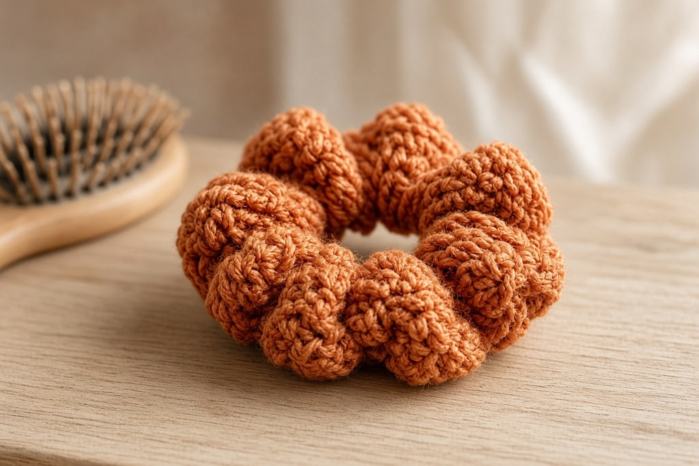
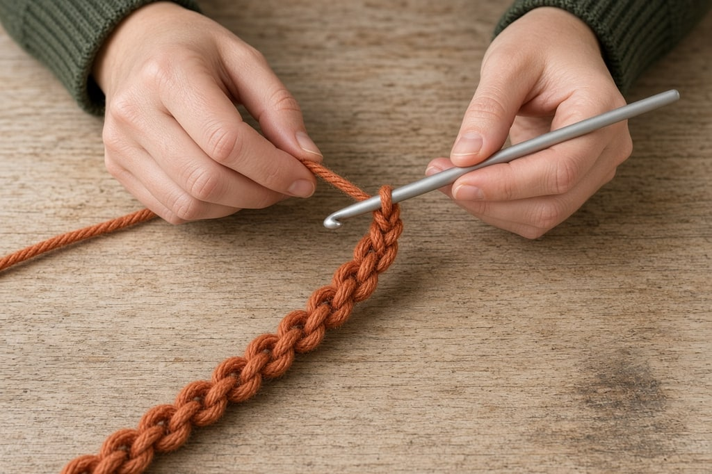
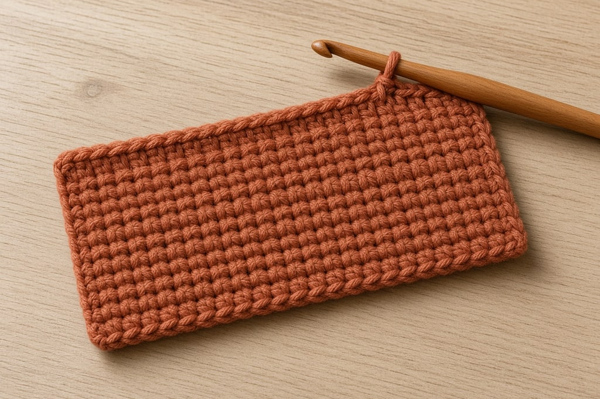
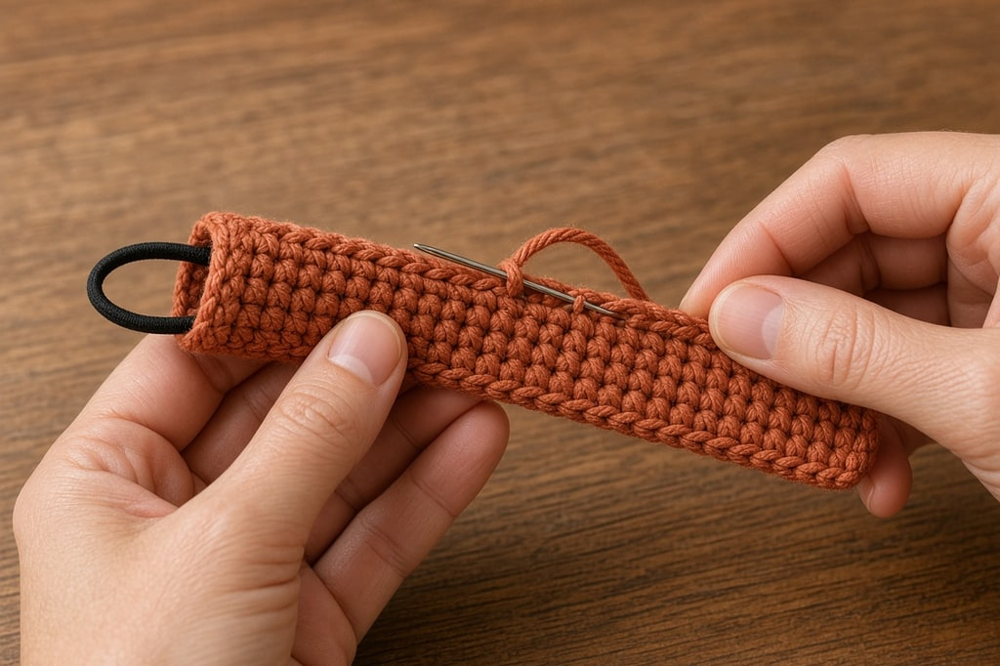
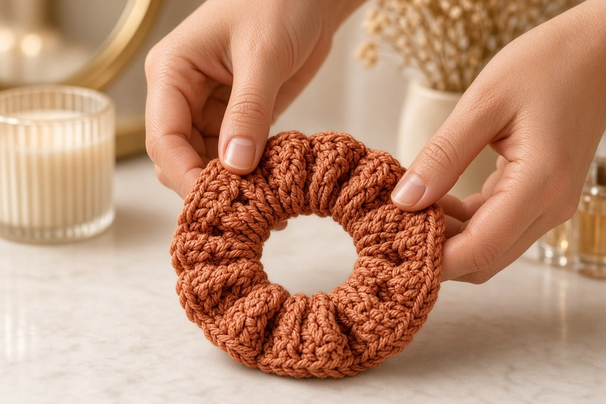

A crochet scrunchie is a fabric tube gathered on a hair elastic. It uses scrap yarn, and the only measurement that matters is the elastic you already own.

You crochet a flat strip, fold it around a covered hair tie, seam it into a tube, and join the ends. If you can [single crochet](/basic-crochet-stitches/) in rows, you can make one. The picture is an illustration, not a worn sample.

There is a second method, working single crochet directly over the elastic. It is faster for some people. The strip method is easier to size, easier to undo, and gives a fuller scrunchie, so it is the one written out here. The other is described at the end.

## What you need

- Smooth worsted-weight yarn, cotton or acrylic. A small scrap ball is enough. [Yarn weights](/yarn-weight-chart/).
- A hook matched to the yarn, often US G/6 (4.0 mm) or H/8 (5.0 mm). [Hook chart](/crochet-hook-size-conversion-chart/).
- **One covered elastic hair tie**, the soft fabric-wrapped kind, not a bare rubber band.
- Yarn needle and scissors.

US abbreviations throughout. [Abbreviations chart](/crochet-abbreviations-chart/).

## Which yarn behaves best

Cotton gives crisp stitches and a firm scrunchie that holds its gathers, but it is heavier and grips hair more. Acrylic is lighter and softer and slides more easily. A cotton-acrylic blend sits between them. Very fuzzy or bouclé yarn hides the stitches, which makes it hard to see where to seam, so save it for your second or third. Whatever you pick, a thinner yarn makes a lighter scrunchie, and lighter is easier to wear all day.

## Size it from your elastic

<figure class="diagram">

<figcaption>Length comes from the elastic. Width comes from the rows.</figcaption>
</figure>

Measure around the elastic as it sits, not stretched. The strip has to be longer than that loop or there is nothing to gather. **About twice the elastic** is a sensible starting point. A longer strip makes a fuller, bulkier scrunchie. A shorter one gives thin gathers.

The width is the number of rows. It folds in half around the elastic, so a 2.5 to 3 inch strip makes a tube a bit over an inch across.

| Your numbers | Example |
| --- | --- |
| Elastic, relaxed | 7 in |
| Strip length, 2 × elastic | 14 in |
| Chains at about 4 per inch | about 56 |
| Strip width | 2.5 to 3 in |
| Rows at about 5 per inch | 12 to 15 |

The example numbers are typical for worsted single crochet. They are not from a measured swatch. Measure your own after a few rows.

## Step 1: chain the length

Chain until the chain, held relaxed, is about twice the elastic. Do not stretch it to measure. Write the count down so the next one matches.

Sc in the second chain from the hook and in each chain across. That stitch count stays the same every row.

A foundation chain is usually tighter than the rows above it, which makes the strip cup. If yours does, chain with a hook one size larger, then switch back.

## Step 2: work the rectangle

Ch 1 and turn at the end of each row. The ch 1 does not count as a stitch. Keep the count identical.

Stop when the strip is 2.5 to 3 inches wide. In worsted that is usually 12 to 15 rows. The fabric should be soft. If it feels stiff, go up a hook size on the next one.

For a stripe, work the last two rows in a second color. [Changing yarn color](/changing-yarn-color-crochet/).

## Step 3: seam around the elastic

Lay the elastic along the middle of the wrong side. Fold the long edges together over it. Whipstitch the long edges closed along the full length, catching both edges but not the elastic. Push the fabric along the elastic as you go, because the strip is twice as long.

Do not sew through the elastic. If you catch it, it will not stretch.

Join the two short ends with a few firm stitches to close the ring. Bury the tails in the seam. [Weaving in ends](/weaving-in-ends-and-blocking/).

## Step 4: even the gathers

Slide the fabric around the elastic until the gathers are even. Twist it twice, as you would a store-bought scrunchie. If it fights you, the strip was too short or the seam too tight.

## The other method: crochet over the elastic

Join yarn to the elastic with a slip stitch around it. Work single crochet around the elastic itself, packing the stitches tightly, until it is covered. Join with a slip stitch. Then work two or three rounds of increases into those stitches (for example 3 dc in each stitch) to make a ruffle. It is quick, but the ruffle grows fast, and too many stitches on the base round stretch the elastic so it never fully relaxes. Pack them firmly, but stop before the elastic is stretched.

## Troubleshooting

**No stretch.** The seam caught the elastic. Unpick and resew.

**A skinny yarn doughnut.** The strip is too narrow. Use at least 2.5 inches.

**Stiff and bulky.** Too tight, or too thick a yarn. Go up a hook size, or use a thinner yarn.

**Tails catching in hair.** Bury them in the seam, not on the outside.

**The elastic snaps quickly.** A thin, cheap elastic. Use a soft covered tie you would wear on its own.

## Frequently asked

### How long does it take?

That depends on your speed, so there is no honest single number. Time ten rows of your strip and multiply by the number of rows you need, then add the seam.

### Can I use velvet or fur yarn?

Yes, but not for a first one. Stitches are hard to see and seaming becomes guesswork. Make one in smooth worsted first.

### Will it damage hair?

A soft covered elastic with no knots on the outside is the same idea as any fabric scrunchie. Avoid metal-joined hair ties.

### Can kids make these?

If they can keep an even single crochet for a dozen rows, yes, with help on the seam so the needle stays off the elastic.

### What should I make next?

A [simple flower](/how-to-crochet-a-simple-flower/) sewn onto a second scrunchie, or a [mug cozy](/crochet-mug-cozy-for-beginners/) for a gift.
