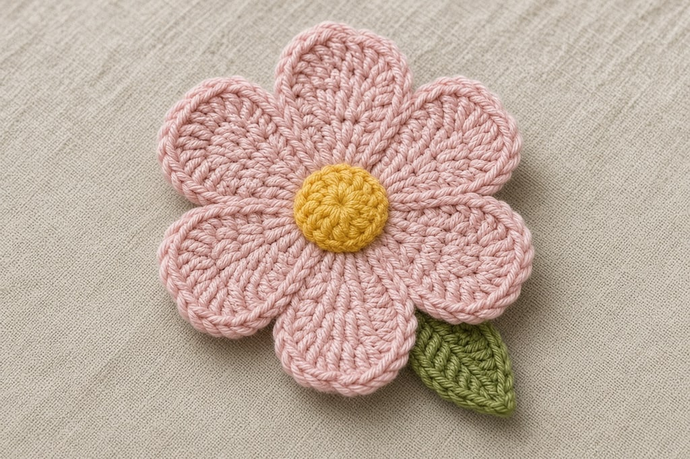
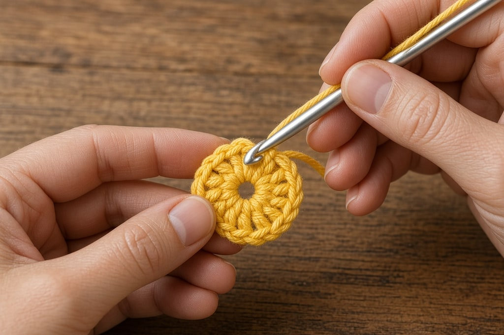
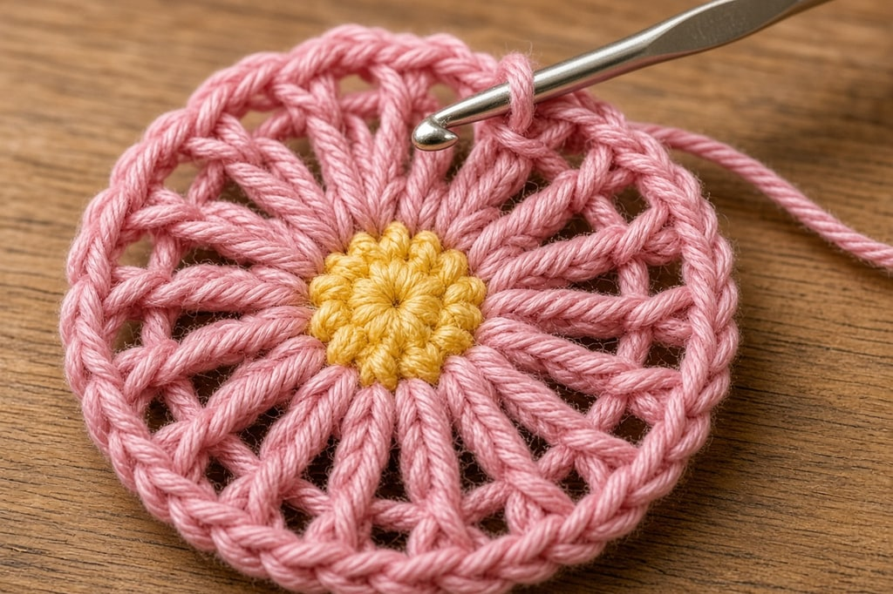
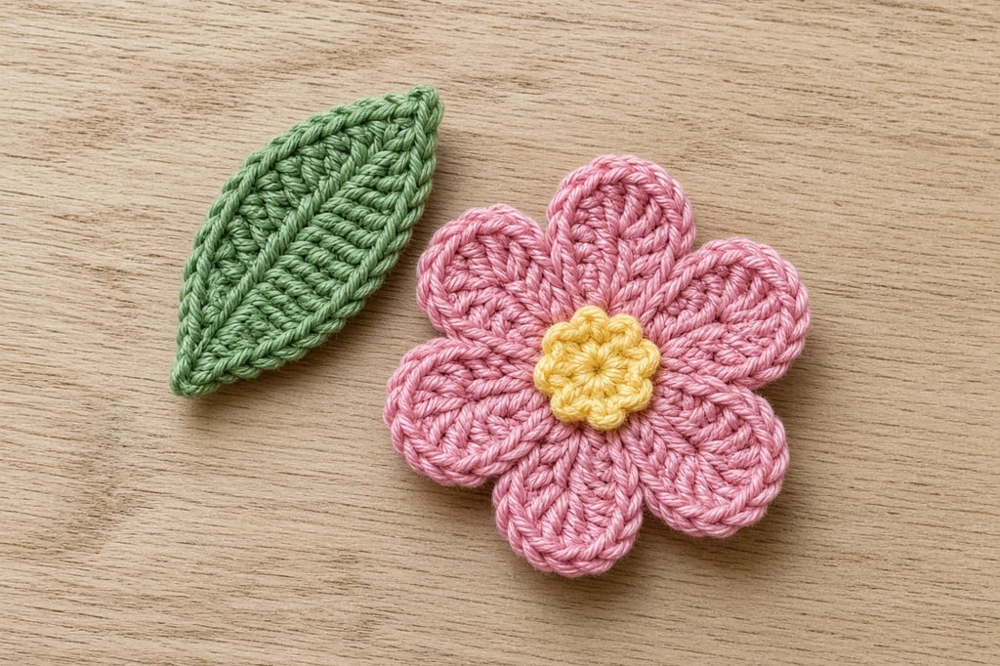
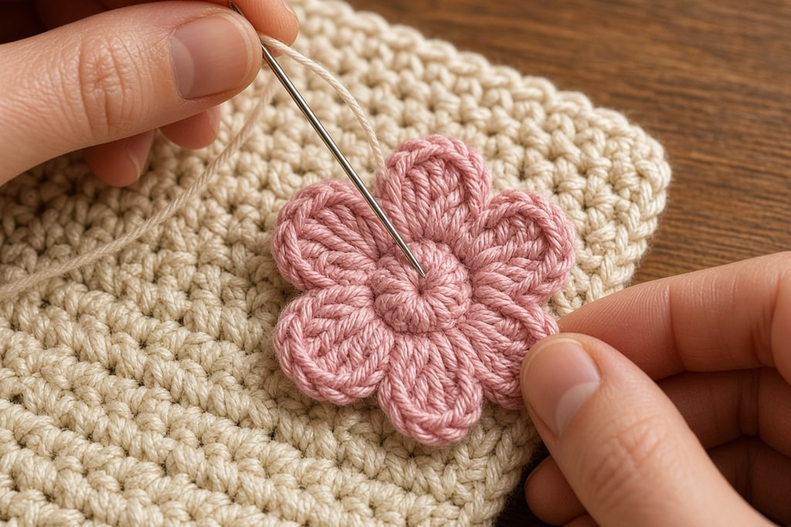

This flower is an appliqué: a center of 5 single crochet, then one petal in each of those stitches. It is sewn onto something else. It is not a stem, a rose, or a measured blossom.

US terms. [Abbreviations](/crochet-abbreviations-chart/). You need a [magic ring](/crochet-in-the-round/) or the chain substitute below, plus [double crochet](/basic-crochet-stitches/). The pictures are illustrations of the finished flower, which has not been made up in yarn here, so its size depends on your yarn and hook.

## Step 1: Five stitches in the center

Worsted in a center color and a petal color. A US G/6 (4.0 mm) or H/8 (5.0 mm) is a common match for worsted. Use the hook that lets you see 5 separate stitches. [Yarn weights](/yarn-weight-chart/). [Hook chart](/crochet-hook-size-conversion-chart/).

**Round 1.** Magic ring, 5 single crochet, slip stitch to the first single crochet to join. (5)

Pull the ring shut before you start petals. A loose ring is a hole in the middle of the flower.

If the ring will not close, chain 2 and work 5 single crochet into the second chain, then join. That center has a small hole. The petals cover some of it. They do not change the count.

Fasten off the center color if you want fewer carried strands. Leave enough tail to weave.

## Step 2: One petal in each stitch

Join the petal color in any center stitch.

**Petal.** In that same stitch: chain 2, 3 double crochet, chain 2, slip stitch into the same stitch.

Slip stitch into the next center sc to move the hook there, then repeat, until there are 5 petals. Slip stitch to the base of the first petal if you want a tidy close. Fasten off and leave a long tail for sewing.

<figure class="diagram">

<figcaption>Five centers, five petals. The next petal starts in the next stitch, not in the one you just used.</figcaption>
</figure>

Checkpoint: five lobes, and you can still find five center stitches under them. Two petals in one stitch leave another stitch empty. That empty stitch reads as a gap. An extra petal has to steal space, and the circle stops being round.

The slip stitch that closed round 1 is not a sixth stitch. If you put a petal in it, you get a sixth lobe and the first petal gets crowded. Petals go in the five single crochets only.

If a petal looks like a tight knot, the doubles were pulled short. If the petals cup into a bowl, the doubles are too tall for the ring or the hook is small. Go up a hook and make another center. Do not block acrylic with an iron. The petals can melt.

## Step 3: The leaf is one pass, if you want it

Chain 7 in green. Single crochet in the second chain from the hook, half double in the next, double in the next 2, half double in the next, single crochet in the last.

That is 6 stitches on the 6 chains that remain after the skip: 1 + 1 + 2 + 1 + 1.

<figure class="diagram">

<figcaption>The two doubles are the wide part of the strip. There is no second side.</figcaption>
</figure>

Sew it under one side of the flower so part of it shows. Skip it if you only need the flower. A leaf with stitches down both sides of the chain is a second pass. This page does not give that count, because it was not checked.

## Step 4: Sew the center and the petal bases

Thread the petal tail. Sew the center to the fabric, then catch the base of each petal once. A flower sewn only through the center can flip. Glue is not the method here. It is not a wash test, and it is not a substitute for the stitches.

Do not sew this onto the [baby blanket](/how-to-crochet-a-baby-blanket/). A flower that can be pulled off does not belong where a child mouths fabric. A [scrunchie](/how-to-crochet-a-scrunchie/) or the flap of a [mug cozy](/crochet-mug-cozy-for-beginners/) is a place where an appliqué is decoration, not a loose part on a blanket.

## Change petal color before building the lobes

After joining the five-sc center, fasten off its color and attach the petal color with a slip stitch in any of the five sc. Ch 2, three dc, ch 2 and sl st all go into that same base sc. Slip stitch into the next sc to move, then make the next complete petal there. After five, fasten off without adding a petal in the joining slip stitch. The small optional leaf is one row, so it is a curved strip rather than the two-sided leaf on the fall-leaf page. Sew it under the flower before attaching the complete motif.

## Mistakes

**The center is a hole.** The ring was not pulled shut. Close it before the petals, or the petals lock the hole open.

**Four petals, or six, on five stitches.** Match the counts. Six petals need six center stitches, which is a different round.

**The flower is wider than the strap you sewed it to.** Worsted on a narrow strap looks out of scale. A lighter yarn is a new swatch, not the same five stitches squeezed.

**Petals flipped after washing.** Only the center was sewn. Catch the five bases.

## Frequently asked

### Is this a rose?

No. A rose is a long ruffle rolled up. This is one flat round of petals.

### Do I have to know double crochet?

Yes for this petal. The three doubles are what make the lobe. Single crochet in the same places makes a bump, not this petal. The stitch is in [basic stitches](/basic-crochet-stitches/).

## Next

The ring that starts the center is practiced on [crochet in the round](/crochet-in-the-round/). A flat motif with a different count, six points instead of five petals, is the [snowflake](/how-to-crochet-a-snowflake/).
