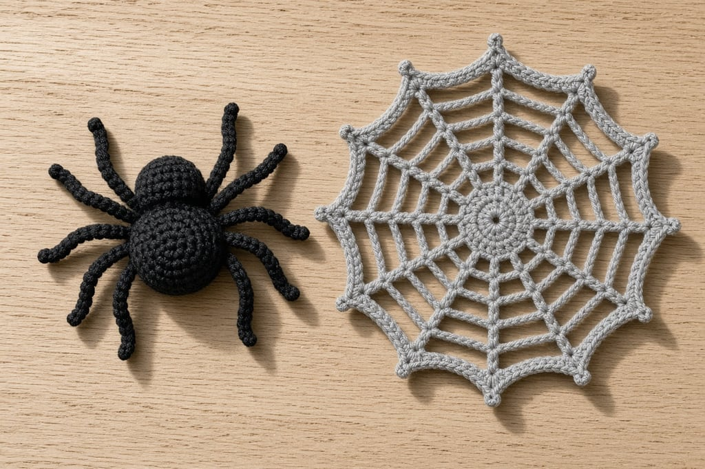
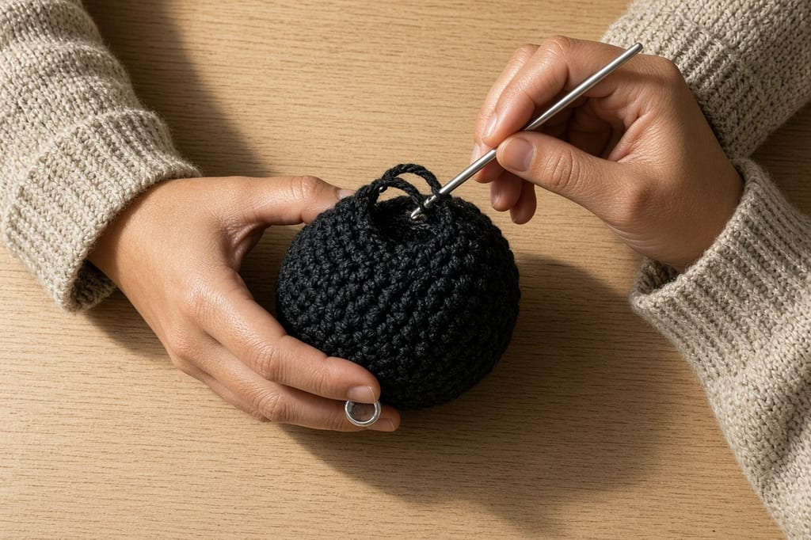
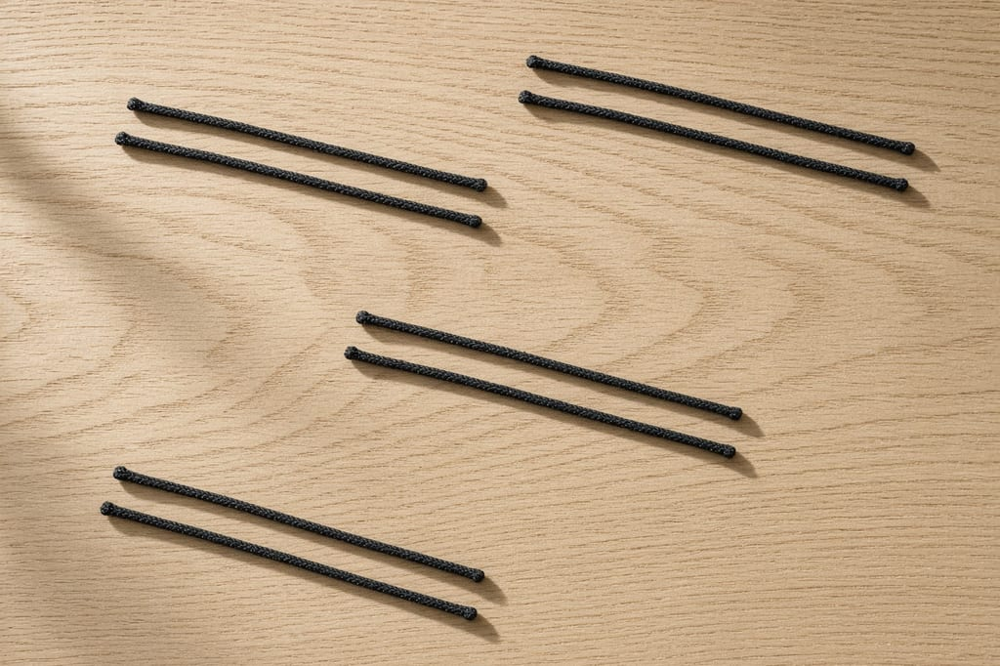
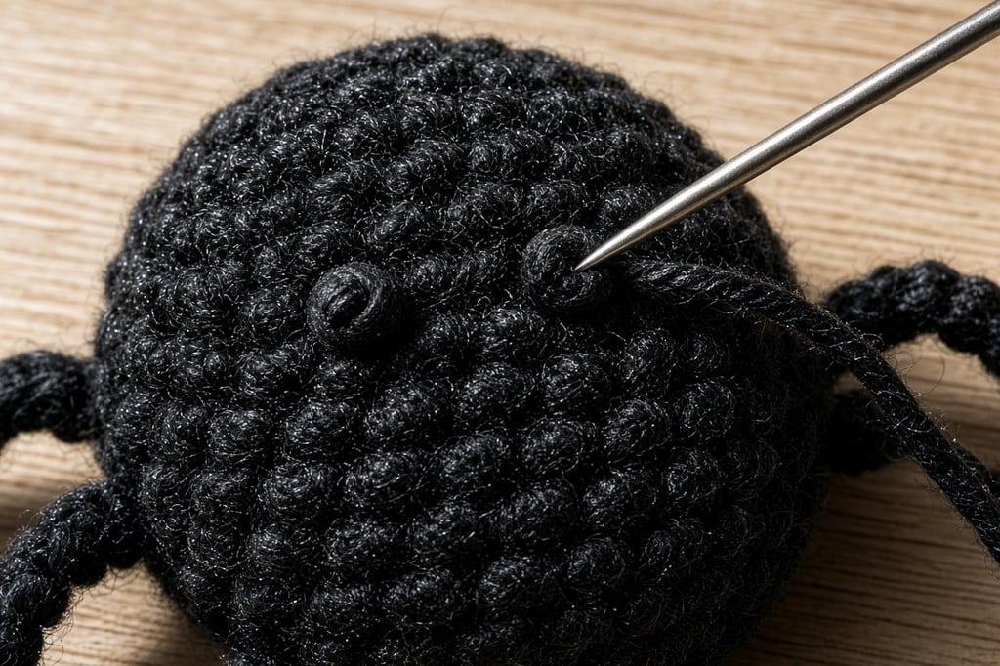
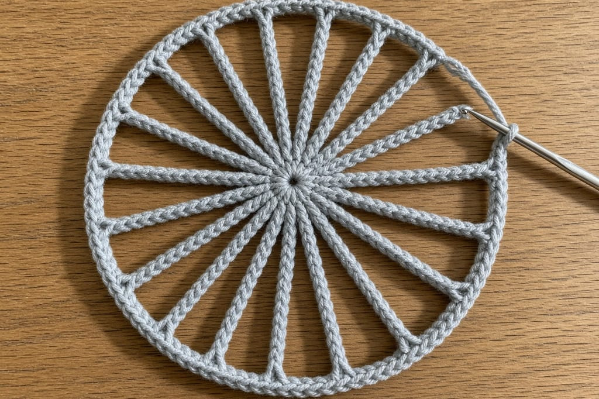
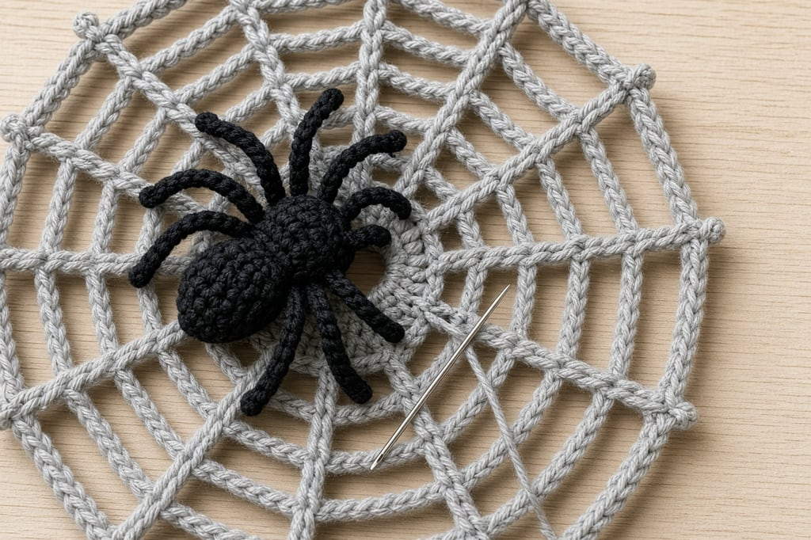

A crochet spider usually fails in one of two ways: the body is a featureless blob, or the legs are different lengths and stick out at random. The stitches are easy. The anatomy and the consistency are the skill.

Two facts fix most of it. A spider's body is in two parts, a larger rear section (the abdomen) and a smaller front section (the cephalothorax). **All eight legs come from the smaller front section**, four on each side. Many crochet spiders put the legs around a single ball, which reads as a starfish or a sun. Put them on the front section and it reads as a spider from across a room.

The web has its own rule: it is a flat mesh worked in rounds, and each round's chain loops have to be longer than the last, because each round goes around a bigger circle. Get that wrong and the web cups or ruffles.

You should be comfortable with [magic rings and spirals](/crochet-in-the-round/). US terms. [Abbreviations](/crochet-abbreviations-chart/). The pictures are illustrations of the finished spider and web, which have not been made up in yarn here, so their size depends on your yarn and hook.

## The plan

<figure class="diagram">

<figcaption>Legs belong on the smaller front body. Web loops grow by two chains a round.</figcaption>
</figure>

## What you need

- **Worsted-weight yarn**: black or dark brown for the spider, white or gray for the web. Smooth cotton gives the crispest web. [Yarn weights](/yarn-weight-chart/).
- **A hook one or two sizes smaller than the label** for the body, and the label size for the web. [Hook chart](/crochet-hook-size-conversion-chart/).
- Stuffing, a yarn needle, stitch markers, a scrap of white or red for eyes.

## Step 1: the rear body (abdomen)

Black. Work in a spiral and mark the first stitch of each round.

**Round 1:** 6 sc in a magic ring. (6)

<figure class="diagram">

<figcaption>Round 1 starts in a magic ring, pulled tight so the top has no hole.</figcaption>
</figure>

**Round 2:** 2 sc in each stitch. (12)

**Round 3:** (Sc, 2 sc in next) 6 times. (18)

**Round 4:** (Sc 2, 2 sc in next) 6 times. (24)

**Rounds 5–7:** Sc in each stitch. (24)

**Round 8:** (Sc 2, sc2tog) 6 times. (18)

<figure class="diagram">

<figcaption>Through the front loops only, the decrease disappears into the fabric.</figcaption>
</figure>

**Round 9:** (Sc, sc2tog) 6 times. (12) Stuff firmly.

**Round 10:** Sc2tog 6 times. (6) Fasten off and pull closed.

## Step 2: the front body (cephalothorax)

<figure class="diagram">

<figcaption>Diagram. The front body is the smaller ball.</figcaption>
</figure>

**Rounds 1–3:** As the rear body. (18)

**Rounds 4–5:** Sc in each stitch. (18)

**Round 6:** (Sc, sc2tog) 6 times. (12) Stuff firmly.

**Round 7:** Sc2tog 6 times. (6) Fasten off with a long tail.

Sew the front body to one end of the rear body, with the seam hidden underneath. Sew all the way round the joint, not at one point, or the front body nods.

## Step 3: eight matched legs

Pick one leg length and use it for all eight. Write the number down.

**Chain legs (fast).** Join black at the side of the front body. Ch 14. Slip stitch in the 2nd chain from the hook and in each chain back to the body. Fasten off and weave the end into the body. That leg is 13 slip stitches long. Make every leg 13.

**Tube legs (sturdier).** 4 sc in a magic ring. Work even for 10 rounds. Fasten off with a long tail and sew on. Every leg 10 rounds.

**Placement.** Four on each side of the front body, in a short row from front to back. Angle the front two pairs forward and the back two pairs backward. Pin all eight before attaching any, then look from above. The two sides should mirror each other.

Some makers slide a chenille stem (pipe cleaner) into tube legs so they can be posed. The wire ends can poke through. That is fine for a shelf decoration, and not for anything a child will handle.

Attach the legs before embroidering the face. Eight legs means a lot of needle traffic through the front body.

## Step 4: eyes

Most spiders have eight eyes, but at this size two French knots in white or red, close together at the front of the front body, read better. Embroidering all eight on a small spider looks like a texture rather than a face.

## Step 5: the web

White or gray, label-size hook.

**Round 1:** 8 sc in a magic ring. Join with a slip stitch to the first sc. (8)

**Round 2:** (Ch 5, sl st in next sc) 8 times. (8 loops)

For each later round, label the eight loops A–H clockwise or counterclockwise in your working direction.

**Round 3:** Sl st into loop A and sc in that same loop to establish the first anchor. (Ch 7, sc in the next loop) 7 times, reaching H. Ch 7 and sl st into the first anchor sc. (8 ch-7 loops, 8 sc anchors)

**Round 4:** Sl st into the first new loop and sc there. (Ch 9, sc in the next loop) 7 times. Ch 9 and sl st to the first sc. (8 loops)

**Round 5:** Sl st into the first new loop and sc there. (Ch 11, sc in the next loop) 7 times. Ch 11 and sl st to the first sc. (8 loops) Fasten off.

**Why two more chains each round.** Each round sits further from the center, so it has a longer distance to cover around. Adding two chains a round is a starting point, not a rule. Lay the web flat after each round. If it cups into a bowl, the loops are too short: add a chain. If it ruffles, they are too long: take one away. Your yarn and tension decide.

**Radial threads (optional).** With a yarn needle, run a strand from the center straight out to the edge, tacking it at each round. Four lines crossing the center, like the diagram, make it read as a web.

Block it flat if the chains curl. [Blocking](/weaving-in-ends-and-blocking/).

## Step 6: put them together

Sew the spider off-center on the web through the underside of the rear body. Add a hanging loop at the top edge of the web. Do not hang it from a leg.

## Close both body pieces before making the legs

The front body ends at six stitches just like the abdomen. After stuffing it, thread the tail through the six front loops, pull closed and secure it, retaining enough tail to join the two closed pieces. Pin their contact surfaces together and sew around the join rather than attaching one loose point. For tube legs, do not stuff the four-stitch tube; flatten its open end and sew it to the front body. All four pairs attach to that front section. For chain legs, slip stitch back through thirteen chains, then slip stitch into the original attachment stitch before fastening off.

## Troubleshooting

**It looks like a starfish.** Legs around one ball, or on the rear body. Move them to the front section.

**Legs of different lengths.** Count every leg against the number you wrote down.

**The front body droops.** Sewn at one point. Sew around the whole joint.

**The web cups.** Loops too short. **The web ruffles.** Loops too long.

**Floppy abdomen.** Under-stuffed.

## Frequently asked

### Is this beginner-friendly?

The bodies are beginner work. Eight identical legs and a flat web push it to intermediate, because consistency is the skill.

### Can I skip the web?

Yes. The spider stands alone as an ornament or appliqué.

### What should I make next?

Another small stuffed body with flat sewn parts is the [bat](/bat-amigurumi-wings-body-and-ears/). A flat lacy motif blocked stiff is the [snowflake](/how-to-crochet-a-snowflake/).
