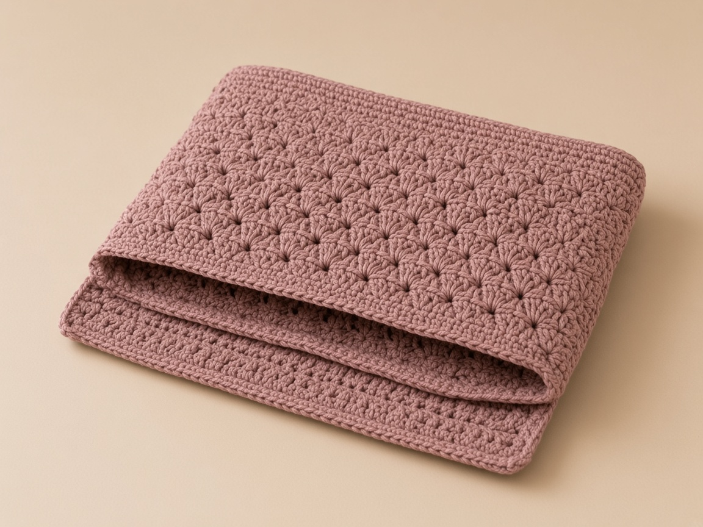
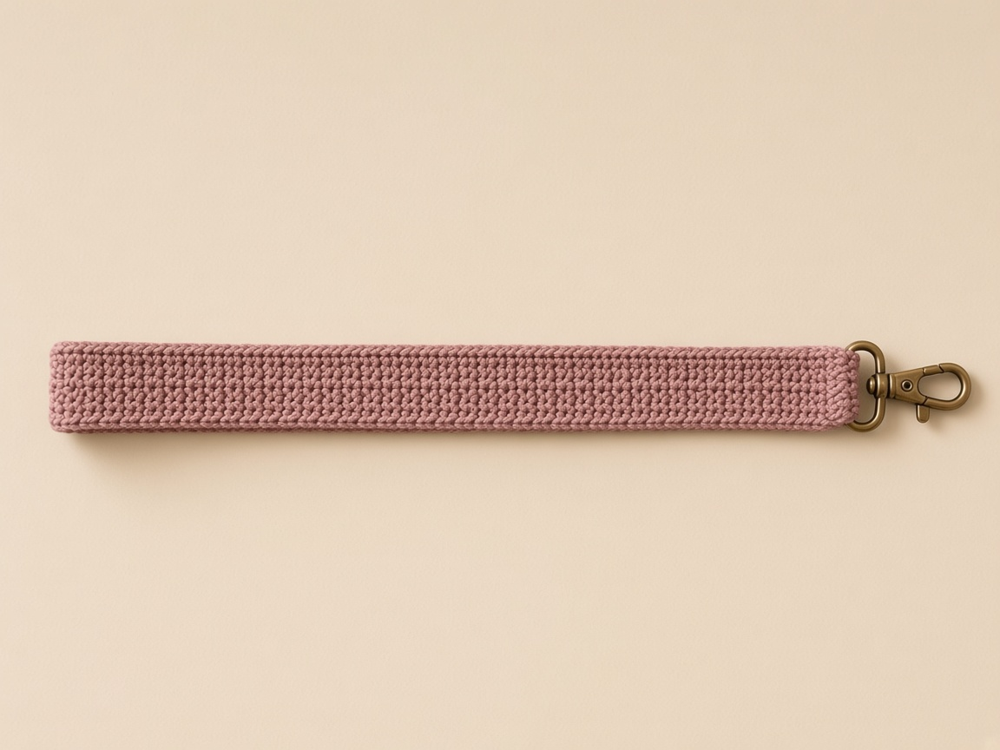

A strap is what turns a crochet sleeve into a bag you can wear. The body is a folded rectangle, the same construction as any flat sleeve. The strap is where bags fail. Sewn through one stitch, it tears out. Made to the length that looked right on the table, it hangs too low once the bag is full, because cotton stretches under weight and does not spring back.

This page covers both the shoulder length and the crossbody length, how to attach a strap so it holds, and how to set its length after it has carried a load.

US terms throughout. US single crochet is UK double crochet. See the [abbreviations chart](/crochet-abbreviations-chart/) if a term is new. The sizes are worked out from an example gauge rather than from a finished, worn bag, so swatch, and wear it loaded before you fix the strap.

## How to measure what this bag will carry

Measure the things, then the yarn. A chain started from a guess has to be ripped, and a strap sewn to a body that is already the wrong width cannot be rescued by sewing it tighter.

#### Put the real objects on the table

1. Use the phone you will carry, in the case it already wears if it will stay in that case.
2. Use the wallet at the thickness it has with cards in it.
3. Count keys only if they ride in the bag rather than in a pocket.
4. Leave a water bottle out of this sleeve. A straight sleeve will not hold it. A [wine bottle bag](/how-to-crochet-a-wine-bottle-bag/) or a [tumbler sleeve](/how-to-crochet-a-tumbler-sleeve/) is the construction that tapers.
5. Write three numbers before you look up a stitch count: width, thickness, and height.

#### Width is the widest closed face

1. Measure side to side, with the item closed.
2. On a phone, width is the short side of that face.
3. Ignore the diagonal printed on a box. That number is corner to corner, and it is longer than the width.
4. If you chain from the diagonal, the sleeve is wide and short in the wrong directions.

#### Thickness is the whole stack

1. Measure front to back, pressed the way the stack will sit.
2. Do not crush it under a book, and do not pile it loose.
3. A folded sleeve has to travel around that thickness at the edges.
4. Leaving thickness out is the mistake that makes the seams strain. It is the first line in the troubleshooting list below.

#### Height is the tallest piece

1. Measure top to bottom.
2. Include a clip only if that clip must live inside the bag.
3. The row count becomes two faces of this height plus a little ease at the fold.
4. That is why the rectangle is long before you fold it.

<figure class="diagram">

<figcaption>Diagram. Take width, thickness, and height from the things you will carry, then build the rectangle from those three numbers.</figcaption>
</figure>

#### Check the phone example against your own phone

The phone example on this page is a 3.0 by 6.0 by 0.35 inch phone at 4 stitches to the inch: about 15 stitches wide and 70 rows, folded to a sleeve about 7.0 inches deep. Those figures belong to that phone and that gauge.

1. Fifteen stitches at 4 to the inch is 3.75 inches of fabric.
2. The phone's 3.0 inch width plus its 0.35 inch thickness is 3.35 inches.
3. The rest of the 3.75 is the ease and the seam allowance the opening needs.
4. If your phone is wider, or thicker because of a case, 15 stitches will not fit it.
5. Multiply your own width-plus-thickness-plus-ease by your own stitch gauge.

The [device case guide](/how-to-crochet-a-device-case/) writes that sum with the seam and the ease each spelled as 0.25 inch. This page's phone width is already rounded: about 15 stitches, not a second formula.

| What you are holding | What 15 stitches does |
| --- | --- |
| The 3.0 by 6.0 by 0.35 inch phone, no extra case, at 4 stitches to the inch | About 15 stitches and 70 rows, sleeve about 7.0 inches deep |
| A wider phone, or the same phone in a case | 15 stitches will not fit. Recompute width plus thickness plus ease |

Do not keep 15 because it is printed here. A case changes the thickness, and thickness is part of the width the chain has to cover.

#### Check the shoulder example against your own stack

The shoulder example is a 4.5 inch wallet in a 1.5 inch stack: about 27 stitches wide and 66 rows.

1. At 4 stitches to the inch, 27 stitches is 6.75 inches across, which is the width drawn on the body diagram.
2. The wallet plus the stack is 6.0 inches.
3. The remaining 0.75 inch is seams and ease.
4. A second wallet, or a stack that measures 2 inches instead of 1.5, needs a new width.
5. Do not keep 27 because it is the number printed here.

#### Depth doubles, because both faces are one piece

1. Work depth from height, then double it. You crochet both faces in one rectangle.
2. The phone example uses 70 rows so the fold splits into two faces of 35 rows.
3. At the five-row gauge stated with the written instructions, 35 rows is about 7 inches, which covers a 6 inch phone with room at the fold and at the opening.
4. The shoulder example uses 66 rows so the fold splits into two faces of 33.
5. Sixty-six rows at 5 rows to the inch is 13.2 inches of fabric before the fold, the length already marked on the body diagram.

| Row total | Faces | What it covers at 5 rows to the inch |
| --- | --- | --- |
| 70 | 35 and 35 | About 7 inches each, over a 6 inch phone |
| 66 | 33 and 33 | 13.2 inches of fabric before the fold |
| 69 or 65 | Does not split evenly | Add or remove rows until the total divides by two |

An odd row total cannot split into two equal whole-number faces. If you lose count and finish on 69 or 65, add or remove rows until the total divides by two.

### Measure your gauge before you multiply

#### Swatch the middle, not the cast-on edge

1. Crochet a flat swatch in the same yarn and the hook you mean to use.
2. Measure the middle, not the cast-on edge.
3. [Crochet gauge](/crochet-gauge/) is the whole method: how many stitches in 4 inches, how many rows, and why the edge lies.
4. The example through this page is 4 single crochet and 5 rows to the inch.

| Swatch | What a 6.75 inch shoulder width becomes | What happens to the top round |
| --- | --- | --- |
| 4 stitches to the inch | 27 stitches | 27 + 27 = 54 |
| 3.5 stitches to the inch | 6.75 times 3.5, a different chain | Twice that new count, not 54 |
| 4.5 stitches to the inch | 27 stitches is narrower than 6.75 inches | The wallet from the example would not go in |

If your swatch is 3.5 stitches to the inch, a 6.75 inch shoulder width is not 27 stitches. If your swatch is 4.5 stitches to the inch, 27 stitches would make a narrower bag than 6.75 inches.

#### Write the swatch on the same card as the objects

1. Write the swatch result on the same card as the three object measurements.
2. A later session will not remember whether the hook was the one that matched.
3. Smooth worsted cotton is the yarn this gauge assumes.
4. A fuzzy acrylic sheds into a port and grabs the phone on the way in.
5. The ranges live on the [yarn weight chart](/yarn-weight-chart/) and the [hook size chart](/crochet-hook-size-conversion-chart/).
6. A bag wants denser fabric than a scarf. If the swatch feels loose and you can see large holes between stitches, drop a hook size and measure again.
7. Do not start a 70-row body on an unmeasured hook.

A loose swatch copied for 70 rows makes a sleeve that stretches around the phone and a strap that grows the week you wear it. Change the hook before the first chain.

### What to write down before the first chain

#### One card, before any chain

1. Object width, thickness, height.
2. Swatch stitches per inch, rows per inch.
3. Planned stitches across, planned rows, and the row number where the fold falls, which is half the rows.
4. Strap style, shoulder or crossbody, and the string length once you have measured your body.
5. Leave a blank line for the strap length after it has carried weight, because that second number is the one you sew.

#### The three terms this page actually uses

1. [How to read a crochet pattern](/how-to-read-a-crochet-pattern/) is worth the time if the abbreviations are still new.
2. On this page you need chain, single crochet, and the fact that the turning chain-1 is not a stitch.
3. The [abbreviations chart](/crochet-abbreviations-chart/) has the rest, including the US and UK table.
4. US single crochet is the short stitch.
5. A UK pattern that says double crochet and means the short stitch will not match these counts if you follow the UK name with a US double crochet, which is the tall stitch.

## The body: a folded rectangle, sized to what you carry

The body is a single-crochet rectangle folded in half and seamed up the sides, open at the top, with one round worked around the opening to firm it. That full method, measuring the contents, adding the stack's thickness to the width, and keeping the stitch count honest over many rows, is the folded-sleeve method in the [device case guide](/how-to-crochet-a-device-case/). Work the body at the size you need.

#### Pick the body that matches what you carry

1. **A phone crossbody** uses a small sleeve sized around one phone. Each face covers the phone's width plus its thickness, plus a little ease and the seams. For a 3.0 x 6.0 x 0.35 in phone at 4 stitches to the inch, that is about 15 stitches wide and 70 rows, folded to a sleeve about 7.0 inches deep.
2. **A shoulder bag** uses a wider body sized around a small stack: a phone, a slim wallet, keys. Measure the widest item and the whole stack's thickness. For a 4.5 in wallet in a 1.5 in stack, that is about 27 stitches wide and 66 rows.

#### Work the opening round after the seams

1. After seaming, join yarn at a side seam.
2. Work one round of single crochet around both top edges.
3. On the shoulder bag that is 27 along the last row and 27 along the foundation chain, 54 stitches.
4. This round keeps the opening from stretching and gives the strap something solid to anchor to.

<figure class="diagram">

<figcaption>Diagram. The body is a folded rectangle; the top round joins both edges and firms the opening.</figcaption>
</figure>

## How to keep the stitch count on a long rectangle

The phone body is 15 stitches for 70 rows. The shoulder body is 27 stitches for 66 rows. Either one is long enough that a single extra stitch, repeated, becomes a wedge you cannot fold square. The count is a habit you keep on every row, not a check you do at the end.

### The first row is the one that sets the width

#### Chain one more than the stitch count

1. The phone example is chain 16, then single crochet in the second chain from the hook and across, for 15.
2. The shoulder example is chain 28 for 27 single crochet.
3. The chain next to the hook is skipped on purpose. It is not a stitch, and it is not part of the width.
4. If you work into it, row 1 is one stitch wider than the plan, and every later row copies that width unless you notice.

| Row 1 count | What happened |
| --- | --- |
| 15 on the phone, or 27 on the shoulder | The skipped chain beside the hook was left out. This is the width. |
| One stitch over the plan | The chain beside the hook was worked. Rip row 1. |
| One stitch under the plan | A chain at the end farthest from the hook was skipped. Rip row 1. |

#### Count row 1 before you turn

1. Count row 1 before you turn for row 2.
2. Fifteen is a group of ten and a group of five.
3. Twenty-seven is two groups of ten and a group of seven.
4. Count the groups, not a blur of loops.
5. If the count is short, look at the end farthest from the hook. That is where a chain gets skipped by accident.
6. If the count is long, you included the chain beside the hook.
7. Rip row 1 rather than fixing it with a decrease on row 2.

A decrease on row 2 puts the number back and leaves a bump at the corner, which is where the strap will pull. The bump stays in every row above it.

#### The turning chain is chain 1, and it does not count

1. [The turning chain](/crochet-turning-chain/) is the usual reason a flat piece becomes a trapezoid.
2. After you chain 1 and turn, the first single crochet goes into the first stitch of the row you just finished, the one at the edge.
3. The chain-1 sits beside that stitch, off to the side.
4. Working into the chain-1 adds a stitch and the edge steps outward.
5. Skipping the last stitch of the row below, because it hides under the hook, drops a stitch and the edge steps inward.

#### Mark the first stitch and the last stitch of row 1

1. Put a marker in the first stitch and the last stitch of row 1.
2. Each new row, work the first single crochet into the marked stitch, then move the marker up into the stitch you just made.
3. Do the same at the end.
4. The marker is not the chain-1.
5. If the marker and the chain-1 have become the same loop, you have started counting the turning chain, and the row is already wrong.

<figure class="diagram">

<figcaption>Diagram. A straight edge is the same count at both ends. A flare or a narrowing is a stitch gained or missed, usually at the turn.</figcaption>
</figure>

### What the edge looks like when the count has drifted

#### A gained stitch is a stair that becomes a slant

1. You can see a bad row before the piece is long.
2. A gained stitch makes a stair. The new row sticks out past the row below by one stitch.
3. After ten of those, the stair becomes a slant and the top is wider than the foundation.
4. Fold that piece and the last row is longer than row 1.
5. The side seams pucker, or you stretch the short edge to match and the opening ripples.
6. A phone that fit the foundation chain will rattle, and the strap anchors will not sit on matching fabric.

#### A missed stitch is the opposite stair

1. A missed stitch makes a stair one stitch in from the edge.
2. The unworked stitch on the row below is still visible if you look. It has two loops and nothing worked into them.
3. The top gets narrower.
4. The phone stops at the opening even though the first rows were wide enough.
5. People tug. Tugging stretches the cotton and does not add a stitch back.

Tugging a narrow opening does not put the missed stitch back. The cotton grows, the stitch count stays short, and the phone still stops.

#### When the count is off, look at the ends first

1. The middle of the row rarely invents or loses a stitch in single crochet. The ends do.
2. When a count is off by one, inspect the first stitch and the last stitch before you recount the center.
3. When it is off by more than one, you may have turned in the middle of a row, or worked two stitches into one loop somewhere you did not mean to increase.
4. Spread the row between your fingers and look for a stitch with two stitches coming out of it. That is an increase.
5. Mark it, rip back to it, and work the row again with one stitch in each stitch.

| What you see at the edge | Usual cause | What to do |
| --- | --- | --- |
| Top wider than the foundation | A stitch was gained, often into the turning chain | Rip to the last row that matched |
| Top narrower than the foundation | The last stitch was skipped | Rip to the last row that matched |
| Off by more than one | A mid-row increase, or a turn in the middle of a row | Find the doubled stitch and rework from there |

### A row tally you can trust after you put the work down

#### Mark every ten rows

1. Seventy rows and sixty-six rows are too many to hold in your head across sittings.
2. Mark the edge every ten rows with a short piece of waste yarn run through the edge stitch, or with a clip marker.
3. Write the number on the card: 10, 20, 30, 40, 50, 60.
4. The phone body then needs 10 more rows to reach 70.
5. The shoulder body needs 6 more rows after 60 to reach 66, not another full ten.
6. "Until it looks long enough" lands on whatever row you happened to stop, and an odd total will not fold into two equal faces.

#### Count across at the mark, then decide

1. At each mark, count across once.
2. If row 40 is still 27, you do not recount rows 1 through 39.
3. If row 40 is 28, rip back to row 30, the last mark that was right, and work forward again.
4. Do not decrease the extra stitch away on row 41.

The rows below a decrease on row 41 stay wide. The edge still slants, and the fold still will not meet.

#### Measure the length flat, not hanging

1. Measure the length flat on a table at the same marks.
2. Cotton single crochet grows when a long piece hangs off your lap, and it shortens again when it lies flat.
3. A hanging measurement will tell you to stop early, and the folded sleeve will be shallow.
4. The phone faces in the example are about 7 inches each, 35 rows at 5 rows to the inch.
5. The whole rectangle at row 70 is about 14 inches flat.
6. The shoulder rectangle at row 66 is 13.2 inches flat at that same row gauge.
7. If your flat piece is much longer at the planned row, your row gauge is taller than the example.
8. The sleeve will be deeper than the example's 7 inches or 6.6 inches. That can still fit if the item sits below the opening with a little ease.
9. Write the flat length down so the strap is planned from the bag you have.

The row count is a plan. The flat measurement on the table is the length the fold will actually use. Write both on the card.

### Joining a new ball without putting a lump on the phone

#### Join at the side, at the start of a row

1. Join at the side edge, at the start of a row, with a long tail.
2. A knot in the middle of a face sits against the phone or the wallet.
3. Weave the tails along the seam later, not across the opening where the strap sewing has to pass through clean stitches.
4. [Weaving in ends](/weaving-in-ends-and-blocking/) covers where to run the tail so it does not pop out.
5. If the new ball is visibly thicker, stop and measure gauge on a few rows before you commit the rest of the rectangle.
6. A thick patch bulges, and the side seam will fight it.

#### A stripe changes color at the edge

1. A stripe is a color change at the edge, not in the middle of the strap's future shoulder line.
2. [Changing yarn color](/changing-yarn-color-crochet/) shows the loop swap.
3. Keep the same stitch count on the change row.
4. A color change is not a reason to chain extra.

#### Left-handed work uses the same counts

1. The hook moves the other way, and the seam you think of as the right side is the other edge.
2. The fold, the row totals, and the strap length do not flip.
3. [Left-handed crochet](/left-handed-crochet/) covers the direction.
4. A twist in the strap is still a twist.

## What a failed fold looks like, and how to fix it before you seam

#### Pin the faces before you seam

1. Fold only when the stitch count has been the same on the first row and the last row, and the row total splits in half.
2. Pin row 1 to the last row at both corners and at the center.
3. The pins should meet without stretching either layer.
4. If you have to pull one layer to make the pins reach, the faces are different lengths or one edge has slanted.

#### Mark the halfway row before the fold

1. Mark the halfway row before you fold, with a spare strand through the edge.
2. On the phone piece that is row 35.
3. On the shoulder piece that is row 33.
4. The fold should sit on that strand.
5. If the fold has wandered toward one end, one face is a deep pocket and the other is a short flap.
6. The strap, sewn at the side seams of the opening, would then sit at two different depths, and the bag hangs crooked even when the strap itself is even.

<figure class="diagram">

<figcaption>Diagram. Equal faces can be seamed. A short face needs rows. A wedge needs the rectangle ripped back to the last good count.</figcaption>
</figure>

#### The contents sit above the opening

1. The faces are equal and the count is honest, but you stopped too soon.
2. The tallest item sticks out.
3. Add rows before you seam, and add enough that half the new total still covers the item plus the ease you wrote on the card.
4. Do not fold off-center to hide a short side.
5. Do not sew a separate strip across the top to extend one face.

That extra strip is a different fabric. It stretches differently, and the top round cannot run cleanly through it.

#### The bag is a deep well and the item sinks

1. The rectangle is longer than the plan.
2. You can seam through a leftover tail of rows, but the extra fabric bunches inside the side seam and the phone has to push past it.
3. Ripping the extra rows is cleaner.
4. Stop on an even total that still splits into two equal faces.

#### One side is longer, a wedge

1. The long edges are not parallel. A ruler laid on each long edge shows it.
2. This is the gained or missed stitch from the section above, or a tension change: tight on the way out, loose on the way back, so one edge grows.
3. Easing the long side into the short side when you sew locks the wedge into the bag.
4. The opening tilts, and one strap end is sewn into stretched fabric.
5. Rip to the last ten-row mark where the width matched, and rework from there.
6. Blocking will not pull a wedge back into a rectangle. Single crochet cotton does not behave like a sweater that you can pin into shape and have it stay.

#### The side seams cup or leave a gap

1. Match row end to row end.
2. For a sewn seam, one whipstitch through each matching pair, snug enough to hold and not so tight that the side shortens.
3. For a single-crochet seam at the example gauge of 4 stitches and 5 rows to the inch, follow the ratio on the [device case guide](/how-to-crochet-a-device-case/): 4 single crochet over each 5 paired row ends.
4. One single crochet in every row end packs the seam tighter than the fabric, the side cups, and the opening bows.
5. If you see the cupping while the yarn end is still free, rip the seam and redo it.
6. Once the end is woven through the seam, unpicking means cutting.

| Seam | What it does at 4 stitches and 5 rows to the inch |
| --- | --- |
| 4 single crochet over each 5 paired row ends | Matches the fabric. The side can lie flat. |
| 1 single crochet in every row end | Packs the seam tighter than the fabric. The side cups and the opening bows. |
| Whipstitch pulled hard | Shortens the side the same way. Snug enough to hold, not tight enough to gather. |

#### Count the top round before you fasten off

1. Work the top round only after both seams are in and the opening lies flat.
2. On the shoulder bag, 27 single crochet along the last row and 27 along the foundation chain is 54.
3. Count 54 before you fasten off.
4. The box-and-X for the strap sews through this round and the wall behind it.
5. A hole at the seam is the spot that tears first, because that is where the strap pulls.

| Opening count on the shoulder bag | What happened |
| --- | --- |
| 53 | A skipped stitch, often at the seam where the fabric is thick and the hook misses a loop |
| 54 | 27 along the last row and 27 along the foundation. This is the round. |
| 55 | Two stitches in the seam stitch |

A skipped stitch at the seam is the hole the strap pulls through. Rip the round and work it again before you sew the box.

#### The phone opening is twice the width

1. On the phone body the same join is 15 along the last row and 15 along the foundation, 30 stitches.
2. If your width is not 15 or 27, the round is twice your width, one pass along each edge.
3. Count it.
4. Write it on the card next to the row total.
5. A later repair is much easier when you know whether the opening was 54 or 30 or your own number.

#### Slide the things in before you weave the ends

1. The phone or the wallet should enter without bending and stop below the opening.
2. If it will not enter, the width left out the thickness or your gauge was tighter than the example.
3. Seams do not add fabric. The next rectangle needs more stitches.
4. If it enters and sticks out the top, add rows as above, while the seams can still be redone.
5. Leave the ends unwoven until that check is done.
6. [Basic stitches](/basic-crochet-stitches/) is the place to slow down if the seam stitch itself is still unfamiliar.
7. The seam is ordinary single crochet or a whipstitch through both layers. It is not a new stitch.

## The strap: a worked strip, never a bare chain

A strap carries the whole weight of the bag at two small points, so it has to be fabric, not a chain. A bare chain stretches without limit and the bag ends up at your knee. Work a narrow single-crochet strip instead.

#### Work 4 or 5 single crochet, every row

1. Chain 5 or 6, single crochet across (4 or 5 stitches).
2. Then single crochet every row, turning with a chain 1 that does not count, until the strip reaches the length you worked out.
3. Four stitches is enough for a light bag.
4. Five is for a phone that swings.

### How long: shoulder versus crossbody

#### Over one shoulder

1. The strap sits on one shoulder and the bag hangs at your hip on the same side, about 26 inches of strap in the example.
2. Hold the strip on your shoulder and let it hang to where you want the top of the bag.
3. Then add or remove rows.
4. The 26 inches is an example of a drop, not a size you have to hit.

#### Across the body

1. A crossbody strap is a loop all the way around your torso, so measuring shoulder-to-hip on the front gives you only about half of it.
2. Put on the clothes you will wear it over.
3. Hold a string at the hip where the bag's top should sit, run it across your chest, over the opposite shoulder, down your back, and to the other side of the bag, then measure.
4. Measure the string path directly from one planned attachment point, across the chest and opposite shoulder, down the back, to the other attachment point.
5. That path is the exposed strap length. Add the overlap sewn inside the bag at both ends.
6. Do not subtract the bag width a second time from a path already measured between attachment points.

### How to take that measurement so the number is the strap you sew

#### Wear the clothes the bag will sit on

1. A string measured over a T-shirt is short once a coat collar is in the way.
2. A string measured over a coat is long on a bare shoulder.
3. Stand the way you walk.
4. Measuring while you lean over a table shortens the front path and lies about the back.

#### Take the shoulder length from hip to hip

1. Put one end of the string where the side seam will sit at your hip.
2. Run it up to the shoulder, and stop where the other side seam would meet the strap.
3. The example is about 26 inches, with the bag top at the hip.
4. Your shoulder-to-hip distance is yours.
5. If the string says 23 inches or 30, that is the exposed length you work toward.

#### Add the overlap once

1. Add the overlap after you have the exposed length.
2. Each end is sewn about an inch inside the bag.
3. If you cut the string to the exposed length and then sew an inch of each end inside, you have used up about two inches and the bag rises.
4. If the string already ran from attachment point to attachment point, the overlaps are extra fabric beyond that string, not part of it.
5. Add them once.
6. Adding them and also subtracting the bag width is how straps come out short and cut the neck.

About an inch at each end is about two inches of strap that disappear inside the bag. If those inches were already part of the exposed length, the bag rises and the strap cuts the neck.

#### The crossbody is one string for the whole loop

1. Use one string for the whole loop.
2. The front half doubled is a guess. It skips the slope of the shoulder and the length of the back, and those two are not the same as the front.
3. Start at one side seam, cross the chest, go over the opposite shoulder, down the back, and stop at the other side seam.
4. That path already begins and ends at the bag.
5. Subtracting the bag width again removes the distance between the seams a second time.
6. The bag then sits high, under the arm, or the strap rides into the neck.
7. The rule is: do not subtract the width a second time.

#### Stop when the flat strip matches the flat string

1. Lay the string flat and measure it with a tape.
2. Do not measure it while it is still on your body if the tape has to bend around your side. The bend adds length that the strap will not have.
3. Write the inches on the card, then work the strip until the strip matches the string when both lie flat and relaxed.
4. A narrow strip often has a different row gauge from a wide swatch.
5. The example body gauge is 5 rows to the inch, and it is only a rough plan for how much yarn a long strap might take.
6. A single-crochet strap runs to a hundred-plus rows, and every row gives a little under weight.
7. Do not stop because a row counter hit a number you derived on paper.
8. Stop when the flat strip matches the flat string.

Five rows to the inch plans the yarn. It does not decide the strap. The flat string decides the strap.

#### Check the string for a flip while it is on you

1. If the string turns over once between the seams, the strap will turn over there too.
2. Note which face of the strip should be out.
3. Pin that face to the inside of the bag when you attach the ends.
4. A twist you discover after both boxes are sewn means unpicking one end.

#### Keep the strap at 4 or 5 the whole way

1. Four is the light bag. Five is the phone that swings.
2. Count those stitches at the end of every row for the first ten rows, then every couple of inches against the string.
3. A gained stitch on a 4-stitch strip makes it 5, then 6, and the strip widens into a wedge that will not lie on a shoulder.
4. A missed stitch narrows it toward a point, and a point cuts.
5. The same turning-chain rule as the body applies: chain 1 does not count, and the first single crochet goes into the edge stitch.
6. On a piece this narrow you feel the mistake in your fingers before you see it, because the strip stops stacking straight.

#### Replace a strip that started at 2 or 3

1. Chain 5 for 4 single crochet, or chain 6 for 5.
2. If you already have a strip that started at 2 or 3 stitches, it will roll into a cord.
3. Replace it.
4. A cord is the bare-chain problem with edges. It still stretches, and it still cuts the shoulder.

| Strip width | What it does |
| --- | --- |
| 2 or 3 single crochet | Rolls into a cord. Stretches and cuts. Replace it. |
| 4 single crochet | Light bag. Chain 5. |
| 5 single crochet | Phone that swings. Chain 6. |
| Wider than 5 | A handle, not this shoulder strap. |

## Attaching the strap so it holds

#### Sew a box and an X through both layers

1. Lay one strap end inside the bag at the top of a side seam, overlapping by about an inch.
2. With a yarn needle, sew a box around the overlap and an X across it.
3. Go through the strap, the top round, and the bag wall.
4. A strap held by a single corner stitch pulls that stitch out under load.
5. The box-and-X spreads the pull across many stitches and both layers.

<figure class="diagram">

<figcaption>Diagram. The box-and-X spreads the load; the strap's final length is decided after it has carried weight.</figcaption>
</figure>

## What a failed strap looks like, and how to correct it before you finish

Most strap failures are visible before the second end is sewn. Look for them while one end is still free. Unpicking one box is a short job. Unpicking two, after the cotton has stretched, is how a bag gets abandoned.

<figure class="diagram">

<figcaption>Diagram. A 4 or 5 stitch strip sewn with a box and an X holds. A chain, a single stitch, or a twist does not.</figcaption>
</figure>

#### A bare chain, or a strip that has rolled into one

1. The strap is round in your fingers, not a flat ribbon.
2. Under a phone it lengthens the same day, and cotton will not spring back.
3. There is nothing to block back into shape.
4. Cut it off if it is sewn, or set it aside if it is not, and work the 4 or 5 stitch strip.
5. Sew the new strip.
6. Do not chain an extension onto the old cord to make up the length. The extension stretches too.

#### One corner stitch

1. The stitch at the top corner elongates, then the yarn parts or the stitch pulls out of the row below.
2. You see a hole and a long loop.
3. The sewing failed because the load sat in one loop.
4. Snip the sewing yarn, not the strap and not the bag wall.
5. Pull the sewing stitches out with the yarn needle until the overlap is free.
6. Check that you did not cut a stitch of the top round.
7. If you did, work a few single crochet over the gap to close it before you resew, and count the opening again.
8. Resew the box around about an inch of overlap, through the strap, the top round, and the wall behind the round.
9. Then cross the box with an X, through the same layers.
10. Space the stitches. A stack of sewing all in one hole is the single-stitch failure again.

Snip the sewing yarn only. A cut through the top round is a hole in the opening the strap is supposed to anchor to. Close that gap and count the round again before you resew.

#### The overlap is a sliver

1. A quarter inch of strap inside the bag makes a tiny box, and the tiny box has nowhere to spread the pull.
2. Lengthen the overlap to about an inch, even if that means the exposed strap gets shorter.
3. If that makes the bag hang too high, add rows at the free end rather than shortening the overlap again.

#### The needle caught only the top round

1. The round stretches away from the wall and the strap seems to float.
2. The stitch should pass through the round and the row below it.
3. If you can lift the strap and see light between the round and the wall, the sewing is too shallow.
4. Redo it.

#### A twist

1. The strip flips once between the seams.
2. On the shoulder it cuts a spiral. On the bag, one face turns outward.
3. Unpick the end that is wrong.
4. Lay the strip on the table, and smooth it until there is no flip.
5. Pin that flat strip inside the seam with the same face out that you noted when you measured.
6. Baste again.

#### Ends at different heights

1. One end is on the top round and the other is an inch down the side seam.
2. The bag tilts, and the lower end carries the load on side-seam stitches that were not meant to be the anchor.
3. Match the top of both overlaps to the top round.
4. The side seam is the horizontal position, left or right.
5. It is not a license to sew one end lower.

#### Pins are not the support

1. Safety pins mark the spot. They do not carry a loaded bag.
2. Sew the first end with the box-and-X.
3. Pin the second.
4. Baste the second with several passes of waste yarn through the overlap.
5. Check with light contents while a hand supports the base.
6. If the drop is wrong, pull the basting out, add or remove rows at the free end, and baste again.
7. Sew the final box only when the length is the one you want.
8. Rows come off the free end, not out of the middle.
9. A join in the middle of a strap is a lump on the shoulder and a weak spot.

#### Both ends already sewn, and the bag has dropped

1. Cotton under steady weight grows, and it does not shrink back because you wish it to.
2. Washing is not a way to restore the length.
3. Heat can shrink cotton, and it can also shrink it unevenly, which is worse than a strap that is simply long.
4. Unpick one box the way described above, take out rows until the flat length matches the drop you want, and resew.
5. The troubleshooting list says the same thing in one line.
6. This is the order of the cuts so you do not slice the bag yarn while you do it.

Dryer heat can shrink one part of a cotton strap more than another. The strap twists even when the length looks closer. Hand wash, and dry the strap flat.

#### The strap edge is already a wedge

1. Count 4 or 5 before you sew either end.
2. If the free end is wider than the sewn end, you gained stitches as you went.
3. Rip back to where the width was still 4 or 5, then continue.
4. Sewing a wedge into the seam puts more fabric on one side of the box than the other, and the box puckers.

#### Look at the bag from the side while you baste

1. The two attachment points should be level when the bag hangs.
2. If one seam is higher because the fold was off-center, fix the body before you sew the second box.
3. A strap cannot level a body whose faces are different depths.

## Fit it after it stretches, not before

1. **Sew the first end** with the box-and-X.
2. **Pin the second end** inside the opposite side seam with two safety pins, and check the strap is not twisted.
3. **Baste the second end securely before checking it.** Do not carry a loaded bag supported only by safety pins. Use several temporary sewing passes over the overlap, then check with light contents while supporting the base. Remove basting to alter the length and sew the final box-and-X before normal use.
4. **Remeasure and sew.** If it now hangs lower than you wanted, take out rows before sewing the second end the same way as the first.

Every row of a single-crochet strap gives a little under steady weight, and over a hundred-plus rows that adds up to inches that cotton will not take back. Setting the length on the second day is what keeps the bag where you want it.

Fill the bag, pin the second end, hang it, remeasure, then sew. The length you liked on the table is not the length the cotton keeps.

## Optional closure

#### A shoulder bag gets a chain loop and a button

1. An open top is quick to reach, but a hard swing can throw the contents.
2. For a shoulder bag, chain a loop at the center of the back top edge.
3. Sew a button on the front where it reaches with the bag full.
4. Place the button only with the contents inside, so the loop reaches.

#### A phone crossbody gets a short flap

1. Work a short flap over the middle stitches of the back opening, with a chain loop on its last row, and button it.
2. If the flap covers the whole opening it becomes a second rectangle, and the chain loop on its last row has to stretch across a wide edge.
3. Keep it to the middle stitches so the loop has a short trip to the button.
4. Count the flap's stitches on every row.
5. A flap that gains a stitch each row turns into a triangle and the loop sits off center.

#### If the loop will not reach, lengthen the chain

1. If the loop will not reach the button once the bag is full, the chain is short. Add chains and sew the loop down again.
2. Do not move the button up into the middle of the front face to meet a short loop.
3. The pull then sits on one stitch of the front, the same failure as a strap sewn through one corner.
4. If the loop reaches and then gaps open along the top, the loop is long. Shorten it before you call the bag finished.
5. Size the loop on the full bag, not the empty one.
6. An empty bag is thinner, and a loop that looks snug on it will not close over a phone and a wallet.

| What the closed top does | What to change |
| --- | --- |
| Loop misses the button on a full bag | Add chains. Do not move the button up into one front stitch. |
| Top gaps after the loop catches | The loop is long. Shorten it. |
| Loop looks snug only when the bag is empty | Size it again with the phone and the wallet inside. |

Single crochet is not waterproof and a bag is not padding. Rain and spilled drinks go through, and a dropped phone is not protected. This keeps your things at your side, nothing more.

## Write out the folded body before making the strap

#### Phone example, then the fit check

1. At the stated four-stitch/five-row gauge: chain 16.
2. Single crochet in the second chain and across (15).
3. Continue chain 1, turn, single crochet across until seventy rows make two equal thirty-five-row faces, about seven inches deep each.
4. Check against your phone before seaming.

#### Shoulder example, then the same fit check

1. Chain 28 for twenty-seven single crochet.
2. Work sixty-six rows for two thirty-three-row faces, then fit your actual contents.
3. Fasten off, fold with equal faces, and seam both sides only.
4. The seventy- and sixty-six-row totals replace odd-row examples that could not split into equal numbered faces.
5. Make the strap only after this fit check.

## Troubleshooting

**The bag bulges and the seams strain.** The body width left out the stack's thickness. Start wider.

**The contents sit above the top edge.** Too few rows in the body.

**The strap got longer after a week.** It was sewn to length before the wearing test. Unpick one end, take out rows, and resew.

**A strap end tore out.** It was sewn through too few stitches. Resew with the box-and-X through both layers.

**The strap twists on the shoulder, or the bag tilts.** The strap was sewn with a twist, or at different heights on the two sides. Unpick one end and lay it flat.

## Care

#### Wash empty, dry flat, strap straight

1. Empty the bag.
2. Hand wash cool and dry flat with the strap laid straight.
3. Do not hang it wet by the strap. That stretches it the most.
4. Keep it out of the dryer.
5. Heat can shrink cotton, and a strap that shrinks unevenly is harder to repair than one that simply grew under weight.
6. Put the phone back only when the cotton is dry.
7. Damp cotton against metal is a separate problem from stretch, and the [device case guide](/how-to-crochet-a-device-case/) says the same about marks on a device.

A wet strap hung to dry stretches more than a dry strap under a phone. Lay it straight on a towel until the cotton is dry.

## Frequently asked

### Shoulder or crossbody, which is easier to make?

1. Both are the same work. Only the strap length differs.
2. The crossbody needs the loop measured around your body rather than a drop from the shoulder.
3. The body, the top round, and the box-and-X are unchanged.
4. If you have not measured a loop on a person before, make the shoulder length first.
5. The string path is shorter, and a mistake costs fewer rows.

### Can I make the strap adjustable?

1. Not with this plain strip. Sew it to the fitted length, which is why the wearing test matters.
2. A buckle or a slider is a different piece of hardware, and this page does not size holes for one.
3. Adding buttonholes along the strap changes the stitch count in those rows and puts the load on the holes.
4. If you need two lengths, work two strips and keep the second until you know which drop you use.
5. Do not sew both onto the bag.

### Can I sell what I make?

Finished bags, yes. Do not republish these instructions, and do not stitch a brand name onto a bag as if the company made it.

### How wide should the strap be?

1. Four single crochet for a light bag, five for a phone that swings.
2. Chain 5 for four stitches, or chain 6 for five.
3. Narrower than four and the strip rolls into a cord that stretches and cuts.
4. Wider than five is a handle, not a shoulder strap, and it needs the kind of attachment used on a [market bag](/how-to-crochet-a-market-bag/) rather than a one-inch box at a side seam.
5. Count the four or the five at the end of the row.
6. The turning chain is not one of them.

### What if my gauge is not 4 stitches to the inch?

1. Keep the inch measurements and change the stitch counts.
2. A 6.75 inch shoulder width at 4 stitches to the inch is 27 stitches.
3. At 3.5 stitches to the inch that same width is a different chain, and the top round is twice the new count, not 54.
4. At 4.5 stitches to the inch, 27 stitches is narrower than 6.75 inches and the example wallet will not fit.
5. [Crochet gauge](/crochet-gauge/) is how you measure the swatch.
6. The phone example, 15 stitches and 70 rows, belongs to a 3.0 by 6.0 by 0.35 inch phone at 4 stitches to the inch.
7. A different phone or a different swatch gets its own arithmetic.

### How do I know the fold is on the right row?

1. The phone rectangle is 70 rows, so the fold is row 35.
2. The shoulder rectangle is 66 rows, so the fold is row 33.
3. Mark that row. Pin the first row to the last row.
4. If the pins meet without stretching, and the stitch count is the same at both ends, the fold is right.
5. If one face is short, add rows until the total still splits in half.
6. If the edges slant, rip back to the last ten-row mark that was the right width.
7. Do not seam a wedge and hope the strap hides it.

### The opening round is not 54 stitches. What happened?

1. Fifty-four is the shoulder example only: 27 along the last row and 27 along the foundation.
2. The phone body is 15 and 15, which is 30.
3. Any other width doubles in the same way.
4. A count that is one off usually means a missed stitch or a double stitch at the seam, where the fabric is thick.
5. Rip the round and work it again.
6. The strap's box sews through this round. A gap at the seam is where a torn strap starts.

| Opening you counted | Which body it belongs to |
| --- | --- |
| 54 | Shoulder example: 27 and 27 |
| 30 | Phone example: 15 and 15 |
| One off either number | A missed stitch or a double stitch at the thick seam. Rip the round. |

### Can I use acrylic yarn?

1. You can make fabric from it.
2. This page plans on smooth worsted cotton because it holds a firmer stitch and does not shed the way a fuzzy acrylic does.
3. Acrylic also stretches under a load, and it does not behave like the cotton the row gauge assumes.
4. If you use it, swatch, and expect the strap to grow.
5. Do not follow the 70-row and 66-row examples without measuring your own rows per inch.
6. A halo yarn that looks soft on a scarf will grab a phone and leave fiber in a port.

### Can I line the bag?

1. A sewn fabric lining is a separate skill, and it will not stop the cotton strap from stretching.
2. The crochet is still the structure.
3. If you do line it, sew the lining to the top round after the strap length is settled, so you are not unpicking lining to remove strap rows.
4. This page does not give a lining pattern.
5. The bag is still not waterproof, and it is still not drop protection.
6. Rain goes through single crochet whether or not a cloth layer sits inside.

### Where should the button go?

1. On the front, at the place the loop reaches when the bag is full.
2. Sew it after the contents are in.
3. A button placed on an empty bag sits in the wrong spot once a phone thickens the front.
4. If the loop is short, lengthen the chain.
5. If you chase a short loop by moving the button higher and higher, you end up sewing the button through a single stitch that tears.
6. The shoulder bag uses a chain loop at the center of the back top edge.
7. The phone crossbody uses a short flap over the middle stitches, with the loop on the flap's last row.

### The strap grew after I carried the bag. Can I shrink it back?

1. Unpick one end, take out rows, and resew the box-and-X.
2. Washing does not put those rows back to their original length.
3. Dryer heat can shrink cotton, and it can shrink one part more than another, so the strap twists even if the length looks closer.
4. The care section is hand wash, dry flat, strap laid straight, and do not hang it wet.
5. Set the length after the bag has carried weight, which is the sequence in the numbered steps above, rather than sewing both ends on the first evening.

### Can I sew the strap to the bottom corners?

No. The strap anchors at the top of the side seams, through the top round and the wall. Sewn at the bottom corners, the bag flips, the opening faces your hip, and the contents lean on a seam that was only meant to close the side. The overlap is about an inch down the inside from the top, not an inch up from the fold.

### Is this a pattern for one specific phone?

1. The worked phone figures are for a 3.0 by 6.0 by 0.35 inch phone at 4 stitches to the inch: about 15 stitches and 70 rows.
2. Measure your phone.
3. If any of those three dimensions differ, or your gauge differs, recompute.
4. A case on the phone counts as thickness.
5. The diagonal on the box is not the width.

### How much yarn should I plan on?

1. Weigh a swatch, then weigh the body when the rectangle is done, and weigh the strap separately, which is what the yardage line on this page is for.
2. A hundred-plus rows of a 4 or 5 stitch strip uses less yarn than the body, but it uses more than people expect because the rows are short and numerous.
3. Start a new ball at the edge of the body, not in the middle of the strap.
4. A knot on the shoulder is a lump you will feel every time the bag is on.

### Can a child wear the crossbody?

1. A crossbody strap is a long loop. Do not put it around a child's neck.
2. A shoulder length for a child should be short enough that they cannot step into the loop, and the bag should not be the only thing keeping a phone safe.
3. The same limit is on the [drawstring bag](/how-to-crochet-a-drawstring-bag/): a cord is not something that goes around a neck.
4. This bag is also not drop protection. Say that to anyone you give it to.

### Do I count the turning chain as a stitch?

1. No. Single crochet turns with chain 1, and that chain is height only.
2. The first stitch of the new row goes into the first stitch of the row below.
3. Working into the chain-1 is the flare on the count diagram.
4. Skipping the last stitch is the narrowing.
5. The [turning chain](/crochet-turning-chain/) page is the longer explanation, and it matches the rule used here.

### The two side seams are different lengths. Should I ease them together?

1. Only if the stitch count is still the same and the difference is a row or two of loose tension you can ease without puckering.
2. A real difference in length is a wedge from gained or missed stitches.
3. Easing that into a seam locks the slant in place.
4. Rip to the last marked row that was the right width.
5. Then seam row end to row end.
6. At 4 stitches and 5 rows to the inch, a single-crochet seam is 4 stitches over each 5 paired row ends, the ratio on the device case page.
7. One single crochet per row end cups the side.

### Can I add a pocket on the outside?

1. A pocket is another rectangle, sewn on after the body is folded and the opening round is counted.
2. If you sew it on before the strap length is settled, you may have to unpick it to reach a seam.
3. Keep the pocket off the side seams where the box-and-X passes through.
4. A pocket that covers the anchor steals stitches the strap needs.
5. This page does not give a pocket stitch count.
6. Size it from the same gauge, and count it the same way you counted the body.

### What if I want a bag that opens with a cord instead?

1. That is a different construction.
2. The [drawstring bag](/how-to-crochet-a-drawstring-bag/) is a round base, a tube, an eyelet round, and a cord.
3. The folded rectangle on this page does not have eyelets.
4. Adding a chain-space row across the top of a seamed sleeve changes the opening count and is not the 54-stitch round written here.
5. Pick one closure.
6. A strap and a drawstring on the same small bag fight each other at the top edge.

## Next

For the folded-rectangle body in full detail, see the [device case guide](/how-to-crochet-a-device-case/). For a phone sleeve with no strap, the [phone case](/how-to-crochet-a-phone-case/). For a larger open carry with no strap sewing, the [granny square tote](/how-to-crochet-a-granny-square-tote/) or the [market bag](/how-to-crochet-a-market-bag/).
