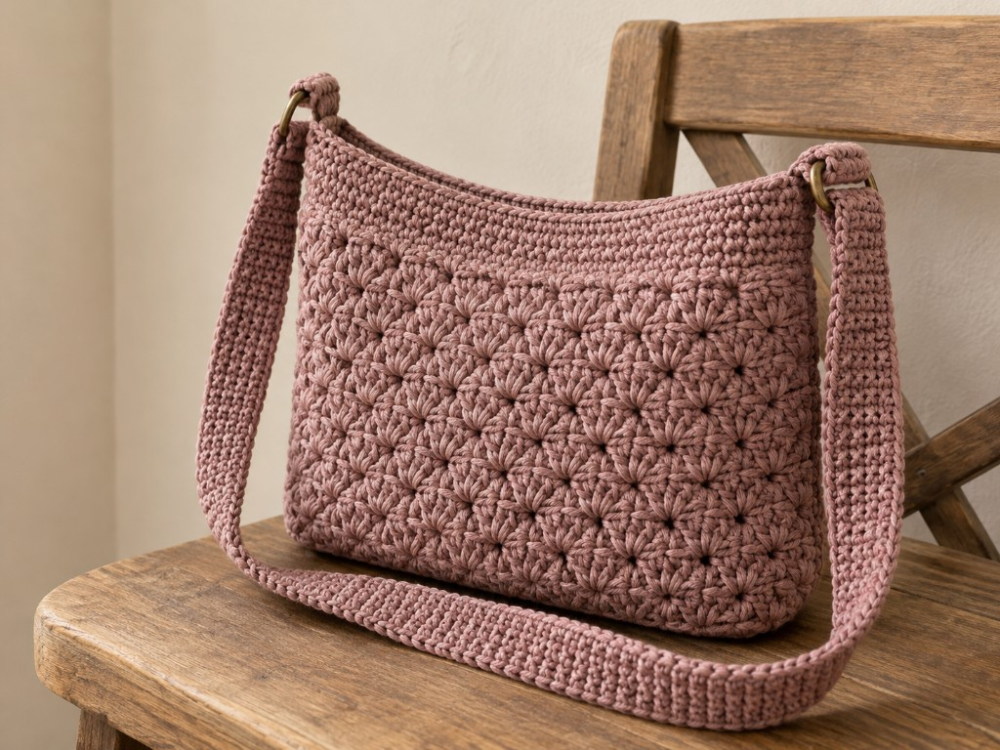
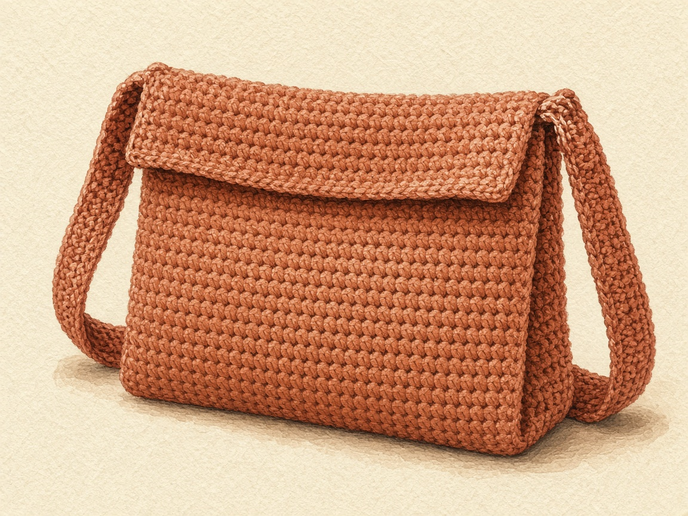

A strap is what turns a crochet sleeve into a bag you can wear. The body is the easy part — it is a folded rectangle, the same construction as any flat sleeve. The strap is where bags fail: sewn through one stitch it tears out, and made to the length that looked right on the table it hangs too low once the bag is full, because cotton stretches under weight and does not spring back. This page covers both the shoulder length and the crossbody length, how to attach a strap so it holds, and how to set its length after it has carried a load.

US terms throughout. US single crochet is UK double crochet. See the [abbreviations chart](/crochet-abbreviations-chart/) if a term is new. The sizes are worked out from an example gauge rather than from a finished, worn bag, so swatch, and wear it loaded before you fix the strap.

## The body: a folded rectangle, sized to what you carry

The body is a single-crochet rectangle folded in half and seamed up the sides, open at the top, with one round worked around the opening to firm it. That full method — measuring the contents, adding the stack's thickness to the width, and keeping the stitch count honest over many rows — is the folded-sleeve method in the [device case guide](/how-to-crochet-a-device-case/). Work the body at the size you need:

- **A phone crossbody** uses a small sleeve sized around one phone: each face covers the phone's width plus its thickness, plus a little ease and the seams. For a 3.0 x 6.0 x 0.35 in phone at 4 stitches to the inch, that is about 15 stitches wide and 70 rows, folded to a sleeve about 7.0 inches deep.
- **A shoulder bag** uses a wider body sized around a small stack — a phone, a slim wallet, keys. Measure the widest item and the whole stack's thickness. For a 4.5 in wallet in a 1.5 in stack, that is about 27 stitches wide and 66 rows.

After seaming, join yarn at a side seam and work one round of single crochet around both top edges. On the shoulder bag that is 27 along the last row and 27 along the foundation chain, 54 stitches. This round keeps the opening from stretching and gives the strap something solid to anchor to.

<figure class="diagram">

<figcaption>The body is a folded rectangle; the top round joins both edges and firms the opening.</figcaption>
</figure>

## The strap: a worked strip, never a bare chain

A strap carries the whole weight of the bag at two small points, so it has to be fabric, not a chain. A bare chain stretches without limit and the bag ends up at your knee. Work a narrow single-crochet strip instead:

Chain 5 or 6, single crochet across (4 or 5 stitches), then single crochet every row, turning with a chain 1 that does not count, until the strip reaches the length you worked out. Four stitches is enough for a light bag; five for a phone that swings.

### How long: shoulder versus crossbody

**Over one shoulder.** The strap sits on one shoulder and the bag hangs at your hip on the same side, about 26 inches of strap in the example. Hold the strip on your shoulder and let it hang to where you want the top of the bag, then add or remove rows.

**Across the body.** A crossbody strap is a loop all the way around your torso, so measuring shoulder-to-hip on the front gives you only about half of it. Put on the clothes you will wear it over, hold a string at the hip where the bag's top should sit, run it across your chest, over the opposite shoulder, down your back, and to the other side of the bag, then measure.

Measure the string path directly from one planned attachment point, across the chest and opposite shoulder, down the back, to the other attachment point. That path is the exposed strap length; add the overlap sewn inside the bag at both ends. Do not subtract the bag width a second time from a path already measured between attachment points.

## Attaching the strap so it holds

Lay one strap end inside the bag at the top of a side seam, overlapping by about an inch. With a yarn needle, sew a box around the overlap and an X across it, going through the strap, the top round, and the bag wall. A strap held by a single corner stitch pulls that stitch out under load; the box-and-X spreads the pull across many stitches and both layers.

<figure class="diagram">

<figcaption>The box-and-X spreads the load; the strap's final length is decided after it has carried weight.</figcaption>
</figure>

## Fit it after it stretches, not before

1. **Sew the first end** with the box-and-X.
2. **Pin the second end** inside the opposite side seam with two safety pins, and check the strap is not twisted.
3. **Baste the second end securely before checking it.** Do not carry a loaded bag supported only by safety pins. Use several temporary sewing passes over the overlap, then check with light contents while supporting the base. Remove basting to alter the length and sew the final box-and-X before normal use.
4. **Remeasure and sew.** If it now hangs lower than you wanted, take out rows before sewing the second end the same way as the first.

Every row of a single-crochet strap gives a little under steady weight, and over a hundred-plus rows that adds up to inches that cotton will not take back. Setting the length on the second day is what keeps the bag where you want it.

## Optional closure

An open top is quick to reach but a hard swing can throw the contents. For a shoulder bag, chain a loop at the center of the back top edge and sew a button on the front where it reaches with the bag full. For a phone crossbody, work a short flap over the middle stitches of the back opening with a chain loop on its last row, and button it. Place the button only with the contents inside, so the loop reaches.

Single crochet is not waterproof and a bag is not padding. Rain and spilled drinks go through, and a dropped phone is not protected. This keeps your things at your side, nothing more.

## Write out the folded body before making the strap

For the phone example at the stated four-stitch/five-row gauge: ch 16, sc in the second chain and across (15). Continue ch 1, turn, sc across until seventy rows make two equal thirty-five-row faces, about seven inches deep each; check against your phone before seaming. For the shoulder example: ch 28 for twenty-seven sc, work sixty-six rows for two thirty-three-row faces, then fit your actual contents. Fasten off, fold with equal faces and seam both sides only. The seventy- and sixty-six-row totals replace odd-row examples that could not split into equal numbered faces. Make the strap only after this fit check.

## Troubleshooting

**The bag bulges and the seams strain.** The body width left out the stack's thickness. Start wider.

**The contents sit above the top edge.** Too few rows in the body.

**The strap got longer after a week.** It was sewn to length before the wearing test. Unpick one end, take out rows, and resew.

**A strap end tore out.** It was sewn through too few stitches. Resew with the box-and-X through both layers.

**The strap twists on the shoulder, or the bag tilts.** The strap was sewn with a twist, or at different heights on the two sides. Unpick one end and lay it flat.

## Care

Empty the bag. Hand wash cool and dry flat with the strap laid straight. Do not hang it wet by the strap — that stretches it the most.

## Frequently asked

**Shoulder or crossbody — which is easier to make?**

Both are the same work; only the strap length differs. The crossbody just needs the loop measured around your body rather than a drop from the shoulder.

**Can I make the strap adjustable?**

Not with this plain strip. Sew it to the fitted length, which is why the wearing test matters.

**Can I sell what I make?**

Finished bags, yes. Do not republish these instructions, and do not stitch a brand name onto a bag as if the company made it.

## Next

For the folded-rectangle body in full detail, see the [device case guide](/how-to-crochet-a-device-case/). For a phone sleeve with no strap, the [phone case](/how-to-crochet-a-phone-case/). For a larger open carry with no strap sewing, the [granny square tote](/how-to-crochet-a-granny-square-tote/) or the [market bag](/how-to-crochet-a-market-bag/).
