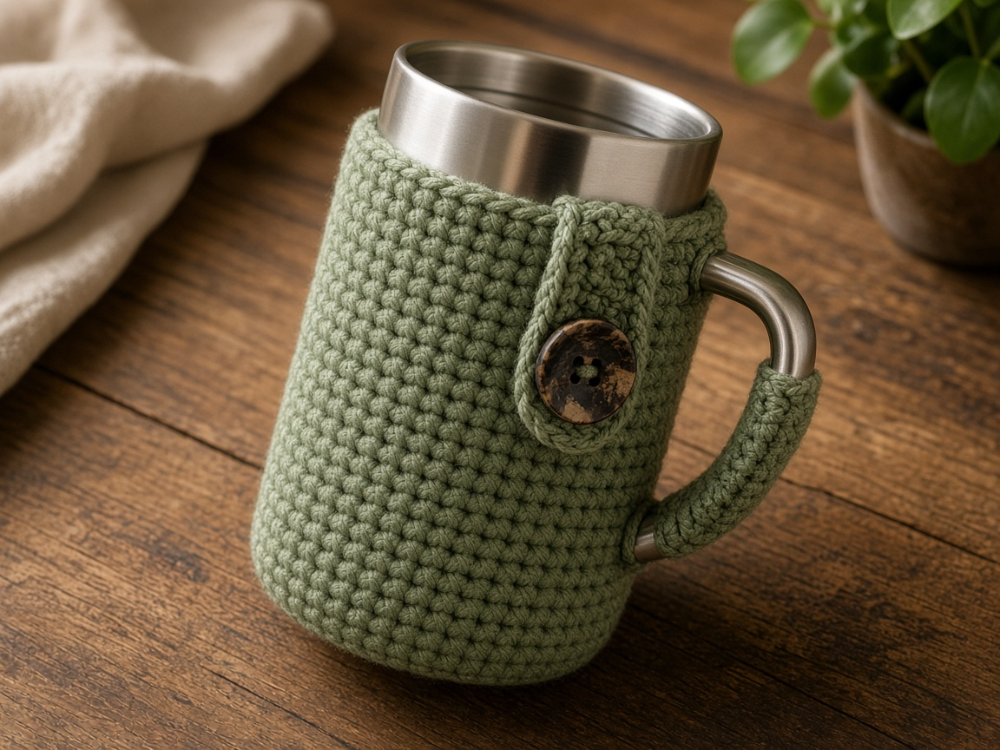
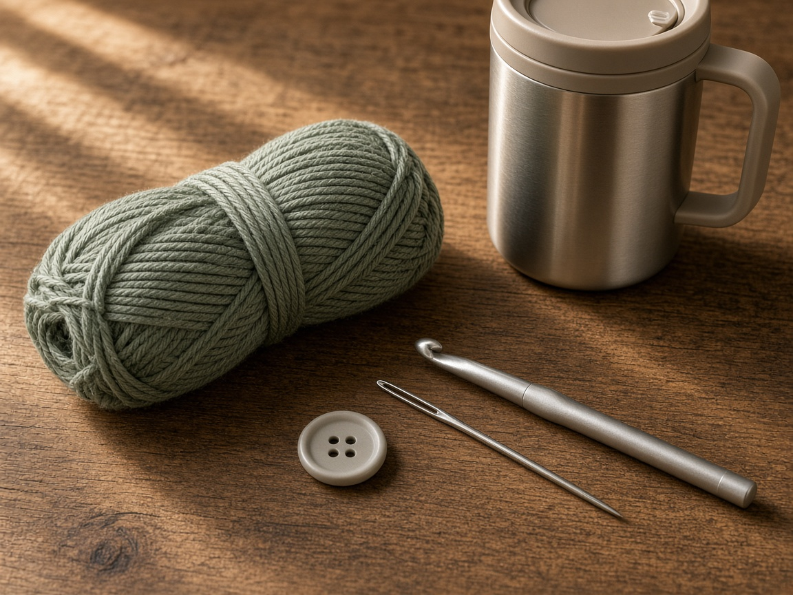
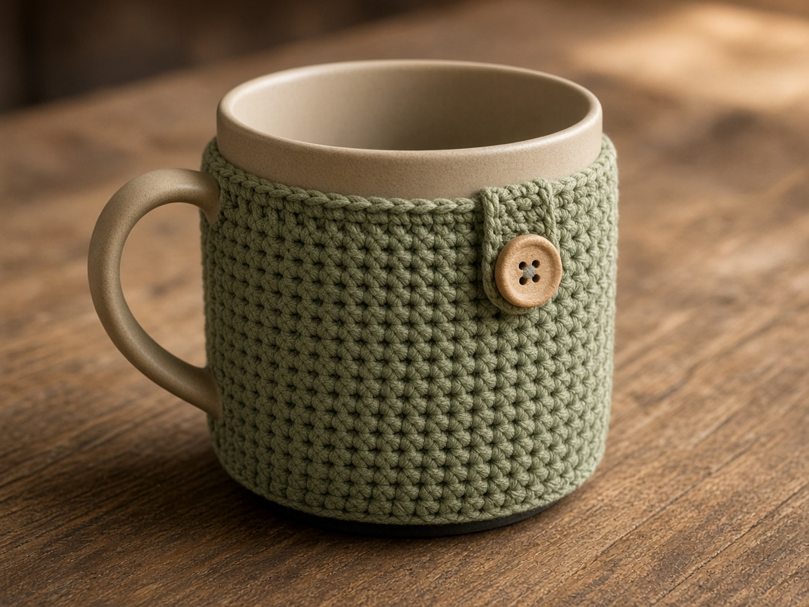

Most travel tumblers are not straight. They are wider at the top than at the bottom, and a straight crochet strip around one gaps at the top or slides down. A plain rectangle works on a straight mug, which is what the [mug cozy](/crochet-mug-cozy-for-beginners/) makes. This page handles the taper.

For a handled tumbler, the sleeve is a strip worked sideways, the same direction as the mug cozy, with a short wedge of partial rows that makes the top edge longer than the bottom. For a tumbler with no handle, it is a tube worked in rounds from the bottom up, with a few single increases spread along the way.

US terms. US single crochet is UK double crochet. [Abbreviations](/crochet-abbreviations-chart/). The pictures are illustrations. No sleeve for this page was crocheted or fitted on a cup. The cup in the example is invented. It is not a named brand.

## Measure the cup

1. **Height** of the wall you want covered, below the lid's threads and above the base. Example: 4.5 inches.
2. **Around the top** of that area. Example: 9.3 inches.
3. **Around the bottom** of that area. Example: 8.5 inches.
4. **Handle base**, the width where the handle meets the wall. Example: 1.5 inches.

If the top and bottom measurements match, your cup is straight. Use the [mug cozy](/crochet-mug-cozy-for-beginners/) instead.

## How the handled version is shaped

The foundation chain is the sleeve's height. Each row runs from the top edge to the bottom edge, and the rows stack around the cup. So the length along the top edge is the number of rows at the top, and the same for the bottom.

To make the top edge longer, you work some rows that stop partway down. These short rows add length to the top part only. Two short rows over the top 12 stitches add two rows there. Two more over the top 6 add two more at the very top. The top edge now has four more rows than the bottom, the middle has two more, and the strip curves to follow the taper.

<figure class="diagram">

<figcaption>Four extra rows at the top, two in the middle, none at the bottom. That is a taper of 0.8 inch.</figcaption>
</figure>

## The worked example

| Part | Arithmetic | Result |
| --- | --- | --- |
| Height | 4.5 × 4 sts | 18 sc, chain 19 |
| Top edge | (9.3 − 1.5) × 5 rows | 39 rows |
| Bottom edge | (8.5 − 1.5) × 5 rows | 35 rows |
| Difference | 39 − 35 | 4 rows: one wedge |

The old version of this page multiplied the cup's circumference by the stitch gauge and then called the result rows. That is the same error the mug cozy page had: the strip runs sideways, so its length comes from rows per inch.

## Yarn and hook

- **Smooth worsted cotton.** A cold cup sweats, and acrylic stays damp and smells. [Yarn weights](/yarn-weight-chart/).
- **US G/6 (4.0 mm) hook**, or the size that gives firm fabric. [Hook chart](/crochet-hook-size-conversion-chart/).
- **One button**, about 3/4 inch, and thread.
- Two stitch markers, yarn needle, scissors.

Measure both stitches and rows per inch on a swatch. [Gauge](/crochet-gauge/) explains how.

## Stage 1: the strip

Chain 19.

**Row 1:** Sc in the second chain from the hook and in each chain across. Ch 1, turn. (18)

<figure class="diagram">

<figcaption>Step 1. The chain is the height of the sleeve, 18 sc for a 4.5 inch cup. Rows run around the cup.</figcaption>
</figure>

Put a marker in the last stitch of row 1. That end is the **top edge**. Every odd row ends there, and every even row starts there.

**Rows 2–17:** Sc in each stitch. Ch 1, turn. (18)

Row 17 ends at the top edge.

## Stage 2: the wedge

Work these from the top edge. Each short row turns partway down.

**Short row 1:** Sc in the next 12 stitches. Ch 1, turn, leaving 6 unworked.

**Short row 2:** Sc in each of the 12 stitches back to the top edge. Ch 1, turn.

**Short row 3:** Sc in the next 6 stitches. Ch 1, turn.

**Short row 4:** Sc in each of the 6 stitches back to the top edge. Ch 1, turn.

You are at the top edge again, ready for a full row.

<figure class="diagram">

<figcaption>Step 2. The short rows add length only to the top edge, which is what lets a straight strip follow a wider rim.</figcaption>
</figure>

At each turning point the fabric steps, and a small gap can open. When you work the next full row past it, put the stitch firmly into the stitch below the step. A tiny gap is normal in single crochet short rows.

## Stage 3: the rest of the strip

<figure class="diagram">

<figcaption>The first full row crosses three exposed levels without adding stitches.</figcaption>
</figure>

**Full row 18:** Starting at the top, sc into the six stitches of short row 4, then the six exposed stitches of short row 2, then the six still-unworked stitches of full row 17. Do not work a turning chain as an extra stitch. Ch 1, turn. (18)

**Full rows 19–35:** Sc in each of the 18 stitches. Ch 1, turn. (18)

Count the bottom edge: 35 rows. The top edge has 39.

**Checkpoint:** wrap the strip on the cup with the top edge at the top. Both short ends should sit beside the handle, and the fabric should lie against the wall all the way down. Add or remove full rows at the end if the ends do not reach.

## Stage 4: the closure

The closure works exactly as it does on the [mug cozy](/crochet-mug-cozy-for-beginners/). Sew the button on the foundation-chain end, at mid-height. On the last-row end, join yarn at mid-height and chain a loop long enough to pass through the gap between the handle and the wall and reach the button. Slip stitch back to close the loop. Putting the loop on the last row means you can pull out rows to adjust the fit and remake the loop. The foundation end cannot be shortened.

## For a tumbler with no handle

Work a tube in rounds, from the bottom up, and spread a few single increases along it.

| Part | Arithmetic | Result |
| --- | --- | --- |
| Bottom | 8.5 × 4 | 34 sts |
| Top | 9.3 × 4 | 37 sts |
| Rounds | 4.5 × 5 | 22 rounds |
| Increases | 37 − 34 | 3, one at rounds 6, 12, and 18 |

Chain 34 and join into a ring with a slip stitch, without twisting the chain. Work single crochet in rounds, using a marker. On rounds 6, 12, and 18, work 2 sc in one stitch, and put each increase in a different place around the tube so they do not stack into a ridge. Stop after round 22.

This sleeve has no ease. It grips the cup. If it will not go on, start again with 36 stitches and three increases to reach 39; measure both edges and adjust the whole tube rather than only enlarging the bottom.

## Heat and water

The sleeve is for holding a cup comfortably. It does not make a cup that is too hot to hold safe to hold, and it does not go in a microwave. A sweating cold cup wets the cotton. Take the sleeve off and dry it.

## Follow the exposed stitches when the wedge ends

Use a marker at each short-row turn. The first full row after the wedge travels through six stitches from the latest short-row pair, six exposed stitches from the earlier pair, then six exposed stitches from the full row below. That is eighteen actual stitches across three levels, not eighteen stitches in the latest six-stitch row. Do not fill turning-chain holes with extra sc. After the full row, remove the turn markers and count eighteen again on the return. Test on an empty, cool cup with the long edge at the larger circumference. Do not add a top wedge when the top is already loose.

## Troubleshooting

**The top edge is loose while the bottom fits.** Too many top-only short rows or too much top-edge length. Remove a wedge or reduce it. If the top edge is too tight while the bottom fits, add top-only short rows in pairs and try the strip again.

**The bottom bunches.** The wedge was worked from the bottom edge. Check which end the marker is on.

**There are holes at the turns.** Work the next full row's stitch firmly into the stitch below each step.

**The strip is an inch short.** The length was worked from the stitch gauge. Use rows per inch.

**The rounds version spirals into a ridge.** The increases stacked. Move them.

## Care

Take it off the cup. Hand wash cool. Dry flat. A damp sleeve left on a steel cup can mark it.

## Frequently asked

**Will it fit every travel cup?**

No. Measure yours. The method works on any cup you measure.

**Can I sell them?**

Finished sleeves, yes. Do not republish the rows, and do not sew a brand name on a sleeve as if the cup company made it.

## Next

The straight-mug version, without short rows, is the [mug cozy](/crochet-mug-cozy-for-beginners/). Rounds with spaced increases are explained in [increase and decrease](/crochet-increase-decrease/).
