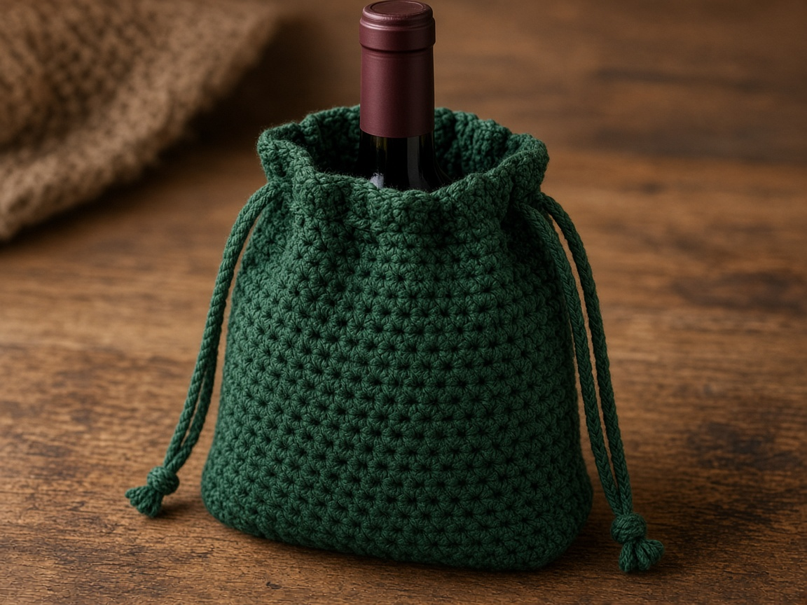
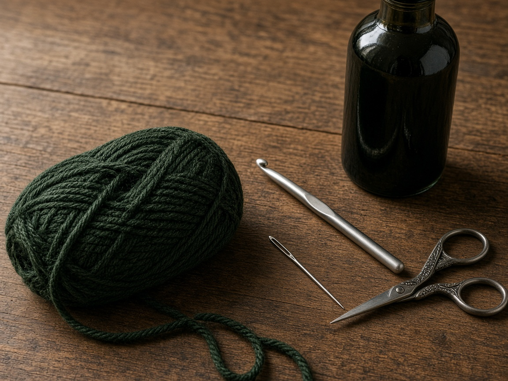

A bottle in a grocery sack knocks against everything, and a paper bag's handle tears before you reach the car. A crochet bottle bag is a drawstring tube: a flat base, straight sides, and a cord that gathers around the neck. It is a carrying sleeve and a gift wrap. It will not stop glass breaking on a hard floor.

The pattern is simple, but it is tall, and two things in it are easy to get wrong. The flat base adds no height, so the side rounds have to be counted from where the base ends. And a drawstring is not a handle. A bottle lifted by its cord hangs its whole weight on the small chain loops of one round.

US terms. US single crochet is UK double crochet. [Abbreviations](/crochet-abbreviations-chart/). The pictures are illustrations. No bag for this page was crocheted or put on a bottle. The bottle measurements below are an invented example.

## Measure the bottle

- **Around the widest part.** Usually the body, sometimes the shoulder. Example: 9.4 inches, about 3 inches across.
- **Height to the cord point.** From the table to a little above the shoulder, where the neck begins to narrow. Example: 9 inches.

Add about half an inch of ease to the circumference. Glass that has to be forced through crochet is glass that slips.

## How the bag is built

<figure class="diagram">

<figcaption>Count side rounds from the end of the base. The base lies under the bottle.</figcaption>
</figure>

**Base.** A flat circle that stops growing at the circumference you need. It lies under the bottle. The old version of this page counted its rounds as part of the height, which made the bag about an inch and a half short at the example gauge.

**Sides.** Even rounds. Because the count never changes, the tube's width at the eyelets is the same as at the base, so the bottle's widest part passes through without stretching.

**Eyelets.** A round of holes just above the shoulder, then two more rounds. The cord gathers the top around the neck.

## Yarn and hook

- **Smooth worsted cotton.** A cold bottle sweats; cotton handles that better than acrylic. [Yarn weights](/yarn-weight-chart/).
- **US G/6 (4.0 mm) hook**, or the size that gives firm fabric. [Hook chart](/crochet-hook-size-conversion-chart/).
- Stitch marker, yarn needle, scissors.

Your base is your swatch. At 4 stitches per inch, 40 stitches should measure 10 inches around the edge of the flat circle.

## The worked example

| Part | Arithmetic | Result |
| --- | --- | --- |
| Around | 9.4 + 0.5 ease | 9.9 in, 40 sts (10 in) |
| Base across | 10 ÷ 3.14 | about 3.2 in, a little wider than the bottle |
| Side rounds | 9 in × 5 | 45 rounds, rounds 8–52 |
| Eyelets | 40 ÷ 2 | 20 holes |
| Cord | 10 in around + 2 tails of 8 in | 26 in |

## Stage 1: the base

Joined rounds: slip stitch to the first stitch and ch 1 (does not count) at the start of each round. To spiral instead, skip both and use a marker.

**Round 1:** 6 sc in a magic ring. (6)

<figure class="diagram">

<figcaption>The base starts in a magic ring, closed tight so the bottle cannot push through.</figcaption>
</figure>

**Round 2:** 2 sc in each stitch. (12)

**Round 3:** (2 sc in next, sc in next) 6 times. (18)

**Round 4:** (2 sc in next, sc 2) 6 times. (24)

**Round 5:** (2 sc in next, sc 3) 6 times. (30)

**Round 6:** (2 sc in next, sc 4) 6 times. (36)

**Round 7:** (2 sc in next, sc 8) 4 times. (40)

Round 7 adds only four stitches, to land on 40. Stand the bottle on the circle. The base should be a little wider than the bottle. If your bottle needs a different count, stop increasing when you reach it, keeping the count even for the eyelets.

<figure class="diagram">

<figcaption>Step 1. Rounds 2 to 6 add 6 each. Round 7 adds 4 to land on 40, an even count for the eyelets.</figcaption>
</figure>

## Stage 2: the sides

**Rounds 8–52:** Sc in each stitch. (40)

Slide the bottle in every 10 rounds. Stop when the fabric reaches the cord point you chose, just above the shoulder. Forty-five rounds is the example. Count the stitches now and then. A gained stitch turns the tube into a slow cone.

## Stage 3: eyelets and top

**Eyelet round:** (Sc in next, ch 1, skip 1) 20 times. (20 sc, 20 ch-1 spaces)

<figure class="diagram">

<figcaption>Step 2. The eyelet round keeps the stitch positions: 20 sc and 20 chain spaces, back to 40 sc on the next round.</figcaption>
</figure>

**Next round:** Sc in each sc and in each ch-1 space. (40)

**Last round:** Sc in each stitch. (40) Fasten off.

<figure class="diagram">

<figcaption>Step 3. The whole bag by stitch count. The 7 base rounds lie flat and add no height.</figcaption>
</figure>

**Cord:** chain to 26 inches, then slip stitch back along the chain so it does not stretch. Thread it in and out of the eyelets, starting and ending at the front. Knot each end.

**Checkpoint:** with the cord loose, the bottle should slide in and out. With the cord pulled, the top should close around the neck.

## Stage 4: a carry handle

Do not lift the bag by the cord. The cord passes through 20 chain-1 loops in a single round, and lifting by it hangs the full bottle from those loops. They stretch, and the eyelet round can tear.

For a handle, chain 6 and work 5-stitch rows of single crochet to about 12 inches. Sew one end to each side of the bag, opposite each other, over the two or three solid rounds just below the eyelet round. Overlap about an inch and sew a box with an X through it, through both layers.

## Support the bottle while checking the seams

Place the filled bottle into the sleeve while it stands on a table. Mark the shoulder and eyelet height without lifting it by the cord. The forty-five side rounds are counted after the seven base rounds, not including them. Sew any handle with the bottle removed and keep stitches on opposite walls rather than sewing through the whole tube. A handle is not tested merely because its overlap looks secure; support the bottle from underneath when handling or gifting it. Leave the cord loose when inserting or removing the glass, and do not force a too-tight opening.

## Troubleshooting

**The bottle will not go in.** The count is too small for the widest point. Add stitches at the base.

**The bag is short of the shoulder.** The base rounds were counted as height. Add side rounds.

**The bottle rocks inside.** The base is much wider than the bottle. Stop increasing sooner next time.

**The tube flares toward the top.** Gained stitches. Count back.

**The top will not close.** The eyelets are below the shoulder, where the bottle is still wide. Move the eyelet round higher.

**The eyelet round stretched.** It was used as a handle. Add a handle.

## Care

Take the bottle out. Hand wash cool. Dry flat with the cord loose.

## Frequently asked

**Will this fit a standard 750 ml bottle?**

Bottles of that volume come in different shapes. Measure the one you have.

**Is it safe to drop?**

No. Crochet is not padding.

**Will it fit other bottles?**

Any bottle you measure. Redo the table from its widest point and its height.

## Next

The same base and eyelet round, smaller, is a [drawstring bag](/how-to-crochet-a-drawstring-bag/). A sleeve for a cup is the [tumbler sleeve](/how-to-crochet-a-tumbler-sleeve/).
