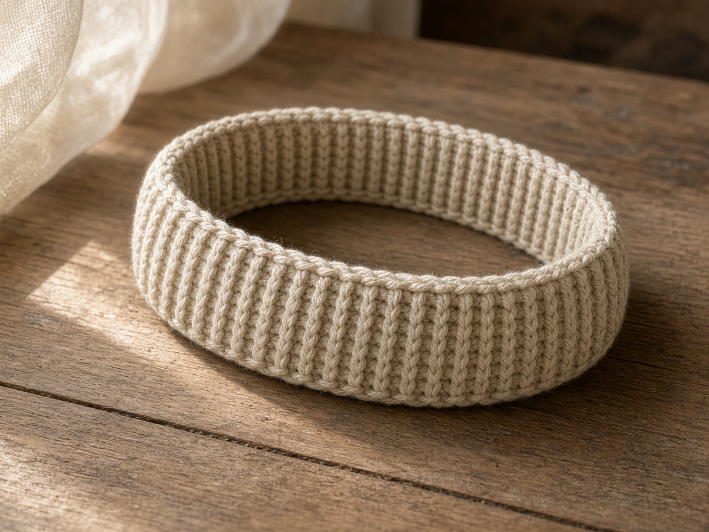
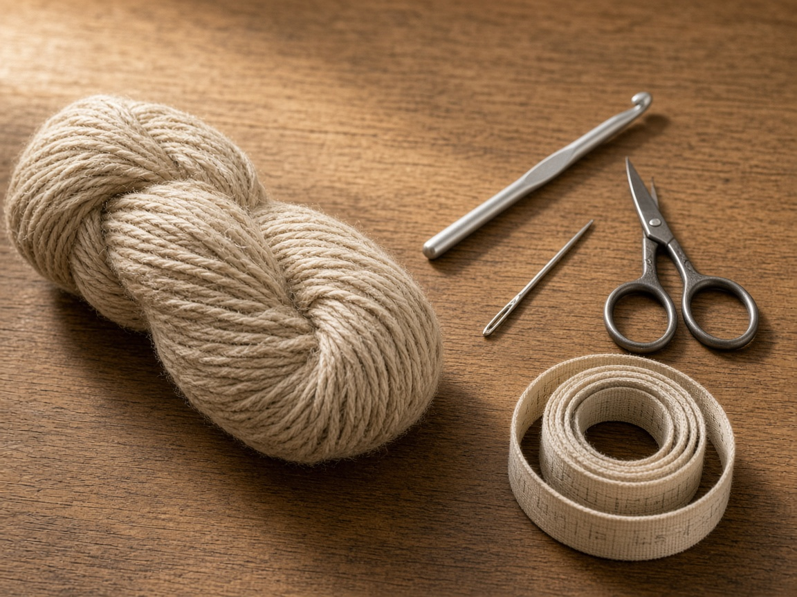
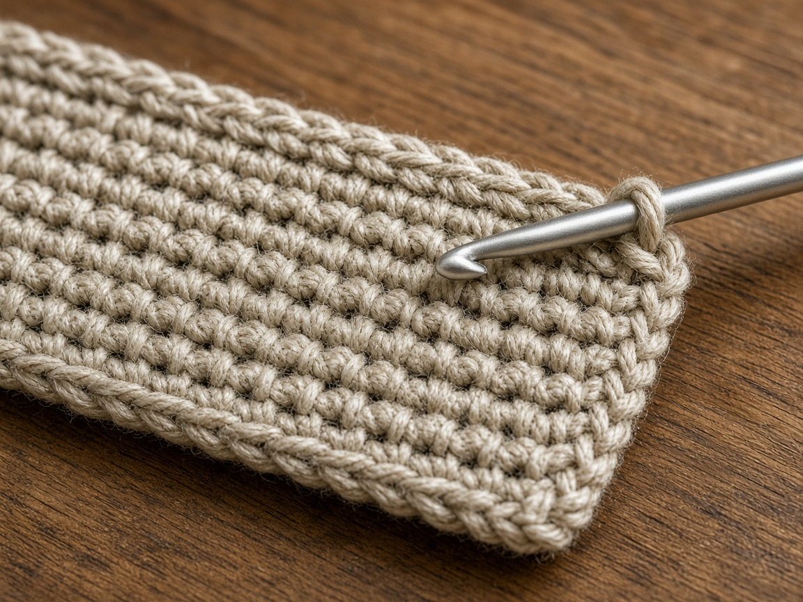
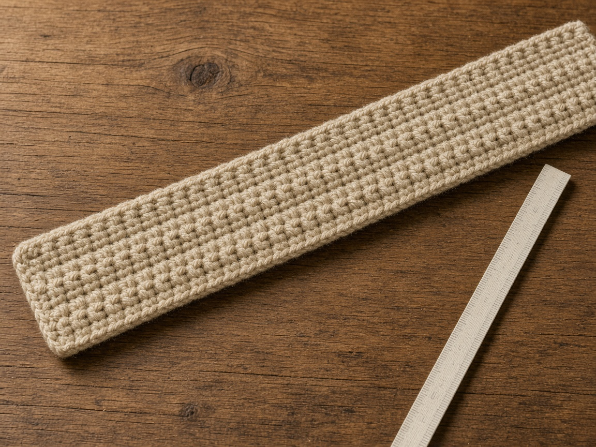
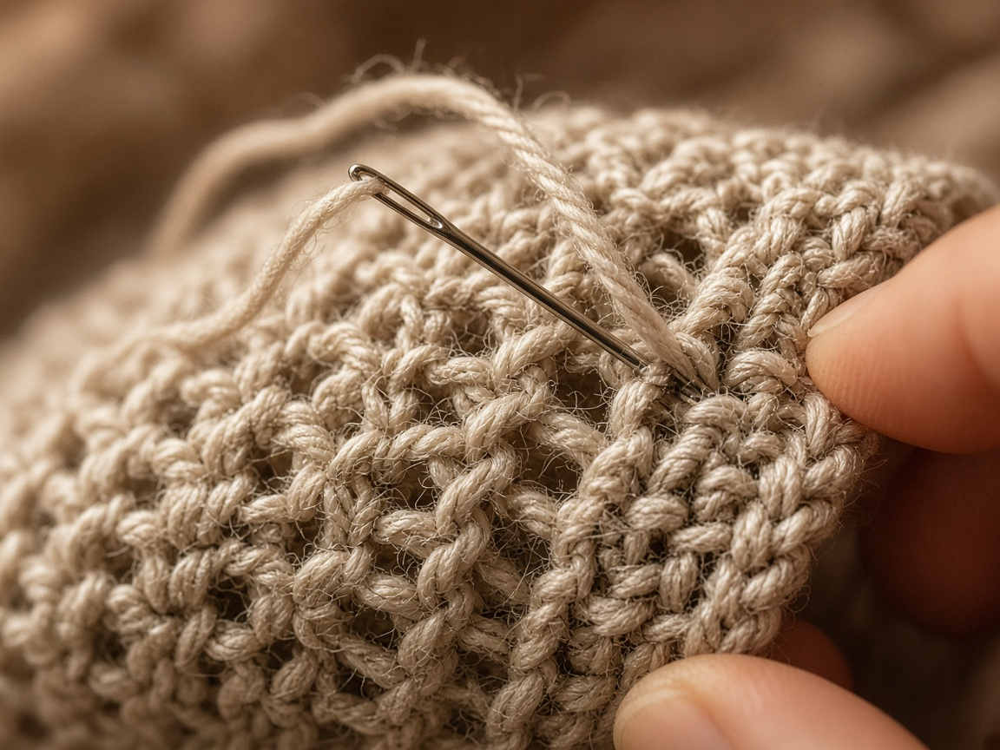
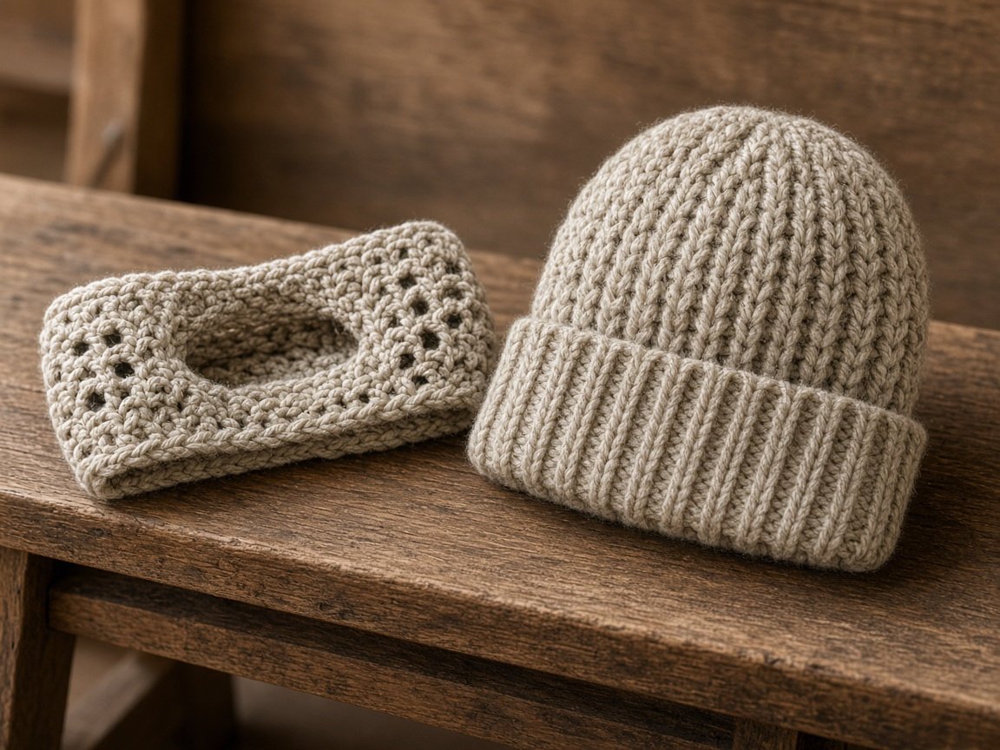

An ear warmer is a ribbed strip joined into a loop. The starting chain is the width of the band. The rows are the distance around the head. Adding rows does not make it wider. Adding chains does not make it longer. That swap is the whole project.

US terms. US single crochet is UK double crochet. The rib is single crochet in the back loop only. [Abbreviations](/crochet-abbreviations-chart/). The pictures are illustrations. This band has not been worn.

## Step 1: Measure the head, then decide the ease

Tape the path the band will take. Write that number down.

A shorter band than the head is negative ease. It lets a stretchy rib hug. Two inches shorter is the old example: a 22 inch path becomes a 20 inch strip. That 2 inches was not tested on a head. A stiff yarn, or cotton, may need less of a cut, or none. A very elastic wool may tolerate more. The check is the strip around the head before you seam it, not the subtraction.

<figure class="diagram">

<figcaption>Width and circumference are different edges. Do not add rows to fix a narrow band.</figcaption>
</figure>

## Step 2: Swatch both directions

Planning stitch gauge: **3.5 back-loop single crochet = 1 inch.** Work 14 of them. If those 14 are not about 4 inches, change the hook. [Gauge](/crochet-gauge/). [Hook chart](/crochet-hook-size-conversion-chart/).

Then count the rows in one inch of that same swatch. Do not copy 3.5 into the row gauge because the stitches were 3.5. Single crochet rows are often a different number per inch. The old 70-row target is 20 × 3.5, which is right only when the rows really are 3.5 per inch.

Twelve stitches at 3.5 per inch are 12 ÷ 3.5 = about **3.4 inches** wide. That width was not tried on an ear. It is only the paper width of the example.

## Materials

Worsted yarn that will stretch a little after you join it. [Yarn weights](/yarn-weight-chart/). The example hook is a US H/8 (5.0 mm) only if it hits your swatch. Yarn needle, scissors, tape. No weighed yardage.

## Step 3: Rib until the relaxed strip matches the tape

Chain-1 does not count.

The 12-stitch start is the example width. For a wider band, chain more at the beginning. Chain 16 gives 15 stitches if you still start in the second chain. The circumference math does not change when you do that.

Chain 13.

**Row 1:** Single crochet in the second chain from the hook and across. Chain 1, turn. (12)

<figure class="diagram">

<figcaption>Chain 13 for 12 sc. The chain is the band's width, about 3.4 inches at 3.5 per inch.</figcaption>
</figure>

**Row 2:** Single crochet in the back loop only across. Chain 1, turn. (12)

<figure class="diagram">

<figcaption>Every row from row 2 goes into the back loop only. The unworked front loops become the ribs.</figcaption>
</figure>

Repeat row 2 until the strip, lying relaxed, matches the length you chose in step 1. Do not stretch it up to 70 rows to hit the example. If your row gauge is 3.5 and you did choose 20 inches, 70 rows is that arithmetic. Otherwise stop at the tape.

Checkpoint: the strip is still 12 stitches wide, or your wider count. A gain at the edge makes one side longer than the other, and the seam will not lie flat.

## Step 4: Seam without a twist

Lay the strip flat. Both short ends should face the same way. Sew through both layers. If one end is flipped, the rib spirals.

<figure class="diagram">

<figcaption>Match the ends, then sew. A twist is a flipped end, not a short row count.</figcaption>
</figure>

Put the loop on before you weave the ends. This page cannot tell you it will stay put when you look down. It can tell you what to change: if the band is loose, the strip was long; if it will not go on, the strip was short or the ease cut was too deep. Open the seam and add or remove rows. Weaving the ends into the seam, rather than across the ribs, keeps them from reading as a stripe.

A crossed front, where the ends overlap in an X, uses up some length. Measure the loop after you pin the overlap. Do not assume the overlap eats one inch. That inch was a guess.

The seam can sit at the nape so the bump is not on the forehead. That is a comfort preference, not a tested fit.

## Match the two short ends stitch by stitch

The short ends have twelve positions in the example: twelve used foundation-chain links at one end and twelve sc tops at the other. Hold them together without twisting and sew each matched pair, or slip stitch through both edges. Do not include the foundation's skipped chain or the unused turning chain as a thirteenth position. Try the loop before securing the final tail. If it is too small, open the seam and add whole rows; if too large, remove rows. A crossed-front version needs separate assembly instructions and is not defined by merely overlapping these ends.

## Mistakes

**The band is a spiral.** One short end was flipped. Open the seam.

**It will not go over the ears.** The strip is short, or a stiff yarn was cut 2 inches under the head. Use a smaller ease cut, or a yarn that stretches, and measure again before you sew.

**You added rows because it looked narrow.** Rows lengthen the loop. Width is the chain. Start over with more chains if you want more forehead coverage.

**Chunky yarn with 12 stitches and 70 rows.** Those counts are a worsted example, and the 70 already depends on an untested row gauge. Swatch the new yarn in both directions.

## Care

Hand wash cool. Dry flat. Read the label before a dryer. Some wool blends felt, and a felted band does not return to the length you measured.

## Frequently asked

### Will it clear a ponytail?

The band does not cover the crown, so hair gathered on top of the head is out of its path. A low ponytail can sit on the seam. Move the seam, or wear the hair down. This was not tried on a head.

### Is it a first project?

The stitch is a beginner stitch. The first project is still easier as a flat [scarf](/how-to-crochet-a-beginner-scarf/), where a twist does not have to pass over a head. Back loop, if it is new, is in [basic stitches](/basic-crochet-stitches/).

## Next

Hands are the [fingerless gloves](/how-to-crochet-fingerless-gloves/). A crown, which this band does not have, is the [chunky beanie](/how-to-crochet-a-chunky-beanie/).
