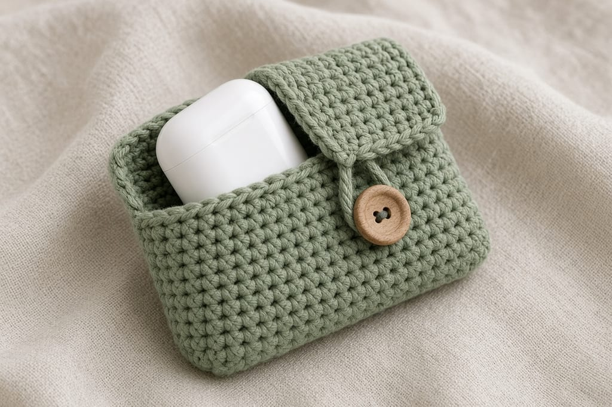
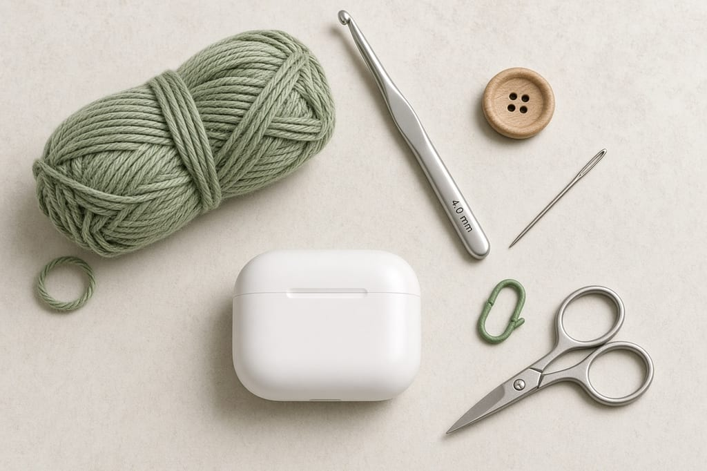
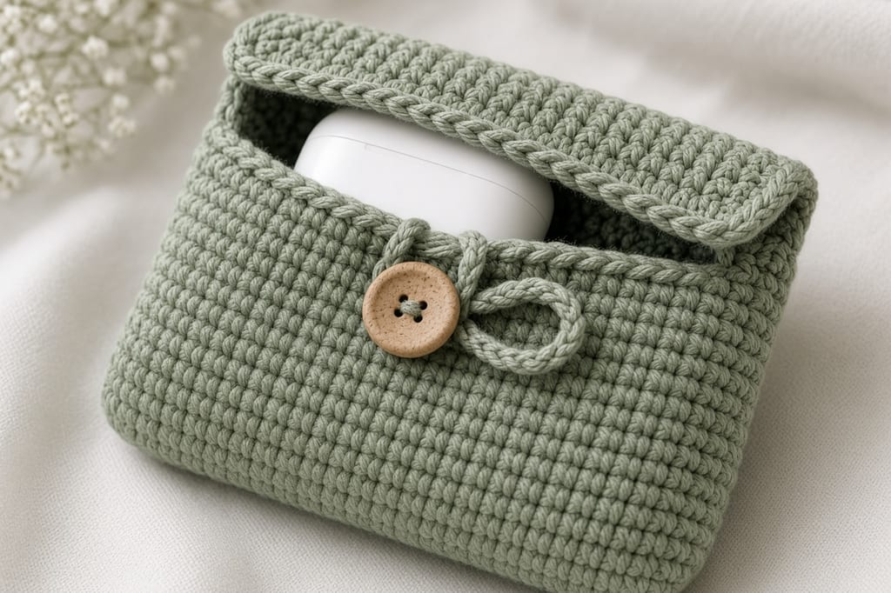

A charging case loose in a bag collects lint in the hinge, and then the lid stops closing cleanly. A small pouch fixes that. It does not cushion a drop, and it does not keep out a spilled drink. It is a cover.

Most earbud pouch patterns give one stitch count and hope your case fits it. This page sizes the pouch from the case instead. The one measurement that matters is the distance around the case, its perimeter. Width alone tells you almost nothing about whether it will go in.

US terms. US single crochet is UK double crochet. [Abbreviations](/crochet-abbreviations-chart/). The pictures are illustrations. No pouch for this page was crocheted or fitted on a case. The case measurements below are an invented example so the arithmetic has numbers.

## What is a technique, and what is only a plan

| Piece of this page | What it is |
| --- | --- |
| Flat circle, then even rounds | Standard construction for a round-bottomed tube. |
| A flap worked in rows on part of the last round | Standard. |
| Tube must go around the case perimeter plus ease | Geometry. |
| 1.9 × 0.9 × 2.4 in case | An invented example. Measure yours. |
| 4 sc and 5 rounds to the inch | An unverified example gauge. |
| About 45 yards | An old line. It was not weighed and is withdrawn. |

## How the pouch is built

Six stitches in a magic ring become a flat circle. Increases stop once the circle's edge is long enough to go around the case. From there, even rounds build a straight tube. When the tube is tall enough, a flap is worked in rows on a third of the stitches, and a chain loop on its last row fastens over a button.

The [ghost coin pouch](/how-to-crochet-a-ghost-coin-pouch/) uses the same base and tube, closed with a drawstring instead. The [bat earbuds pouch](/gothic-bat-earbuds-pouch/) is this pouch with ears and wings sewn on.

## Measure the case

Measure three things with the lid closed: width, depth (thickness), and height. In the example, the case is 1.9 inches wide, 0.9 inch deep, and 2.4 inches tall.

The perimeter of the footprint is 2 × (1.9 + 0.9) = **5.6 inches**. That is how far the tube has to stretch around the case. Add ease, around half an inch to an inch, so the case drops in without scraping the lid.

<figure class="diagram">

<figcaption>Choose the stitch count from the perimeter. A round tube around an oblong case leaves space at the sides, which is fine in soft fabric.</figcaption>
</figure>

## Yarn, hook, and gauge

- **Smooth worsted cotton.** Fuzzy yarn sheds into the speaker mesh and the charging port. [Yarn weights](/yarn-weight-chart/).
- **US G/6 (4.0 mm) hook**, or the size that gives firm fabric. [Hook chart](/crochet-hook-size-conversion-chart/).
- **One button**, about 1/2 inch across.
- Stitch marker, yarn needle, scissors.

Crochet a small flat circle to 24 stitches and measure around its edge. That is your gauge for this project, and it is faster than a square swatch. In the example, 24 stitches measure 6 inches around: 4 stitches per inch.

## The worked example

| Part | Arithmetic | Result |
| --- | --- | --- |
| Case perimeter | 2 × (1.9 + 0.9) | 5.6 in |
| Target around | 5.6 + about 1 in ease | about 6.6 in |
| Stitches | 6.6 × 4, nearest workable | 27 |
| Wall height | 2.4 in case + 0.2 in ease, × 5 rounds | 13 rounds |
| Flap | a third of 27 | 9 stitches |

## Stage 1: the base

Work in a spiral without joining. Put a marker in the first stitch of each round. [Crochet in the round](/crochet-in-the-round/) explains spirals.

**Round 1:** 6 sc in a magic ring. (6)

**Round 2:** 2 sc in each stitch. (12)

**Round 3:** (Sc, 2 sc in next) 6 times. (18)

**Round 4:** (Sc 2, 2 sc in next) 6 times. (24)

**Round 5, for 27:** (Sc 7, 2 sc in next) 3 times. (27)

A flat circle adds six stitches a round. Round 5 adds only three, which keeps the base nearly flat while landing on a count between 24 and 30. For 30, work (sc 3, 2 sc in next) 6 times instead. For 24, skip round 5.

**Checkpoint:** lay the base flat. A slight cup is fine, because it will turn into the wall. A ruffle means extra stitches.

## Stage 2: the wall

**Rounds 6–18:** Sc in each stitch. (27)

The wall turns up on its own once increases stop. Stand the case in the pouch every few rounds. Stop when the top of the lid sits just below the rim. Thirteen rounds is the example. Your count is whatever covers your case.

## Stage 3: the flap and the loop

The flap is worked in rows over 9 of the 27 stitches. The other 18 stay unworked as the open front. Ch 1 at the end of each row does not count as a stitch.

**Row 1:** Sc in the next 9 stitches. Ch 1, turn. (9)

**Rows 2–5:** Sc in each stitch. Ch 1, turn. (9)

**Row 6:** Sc 3, ch 4, skip 3, sc 3. (6 sc and a ch-4 loop)

Three stitches, three skipped, three stitches: 3 + 3 + 3 = 9, so the loop sits centered across the flap. Fasten off.

With the case inside, fold the flap down and mark where the loop lands on the front, about four rounds below the rim. Sew the button there, through several stitches. Close it. The loop should reach without pulling the flap into a point. If it does not, rework row 6 with a ch 5 or ch 6 over the same 3 skipped stitches.

For a 30-stitch pouch, work the flap on 10 stitches and make row 6: sc 4, ch 4, skip 2, sc 4. For 24, use 8 stitches: sc 3, ch 4, skip 2, sc 3.

## Optional hanging loop

Chain 16, join into a ring with a slip stitch, and sew it to the back just below the rim, behind the flap. A split ring goes through that loop. On a bag strap it will knock against your hip. On a belt loop, keep the chain short.

## Troubleshooting

**The case will not go in.** The stitch count is below the perimeter. Go up a size from the table.

**The case rattles and falls out when the flap is open.** Too much ease. Go down a size, or use a smaller hook at the same count.

**The base bowls into a cup before the wall.** The ring or the increases are tight. Loosen up, or work round 5 with six increases and see whether it flattens.

**The flap pulls into a point.** The loop is too short, or the button is too low. Lengthen the chain before moving the button.

**The flap sits off center.** The flap stitches started somewhere other than where you wanted the back. Plan which stitches will be the back before row 1.

## Use and care

Leave the port reachable, or take the case out to charge. A flap sewn shut also locks out the charger. Take the case out before washing. Hand wash cool and dry flat. Cotton can shrink, and a pouch that was snug becomes too small.

## Frequently asked

**Will it fit every brand?**

No. That is why it is sized from your case. Two cases can share a width and differ by half an inch around.

**Can I use a drawstring instead of a flap?**

Yes. The eyelet round from the [ghost coin pouch](/how-to-crochet-a-ghost-coin-pouch/) needs an even count, so use 24 or 30, not 27.

**Is it safe in the rain?**

No. Single crochet has gaps. Water goes through.

## Next

A flat sleeve has the same around-not-across rule: [how to crochet a phone case](/how-to-crochet-a-phone-case/). For a smaller tube with no flap, see the [lip balm holder](/how-to-crochet-a-lip-balm-holder/).
