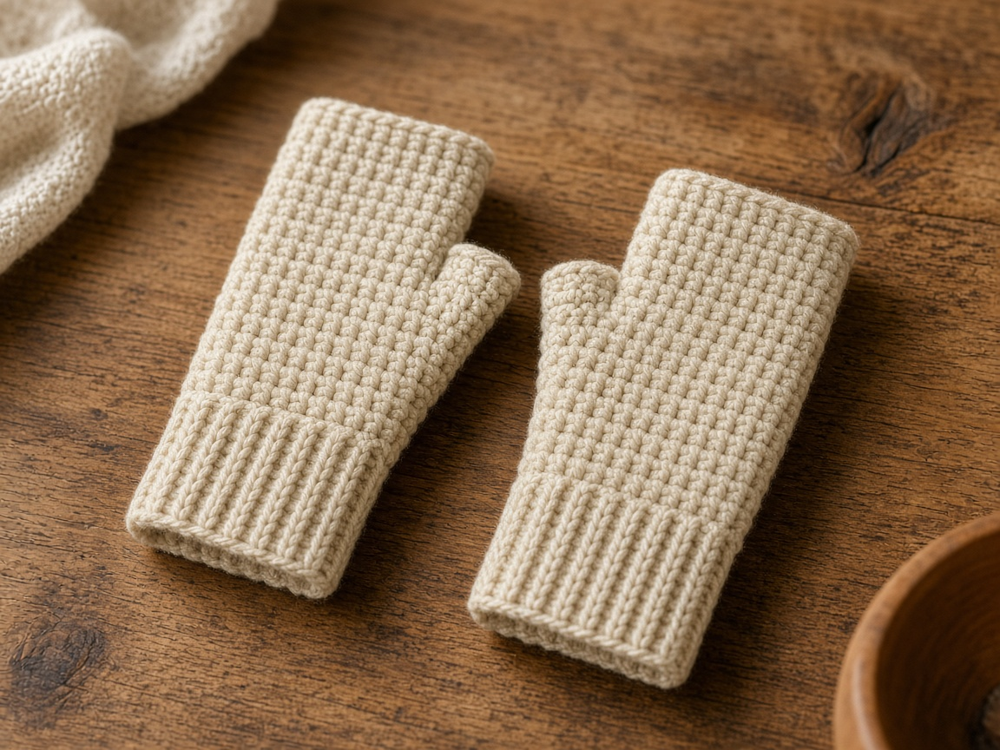
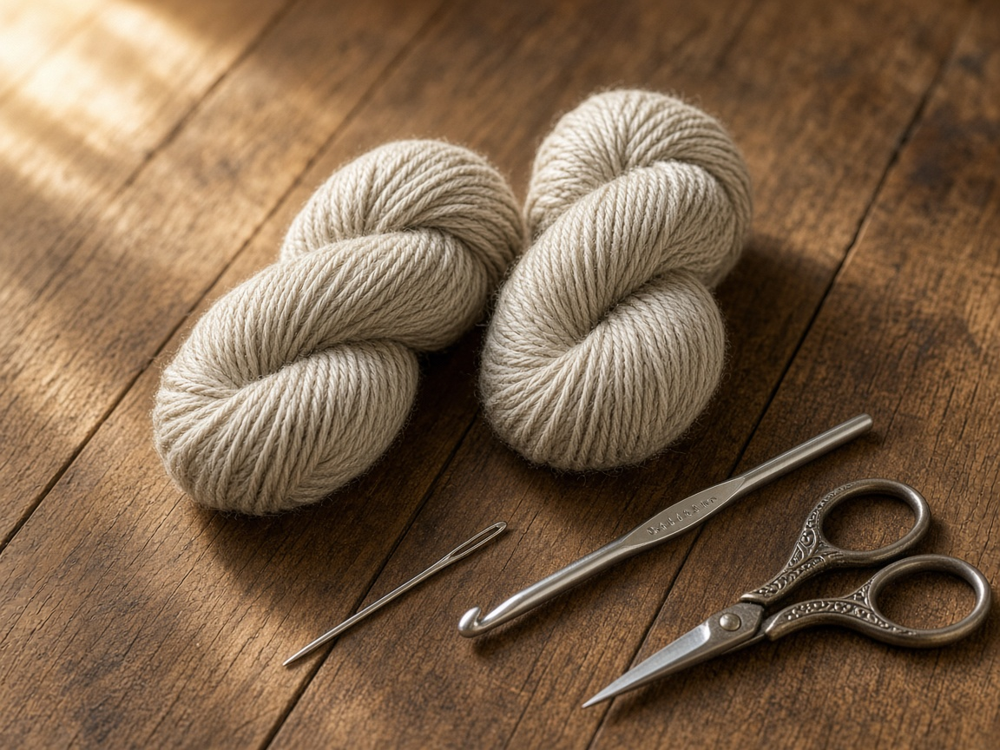

A fingerless glove is three parts. A ribbed cuff is worked flat and sewn into a ring. A tube of single crochet is worked in rounds from the cuff's edge. One round leaves a gap for the thumb. There is no shaping. The fit comes from five measurements and two conversions: turning cuff rows into hand stitches, and bridging the thumb gap without changing the stitch count.

US terms. US single crochet is UK double crochet. [Abbreviations](/crochet-abbreviations-chart/). The pictures are illustrations. No pair for this page was crocheted or worn. The hand numbers below describe one example hand so the arithmetic has values. They are not a size chart.

## What is a technique, and what is only a plan

| Piece of this page | What it is |
| --- | --- |
| Back-loop single crochet rows, sewn into a ring | A standard crochet rib for a cuff. |
| Hand worked in rounds from the cuff's row ends | Standard construction. The pickup ratio depends on your gauge. |
| A chain bridging skipped stitches | The standard way to leave a hole in a round. |
| 4 sc and 5 rows or rounds to the inch | An unverified gauge, used only so the example has numbers. |
| Half an inch under the wrist and knuckle measurements | A starting choice. Not a fit rule. |
| Thumb gap about half the thumb's circumference | An estimate. Try it on. |
| About 140 yards | An old line. It was not weighed and is withdrawn. |

## How the glove is built

<figure class="diagram">

<figcaption>The cuff is sideways: its chain is the depth along the arm, and its rows go around the wrist. The hand's first round is made from the ends of those rows.</figcaption>
</figure>

The cuff is worked sideways for a reason. Back-loop single crochet makes ridges along the rows. Turned on its side, those ridges run up the arm, and the fabric stretches around the wrist, which is the direction a cuff needs to give. The 4-H Crocheting Handbook builds its mitten cuffs on the same principle: rows of back-loop single crochet, ends joined, hand worked from the row ends. No pattern from that book is used here.

The hand is a straight tube. It does not get wider over the knuckles, because the knuckle count is reached on round 2 and held. The thumb is not cased in. A thumb opening is the whole design.

## Measure five places

Write these down for the hand you are fitting. The example values are one hand on paper.

| Measure | Example | Becomes |
| --- | --- | --- |
| Around the wrist, where the cuff sits | 6.5 in | Cuff length |
| Around the knuckles, thumb tucked out of the tape | 7.5 in | Hand stitch count |
| Wrist crease to the web of the thumb | 1.5 in | Rounds below the thumb gap |
| Wrist crease to the base of the fingers | 3.5 in | Total hand rounds |
| Around the thumb at its base | 2.5 in | Width of the thumb gap |

The example takes half an inch off the wrist and the knuckles so the glove stays put: 6 inches and 7 inches. Single crochet has less stretch than the rib, so that half inch is more likely to be too much on the hand than at the wrist. If you are unsure, plan the hand at the full knuckle measurement and try it on at round 3.

## Yarn, hook, and gauge

- **Smooth worsted yarn**, ideally with some wool. Wool recovers after it stretches. Cotton has little spring, so a cotton glove that fits in the morning can be loose by the evening. Fuzzy yarn hides the stitches you need to count. [Yarn weights](/yarn-weight-chart/).
- **A US G/6 (4.0 mm) hook** as a starting point, or whatever hook matches your swatch. [Hook chart](/crochet-hook-size-conversion-chart/).
- **Two stitch markers:** one for the first stitch of the round, one to mark the thumb round.
- Yarn needle, scissors, tape measure.

Make two small swatches, because the cuff and the hand are different fabrics. In plain single crochet, measure stitches and rows per inch. In back-loop single crochet, measure rows per inch. A back-loop rib does not have to match the plain fabric. The example assumes 4 stitches and 5 rows per inch in plain single crochet, and 5 rows per inch in the rib. [Gauge](/crochet-gauge/) explains how to measure without stretching.

## The worked example

Every number below follows from the five measurements and the gauge. Change either, and redo this table before you chain.

| Part | Arithmetic | Result |
| --- | --- | --- |
| Cuff depth | 2 in × 4 sts | 8 sts, chain 9 |
| Cuff length | (6.5 − 0.5) in × 5 rows | 30 rows |
| Round 1 | 6 in of cuff × 4 sts | 24 sts, 4 for every 5 row ends |
| Hand | (7.5 − 0.5) in × 4 sts | 28 sts from round 2 |
| Thumb gap position | 1.5 in × 5 rounds | Gap on round 8, after 7 rounds |
| Thumb gap width | 2.5 in ÷ 2 × 4 sts | Skip 5, chain 5 |
| Hand length | 3.5 in × 5 rounds | 17 rounds, 3.4 in |

The earlier version of this page had two counting errors. It called 28 cuff rows 7 inches at 4 rows per inch, while its own gauge said 5 rows per inch, which makes 5.6 inches. Its thumb round chained 6 over 4 skipped stitches, which quietly turns 28 stitches into 30.

## Stage 1: the cuff

Chain 9.

**Row 1:** Sc in the second chain from the hook and in each chain across. Ch 1, turn. (8)

<figure class="diagram">

<figcaption>Step 1. Chain 9 for an 8-stitch cuff, about 2 inches deep. The cuff is worked sideways.</figcaption>
</figure>

**Row 2:** Sc in the back loop only of each stitch across. Ch 1, turn. (8)

<figure class="diagram">

<figcaption>Back loop only from row 2 gives the cuff its stretch around the wrist.</figcaption>
</figure>

Repeat row 2 until you have 30 rows. The ch 1 does not count as a stitch.

Count ridges, not rows. In back-loop rows, each raised ridge is two rows, so 30 rows show 15 ridges on each side. Count the stitches every few rows too. A ninth stitch makes the cuff deeper at one end, and the seam will not meet.

**Checkpoint:** relaxed, the strip is about 6 inches long. Wrap it around the wrist. It should close with a little stretch. If it overlaps, take out rows. If it gapes, add them.

Fold the strip so row 30 meets row 1, right sides together, and slip stitch through both layers across the 8 stitches. Do not twist the strip. Turn it right side out. That seam is where every round of the hand will start and end. Wear it on the little-finger side of the wrist.

## Stage 2: the hand, up to the thumb

**Round 1:** Join yarn at the seam on one row-end edge. Ch 1. Work 24 sc around the edge by working 1 sc in each of 4 row ends, then skipping 1, all the way round. Slip stitch to the first sc. (24)

The cuff edge is 6 inches. At 4 stitches per inch, 6 inches holds 24 stitches. One stitch in every row end would make 30, which is 7.5 inches of fabric on a 6 inch edge, and the glove flares above the cuff like a bell. The [bowl cozy](/how-to-crochet-a-bowl-cozy/) uses the same 4-for-5 ratio to join row ends to stitch tops.

**Round 2:** Ch 1. (Sc in the next 5 stitches, 2 sc in the next) 4 times. Slip stitch to the first sc. (28)

<figure class="diagram">

<figcaption>Step 2. Four increases take the hand from the wrist's 24 stitches to the knuckles' 28.</figcaption>
</figure>

**Rounds 3–7:** Ch 1, sc in each stitch, slip stitch to the first sc. (28)

<figure class="diagram">

<figcaption>These rounds are joined. Starting each round in the same stitch as the join keeps the seam straight and the count at 28.</figcaption>
</figure>

Put the marker in the first stitch of each round. The join of a joined round tends to drift a little to one side. That is normal. Count from the marker, not from where the seam seems to be.

**Try it on after round 3.** The tube should close around the palm without gaps and without straining. If it is tight, rework round 2 with six increases for 30 stitches. If it slides around, work round 2 with two increases for 26.

## Stage 3: the thumb gap

<figure class="diagram">

<figcaption>The chain replaces the skipped stitches one for one. That is why the next round still has 28.</figcaption>
</figure>

**Round 8:** Ch 1. Sc in the next 11 stitches, ch 5, skip the next 5 stitches, sc in the last 12. Slip stitch to the first sc. (23 sc and a ch-5)

**Round 9:** Ch 1. Sc in the next 11 stitches, sc in each of the 5 chains, sc in the last 12. Slip stitch to the first sc. (28)

Why skip half the thumb's circumference: the hole is the 5 skipped stitches on one side and the 5 chains on the other, so its edge runs about 1.25 inches each way, about 2.5 inches around, plus the height of the round. That is an estimate. Try it on before you go further.

The gap sits directly opposite the seam, centered on stitch 14 of 28. With the seam on the little-finger side, the gap lands on the thumb side, and the left and right gloves are identical. Turn one over for the other hand. Two "right" gloves only happen when the gap is placed somewhere else.

If the edge of the hole cuts into the web of your thumb, pull out rounds 8 and 9 and skip 6 with a chain of 6. If you ever chain more than you skip, decrease the difference on the next round, or the hand gets wider from there up.

## Stage 4: the upper hand and the edge

**Rounds 10–17:** Ch 1, sc in each stitch, slip stitch to the first sc. (28)

Try it on at round 14. Stop when the fabric reaches the base of the fingers and the fingers still bend freely. Seventeen rounds is the example's 3.5 inches at 5 rounds per inch. Your round count is whatever reaches your knuckles.

Fasten off. If the top edge flips outward, work one loose round of slip stitch to firm it. For a neater thumb hole, join yarn at one side and work about 12 sc around it: 5 along the skipped stitches, 5 along the chain, and 1 at each side.

## The second glove

Write down four numbers from the first glove: cuff rows, the round 1 count, the round with the thumb gap, and the total rounds. Work the second to the same numbers. Before you weave in ends, lay the two gloves side by side. The holes should be at the same height and the tops should line up.

## Troubleshooting

**The glove flares just above the cuff.** Round 1 has too many stitches for the cuff edge. Rework it at 4 stitches for every 5 row ends, or whatever your gauge gives.

**The fabric puckers just above the cuff.** Too few stitches on round 1. Pick up more evenly.

**The glove rotates until the hole is on the back of the hand.** The tube is loose. Fewer stitches on round 2.

**The thumb hole is on the palm, not the side.** The gap was not opposite the join, or you counted from a drifting seam. Count from the marker.

**The cuff stretches out over the day.** The rib is loose, or the yarn has no spring. Work the cuff on a hook one size smaller, or use a yarn with some wool.

**One glove is longer.** Different round counts. Compare the notes before blaming gauge.

**Double crochet for speed.** The gaps let cold through and catch on zippers. Stay with single crochet.

## Care

Wash the pair together so they wear the same way. Dry flat. Do not hang them by the thumb hole, because the chain stretches.

## Frequently asked

**Can I add a real thumb?**

A thumb sleeve is a short tube worked in rounds around the opening. It is not specified on this page, and no thumb was tested.

**What about a child?**

Measure the child and redo the table. Do not scale the example by eye. A thumb gap that is too small matters more on a small hand.

**Can I use the rib for the whole glove?**

You can, but the hand stitch count then comes from the rib's row gauge, and the pickup step disappears. That is a different pattern.

## Next

The same back-loop rib, as a band around the head, is the [ear warmer](/how-to-crochet-an-ear-warmer/). [Increases and decreases](/crochet-increase-decrease/) explains how to spread the round 2 increases evenly, and [crochet in the round](/crochet-in-the-round/) covers joined rounds versus spirals.
