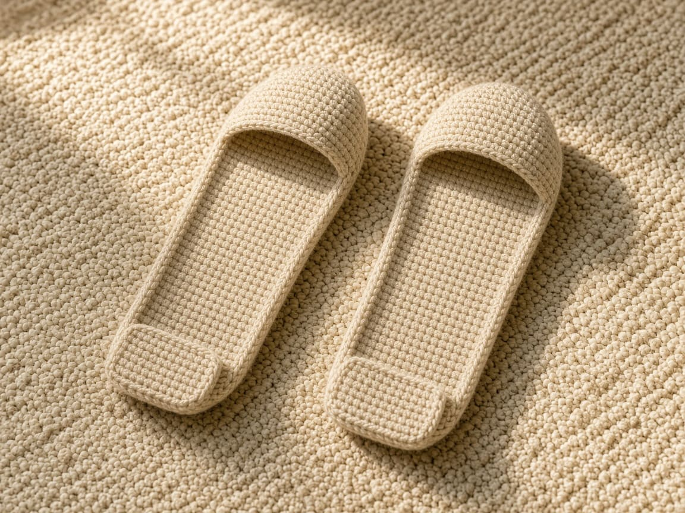
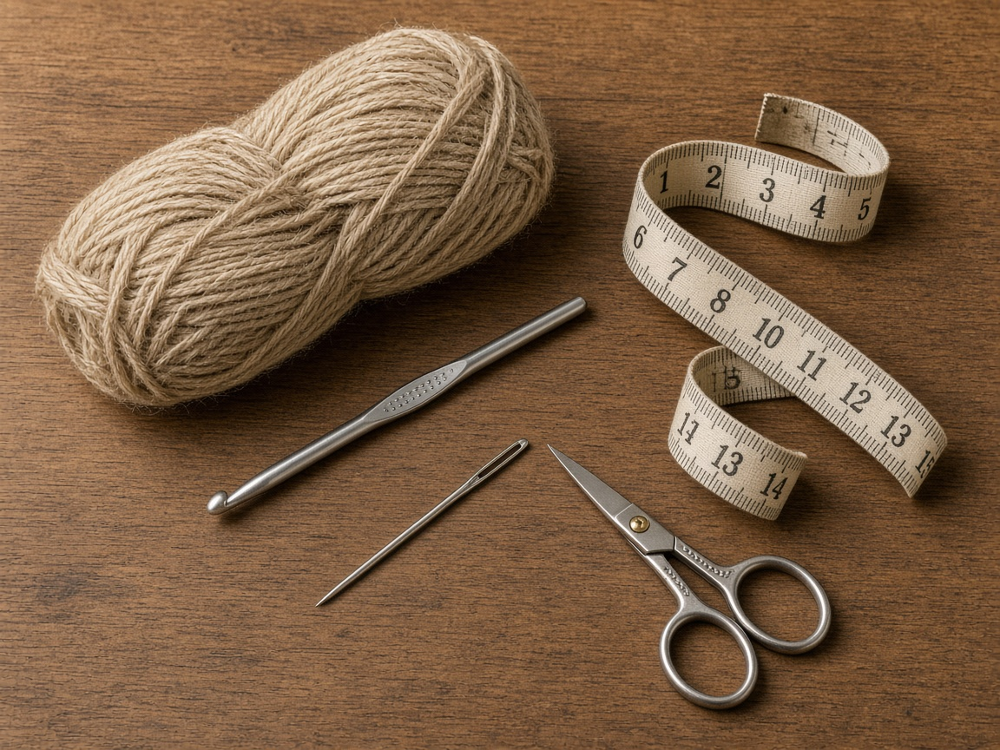
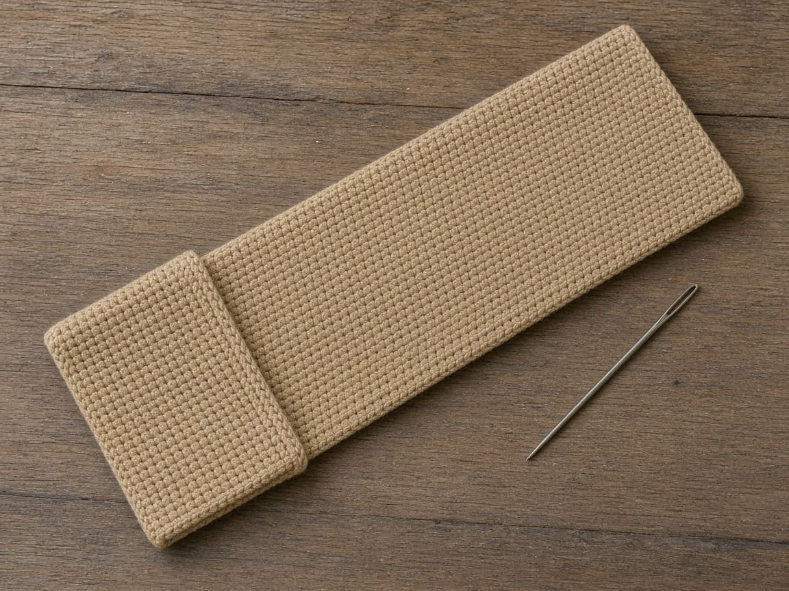
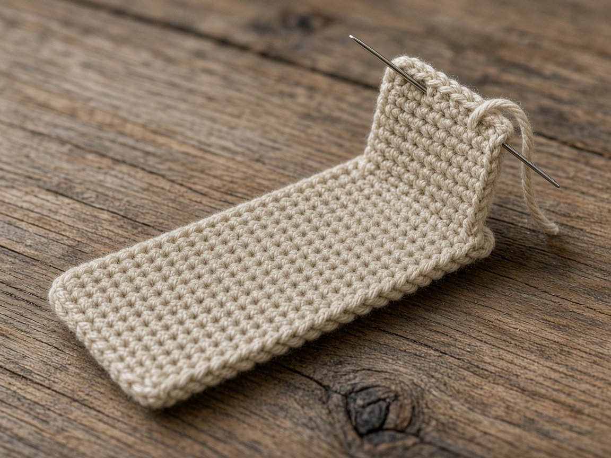

Socks slide on a wood floor, and a bought slipper is often a size you do not have. A crochet slipper can follow the foot you measured. It will still slide on tile, wood, and any hard floor. These are indoor slippers for a rug or carpet. They are not shoes, and they are not safe on stairs.

The shape is a clog: a flat sole, a cap over the toes, and a low wall around the heel. Each part is a rectangle. The part most simple slipper patterns get wrong is the cap. A foot has height. If the cap is the same width as the sole and is sewn down flat on top of it, there is no room for toes inside. The cap has to be as wide as the distance from one edge of the sole, **over** the foot, to the other edge. This page shows how to measure that.

US terms. US single crochet is UK double crochet. [Abbreviations](/crochet-abbreviations-chart/). The pictures are illustrations. No pair for this page was crocheted or worn. The example measurements are invented to show the arithmetic.

Crochet soles are slippery on hard floors. Tile, wood, laminate, and a wet bathroom floor are all a fall risk, and stairs are worse. Wear these on carpet or a rug. A sock underneath does not add grip. This page does not include a non-slip sole.

## How it is built

<figure class="diagram">

<figcaption>The cap's width is the over-the-top measurement, not the sole width. Its extra stitches gather at the toe.</figcaption>
</figure>

## Measure the foot

Stand on paper and measure three things:

1. **Length**, heel to longest toe.
2. **Width**, across the widest part.
3. **Over the top.** About 3 inches back from the tip of the longest toe, run a tape from the floor on one side of the foot, over the top, to the floor on the other side. That is the width the cap needs.

The example foot is 9 inches long, 3.5 inches wide, and 6 inches over the top.

## Yarn and hook

- **Worsted yarn.** Wool or a wool blend is warmer. Cotton washes more easily and feels cooler. Both slide on hard floors. [Yarn weights](/yarn-weight-chart/).
- **US G/6 (4.0 mm) hook**, or the size that makes dense fabric. A larger hook makes a floppy sole. [Hook chart](/crochet-hook-size-conversion-chart/).
- Yarn needle, scissors, a scrap of yarn to mark the toe.

Single crochet is used throughout because it is the densest of the [basic stitches](/basic-crochet-stitches/). Swatch 14 sc for 20 rows. In the example it would be 3.5 inches wide and 4 inches tall. [Gauge](/crochet-gauge/).

## The worked example

| Part | Arithmetic | Result |
| --- | --- | --- |
| Sole width | 3.5 in × 4 | 14 sts |
| Sole length | 9 in + about 0.6 in, × 5 | 48 rows (9.6 in) |
| Cap width | 6 in over the top × 4 | 24 sts |
| Cap depth | about 3.2 in × 5 | 16 rows |
| Heel wall | 3.5 in across + 1.6 in up each side | about 6.5 in, 26 sts |
| Heel height | 1.6 in × 5 | 8 rows |
| Opening each side | 48 − 16 − 8 | 24 rows, about 4.8 in |

The sole is a little longer than the foot so the toes do not press against the end.

## Stage 1: the soles (make 2)

Ch 1 does not count as a stitch.

<figure class="diagram">

<figcaption>The three pieces of one slipper, drawn to the same scale from the example counts.</figcaption>
</figure>

Chain 15.

**Row 1:** Sc in the 2nd chain from the hook and across. Ch 1, turn. (14)

**Rows 2–48:** Sc in each stitch. Ch 1, turn. (14)

<figure class="diagram">

<figcaption>All three pieces are plain sc rows. Start each row in the edge stitch so the widths stay at 14, 24, and 26.</figcaption>
</figure>

**Checkpoint:** Stand on it. The longest toe should sit just inside the far end. Add rows if not. If the width is tight, restart with more stitches.

Mark one short end with yarn as the toe. Both ends look alike. Make the second sole and count its rows. The two must match.

## Stage 2: the toe caps (make 2)

Chain 25.

**Row 1:** Sc in the 2nd chain from the hook and across. Ch 1, turn. (24)

**Rows 2–16:** Sc in each stitch. Ch 1, turn. (24)

**Sewing:**

1. Sew the side edges of the cap to the first 16 rows of each side of the sole, row end to row end, starting at the toe. Both use 5 rows per inch, so they match.
2. Run a length of yarn through the cap's chain edge. Gather it until it fits the 14 stitches of the toe end, then sew it down. The gathers make room for the toes.
3. The last row of the cap stays open. That is the instep edge.

**Checkpoint:** Put the foot in. The toes should fit under the cap without pressing it tight. If they do not, the cap needs more stitches. If the cap gapes loosely, it has too many.

## Stage 3: the heel walls (make 2)

Chain 27.

**Row 1:** Sc in the 2nd chain from the hook and across. Ch 1, turn. (26)

**Rows 2–8:** Sc in each stitch. Ch 1, turn. (26)

**Sewing:** Find the middle of the chain edge. Pin it to the middle of the heel end. Sew 14 stitches across the heel end, then 6 stitches up each side over the last 8 rows of the sole. The wall stands up around the heel. The top edge stays open.

## Stage 4: finishing

Weave the ends in on the inside. [Weaving in ends](/weaving-in-ends-and-blocking/). Sew without pulling hard, because a puckered seam cups the sole and makes it rock when you stand.

Left and right slippers are identical, so the second is made to the same counts.

## Baste one slipper before making the second

The toe cap's twenty-four-stitch foundation is gathered to the sole's fourteen-stitch toe edge, while its sixteen row-end positions match the first sixteen sole rows on each side. Baste both side seams first, then ease the foundation edge evenly rather than putting all gathers at one corner. On the heel wall, allocate fourteen chain positions to the heel end and six to each side; distribute those six over the final eight sole row ends. Leave both wall short ends unsewn unless a separate design calls for joining them to the toe cap. Try the foot in on carpet before repeating the counts for the second slipper.

## Troubleshooting

**Toes will not fit under the cap.** The cap is too narrow. Measure over the top again and add stitches.

**The foot will not go in.** The cap is sewn too far down the sides. Sew fewer rows.

**The heel walks out.** The heel wall is too low or too loose. Add rows, or ease it in.

**The sole rocks.** A seam was pulled tight and cupped the sole.

**The pair do not match.** Different row counts. Count, do not compare by eye.

**It slides.** It is a crochet sole. Keep it on a rug.

## Care

Hand wash cool. Dry flat. A damp sole is slicker. Do not wear them wet.

## Frequently asked

**Will this fit every foot?**

Only if you measure. The example counts suit only the example foot.

**Can I add a non-slip sole?**

People do, using products sold for that purpose. This page has not tested any, and grip depends on the product and your floor. Follow the product's instructions and test it carefully on a rug first.

**Can I sell them?**

Finished slippers, yes. Do not republish the pattern. Tell the buyer they slide on hard floors.

**Are they warm enough?**

Wool is warmer than cotton. Neither replaces a shoe outdoors.

## Next

A winter project that stays off the floor is the [chunky beanie](/how-to-crochet-a-chunky-beanie/). The same measure-then-calculate approach to a hand is the [fingerless gloves](/how-to-crochet-fingerless-gloves/).
