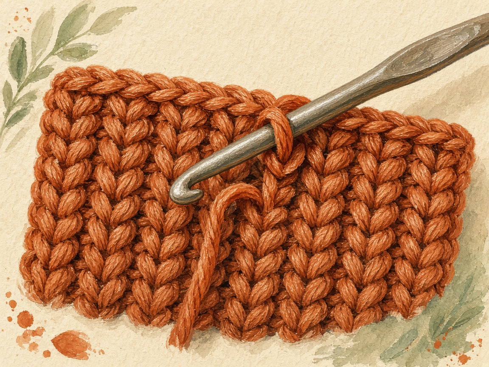
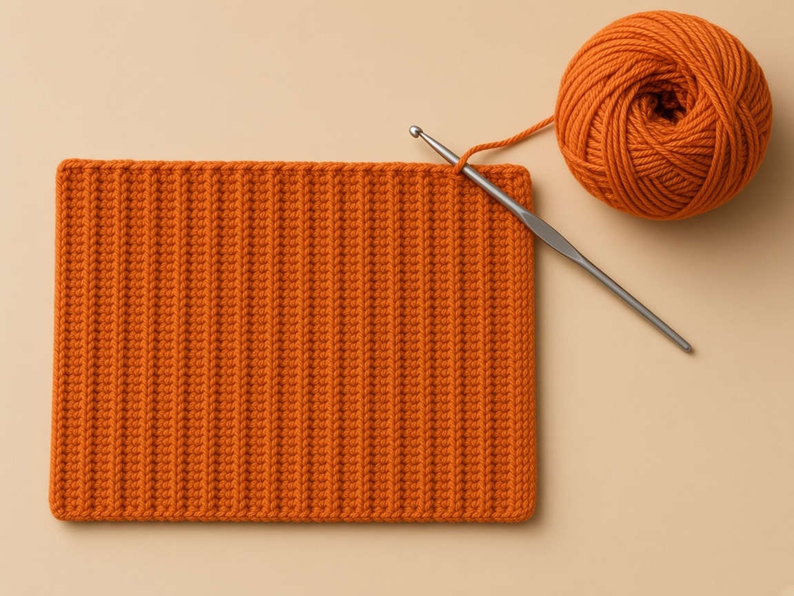
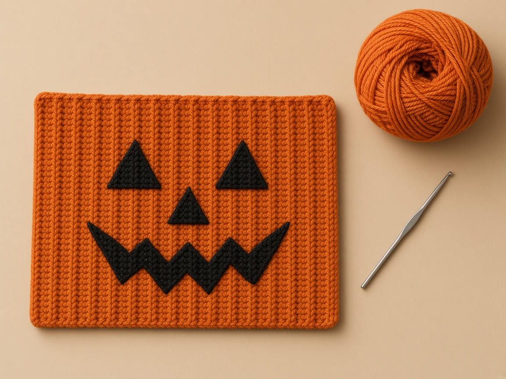
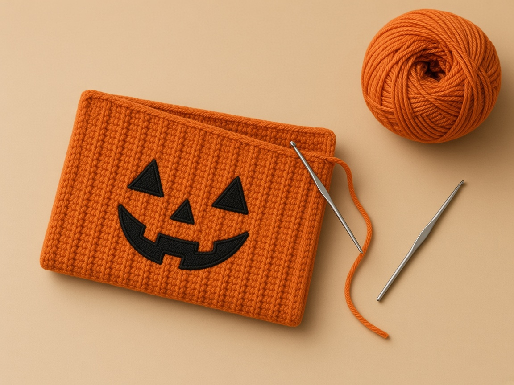
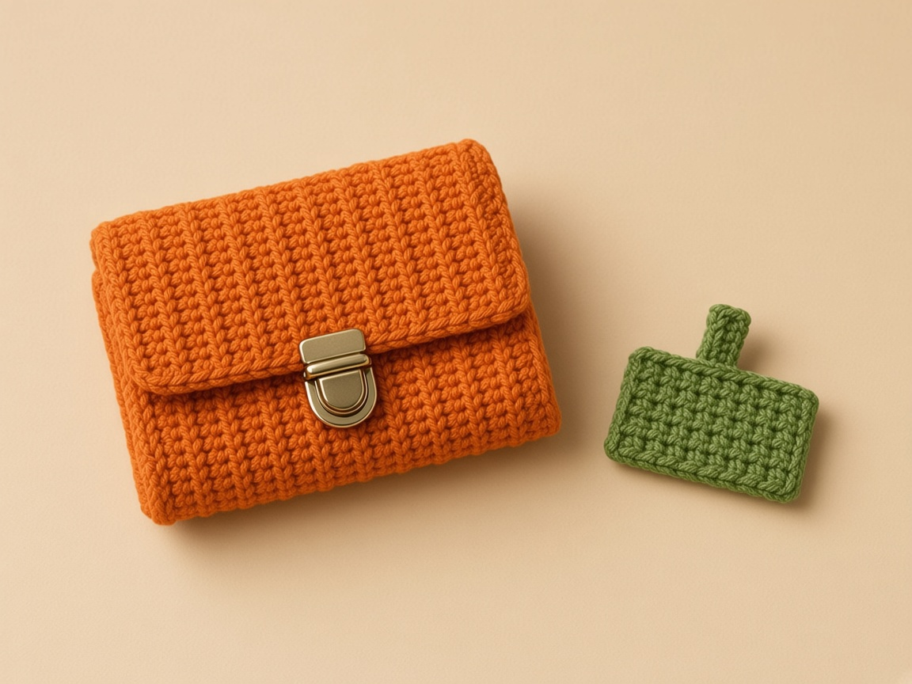
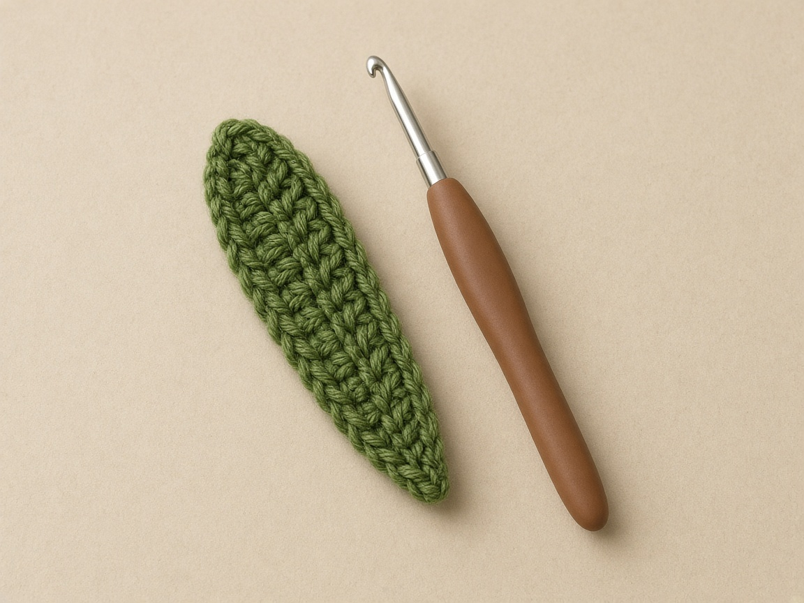
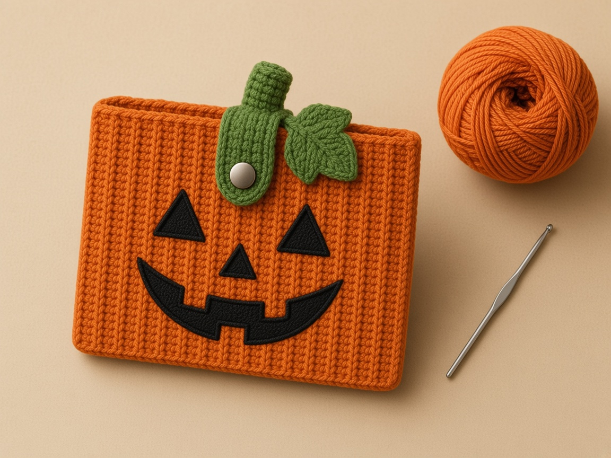

Most crochet pumpkins are round, which is a poor shape for cards. This one is a flat pouch that still reads as a jack-o'-lantern, because the ribs run up and down the way a real pumpkin's do. You get those ribs for free by working sideways in the back loop only. No color changes, no counting ribs, and one fold makes the pocket.

It is one of five patterns in the [Halloween crochet wallet collection](/halloween-crochet-wallets/), and the most forgiving one for a first project.

The finished size and card fit here are worked out from the example gauge rather than measured from a finished wallet, so swatch in back loops (those rows run shorter) and slip a real bank card in before you fold. A standard US bank card is 3.370 by 2.125 inches, the ISO/IEC 7810 ID-1 size.

## Materials

- **Worsted weight (CYC 4) yarn** in orange. Cotton shows the ribs most crisply. [Yarn weight chart](/yarn-weight-chart/).
- **Scraps** of black for the face and green for the stem and tab.
- **US G/6 (4.0 mm) hook**, or the size that gives the gauge. [Hook size chart](/crochet-hook-size-conversion-chart/).
- **One sew-on snap**, 3/8 in (10 mm), and thread.
- Tapestry needle, scissors, a stitch marker, one card.

**How much yarn.** Not weighed from a made wallet. The pouch is about 24 square inches, roughly 1.5 times a 4 inch swatch. Weigh your back-loop swatch, multiply by 1.5, and add 20 percent.

## Abbreviations and stitches

US terms. See the [abbreviations chart](/crochet-abbreviations-chart/).

| Abbreviation | Meaning |
| --- | --- |
| ch | chain |
| sc | single crochet |
| BLO | back loop only: insert the hook under the loop farther from you |
| sc3tog | single crochet three together: pull up a loop in each of 3 stitches, yarn over, pull through all 4 loops |
| st(s) | stitch(es) |

**Turning chain rule.** Every row: ch 1, turn. The ch 1 does not count as a stitch.

## Size and gauge

**Gauge:** 16 sc and 20 rows = 4 in in single crochet, as an example. Work your swatch in BLO, because back-loop row gauge can differ from plain single crochet. The [gauge guide](/crochet-gauge/) shows how to measure.

The piece is worked sideways. The 20 stitches in each row set the height before folding: 5 inches, which folds to 2.5. The number of rows sets the width. You work rows until the piece measures 4.25 inches, which is about 22 rows at the example gauge, whatever your back-loop row gauge turns out to be. After seaming, the inside is about 3.9 inches wide and 2.4 deep against a 3.37 by 2.125 inch card.

## The pattern

### Step 1: the first row, both loops

<figure class="diagram">

<figcaption>Diagram. Rows run up and down. The fold runs across the middle of every row.</figcaption>
</figure>

<figure class="diagram">

<figcaption>Diagram. One raised rib for every two rows, on one face of the fabric.</figcaption>
</figure>

Use orange.

1. Slip knot on the hook. Chain 21. Do not count the loop on the hook.
2. Skip the chain nearest the hook. Single crochet in the second chain from the hook.
3. Single crochet in every chain after that, one stitch per chain.
4. Count. You need 20. If you have 19, a chain was skipped. If you have 21, you used the chain next to the hook.

### Step 2: every row after row 1, back loop only

<figure class="diagram">

<figcaption>Diagram. The near loop stays free. That free loop is the rib.</figcaption>
</figure>

Look at the top of a stitch. The V has two strands. The strand closer to you is the front loop. Leave it sitting there. The strand farther from you is the back loop. The hook goes under that one only.

Do this list for row 2, then again for row 3, and keep going:

1. Chain 1. It does not count.
2. Turn the work.
3. Insert the hook under the back loop only of the first stitch. Finish a normal single crochet: yarn over, pull up a loop, yarn over, pull through both loops.
4. Do that in every stitch across, including the last one.
5. Count 20 before you turn again.

Stop when the piece measures 4.25 inches from the chain edge to the top of the row you just finished, and that row number is even. At the example gauge that is about 22 rows. Your row gauge may need a different even number to hit 4.25 inches. Measure. Do not stop at 22 if the tape says something else.

Fasten off.

The side with the raised ribs is the right side. Put a marker on it. Pick one long edge to be the front rim. From here on, stitch 1 is that front rim, stitch 10 sits next to the fold, and stitch 20 is the back rim. Write those three numbers on a scrap of paper and keep it next to the work, because turned rows reverse which physical edge is on your right.

Count 20 at the end of every few rows. Back-loop rows are easy to miscount at the turn, because the first stitch's back loop hides under the turning chain.

### Step 3: one stitch per row end on each rim

<figure class="diagram">

<figcaption>Diagram. One single crochet in each row-end bump.</figcaption>
</figure>

1. Lay the piece right side up.
2. Turn it so the long edge at stitch 20, the back rim, is at the top of the table.
3. Count the row ends along that edge. One bump per finished row. Write the number down. If you worked 22 rows, you need 22.
4. Join orange at the right-hand corner of that edge. Chain 1.
5. Make 1 single crochet in the first row end. Move to the next bump and make 1 single crochet. Do not put two stitches in one bump.
6. Continue to the last row end. The stitch count must match the row count you wrote down.
7. Fasten off.
8. Join orange at the other long edge, the front rim, and do the same thing: 1 single crochet in each row end, then fasten off.

If a rim ripples, two stitches went into one row end. If it puckers, a row end was skipped. Pull that rim out and match the count.

### Step 4: place the face on the front half only

<figure class="diagram">

<figcaption>Diagram. Row k mirrors row 23 minus k. Stitch 1 is at the front rim.</figcaption>
</figure>

Stay on the right side. Only stitches 1 through 10 get embroidery. Stitch 1 is the front rim. Stitch 10 is the last stitch before the fold. If your row count is not 22, find the middle row with a tape and shift the nose to that middle. Do not copy rows 11 and 12 onto a piece that is 18 or 26 rows tall.

The leaf tab will cover rows 10 to 13 on stitches 1 to 5. Leave that rectangle empty. Do not push the needle past stitch 10, or you will sew the fold shut.

**Left eye**, if row 1 is on your left. Thread black. On rows 5, 6, and 7, over stitches 3, 4, and 5, outline a triangle in backstitch: come up a short step ahead, go down at the end of the last stitch, and repeat until the triangle is a solid line. Then fill the inside with straight stitches sitting next to each other. Point the triangle toward the rim or toward the mouth.

**Right eye.** The same triangle on rows 16, 17, and 18, still over stitches 3, 4, and 5.

**Nose.** A smaller triangle on rows 11 and 12, over stitches 6 and 7 only.

**Mouth.** Backstitch from row 6 to row 17. Start on stitch 8. Every two rows, step over to stitch 9, then back to stitch 8. Follow a rib so the points line up. Stop at row 17.

### Step 5: fold, then seam one short edge at a time

<figure class="diagram">

<figcaption>Diagram. Fold right side out so the ribs and face stay outside.</figcaption>
</figure>

1. Fold the fabric between stitch 10 and stitch 11, right side out. The ribs and the face stay on the outside. The two rims meet at the top and stay open.
2. Pair the stitches on the chain edge: stitch 10 against stitch 11, stitch 9 against stitch 12, stitch 8 against stitch 13, and keep going until stitch 1 meets stitch 20.
3. Thread orange on a needle. Whipstitch that edge through both layers, one pair at a time. Catch the rim stitch at the top. Do not pull the thread tight. A tight seam makes a card bind.
4. Do the same pairs on the last-row edge, the other short side.
5. Slide a card in. It should lie flat. If it sticks at a seam, loosen those whipstitches.

### Step 6: the stem, flat first, then rolled

<figure class="diagram">

<figcaption>Diagram. Roll the six-stitch width. Sew the stem on the back rim. The tab closes the opening.</figcaption>
</figure>

Use green.

1. Chain 7. Single crochet in the second chain from the hook and in each chain across. Count 6.
2. Row 2: chain 1, turn, single crochet in each of the 6 stitches.
3. Row 3: the same. Count 6 again.
4. Fasten off and leave a tail about 10 inches long.
5. The piece is a small rectangle. The long sides are the 6-stitch edges. The short sides are the 3-row edges.
6. Roll the 6-stitch width so the two 3-row edges meet. Sew those two short edges together with the tail. The 3-row direction is the height of the little cylinder, about 0.6 inch at the example row gauge. Do not roll from a short end. That makes a long thin tube instead of a stem.

### Step 7: the leaf tab

<figure class="diagram">

<figcaption>Diagram. Six even rows of 3, then one decrease row.</figcaption>
</figure>

1. With green, chain 4. Single crochet in the second chain from the hook and in each chain across. Count 3.
2. Rows 2, 3, 4, 5, and 6: chain 1, turn, single crochet in each of the 3 stitches. Count 3 at the end of each row.
3. Row 7: chain 1, turn, single crochet three together across all 3 stitches. One stitch remains. To do it: pull up a loop in the first stitch, a loop in the second, a loop in the third, yarn over, pull through all four loops.
4. Fasten off with a tail about 10 inches long.

At the example gauge the tab is about 0.75 inch wide and 1.4 inches long.

### Step 8: sew the tab, the snap, then the stem

<figure class="diagram">

<figcaption>Diagram. The stem anchors the tab. The snap closes the pouch.</figcaption>
</figure>

1. Find the center of the back rim: the middle 3 rim stitches.
2. Sew the tab's chain edge to the inside of that rim, over those 3 stitches.
3. Put a card in the pouch. Fold the tab over both rims and down the front.
4. Mark where the tip lands. At the example gauge that is stitches 3 to 4 of the front, between rows 11 and 12. Use your mark, not the example, if the rims came out taller.
5. Sew the ball half of the snap to the underside of the tab at row 6. Doubled thread, 4 or 5 passes through each hole, through the tab only.
6. Sew the socket to the front at the mark you made, through the front layer only. Do not sew through to the back of the pouch.
7. Stand the stem upright on the back rim, on top of the tab's base. Sew through the rim and catch the tab's base too.
8. Fold the tab. It has to swing over the opening by itself. The stem is only an anchor. It is not the closure.

Weave the ends inside the pocket along the seams. See [weaving in ends](/weaving-in-ends-and-blocking/).

Weave in ends inside the pocket along the seams. See [weaving in ends](/weaving-in-ends-and-blocking/).

## Make it yours

- **Two oranges.** Change color every 2 rows on the last yarn over, as in [changing yarn color](/changing-yarn-color-crochet/). Carry the unused color up the edge, under the rim.
- **No ribs.** Work both loops. Row gauge changes, so still work to 4.25 inches.
- **A friendly face.** Round eyes and a curved smile instead of triangles.
- **A white or green pumpkin.** Same counts, different yarn.
- **Lining.** Cut fabric 4.25 by 5 inches plus a 1/4 inch fold all around, sew it to the wrong side before folding, and fold the two together.

## Label the two rims before embroidery

Lay the twenty-stitch rows horizontally and the row-count direction vertically. Choose one row-end edge as the front rim; label the stitch positions from that edge as 1–20 on every row, regardless of the direction in which that row was worked. The fold is between positions 10 and 11, and both row-end edges become the opening. Pair positions 10/11, 9/12, continuing to 1/20 when seaming the foundation and last-row edges. Work each rim into exactly one row end per completed row and use that actual rim count to center the tab. If it is not twenty-two rows, recenter the face from the measured midpoint rather than copying rows 11 and 12.

## Common mistakes and fixes

**The ribs show on both sides.** That is normal in turned BLO rows. If the texture changes partway through, check that every row after row 1 was worked into the back loop only.

**The piece slants.** The first or last stitch of rows got skipped. Count 20.

**The rims ripple.** More than one sc went into some row ends. One per row end.

**The face is on the wrong half.** Stitches were counted from the wrong edge. Stitch 1 is at the front rim.

**The tab will not reach.** The tab tip should land 3 to 4 stitches below the front rim. Add a row to the tab before row 7 if your rims came out tall.

**Cards fall out.** Normal if the tab is open. The pouch is a card sleeve, not a coin purse.

## Care

Hand wash cool, dry flat, and shape the ribs with your fingers while damp. Test the black and green for color running on a white paper towel before the first wash.

## Frequently asked

**Will a bank card fit?** On paper, yes: about 3.9 by 2.4 inches inside against a 3.37 by 2.125 inch card, so test with a real card before you fold.

**Why sideways?** Sideways back-loop rows make ribs that run up and down, like a pumpkin. Worked bottom to top, the ribs would run sideways.

**Can a beginner make this?** Yes. It is single crochet, a fold, and two short seams. The embroidery is the slowest part.

**Do I need the snap?** Not strictly. Without it, the tab lies over the opening and cards stay in if the pouch stays upright.

**Can I sell the finished pouches?** Yes. Link here rather than reposting the pattern.

## More Halloween wallets

- [Black cat crochet wallet](/black-cat-crochet-wallet/): a seamless tube with ears
- [Ghost crochet wallet](/ghost-crochet-wallet/): shaped panels and a scalloped hem
- [Witch hat crochet wallet](/witch-hat-crochet-wallet/): two pockets and a buttonhole
- [Spiderweb crochet wallet](/spiderweb-crochet-wallet/): an embroidered web on a pointed flap

For round pumpkins, see [how to crochet a pumpkin](/how-to-crochet-a-pumpkin-step-by-step/). For a zipped pumpkin pouch, see the [pumpkin zipper pouch](/how-to-crochet-a-pumpkin-zipper-pouch/).

The pumpkin depends on two habits: back loops on every row, and one single crochet per row end on the rims. Work to 4.25 inches, embroider the face before you fold, and let the stem anchor the tab.
