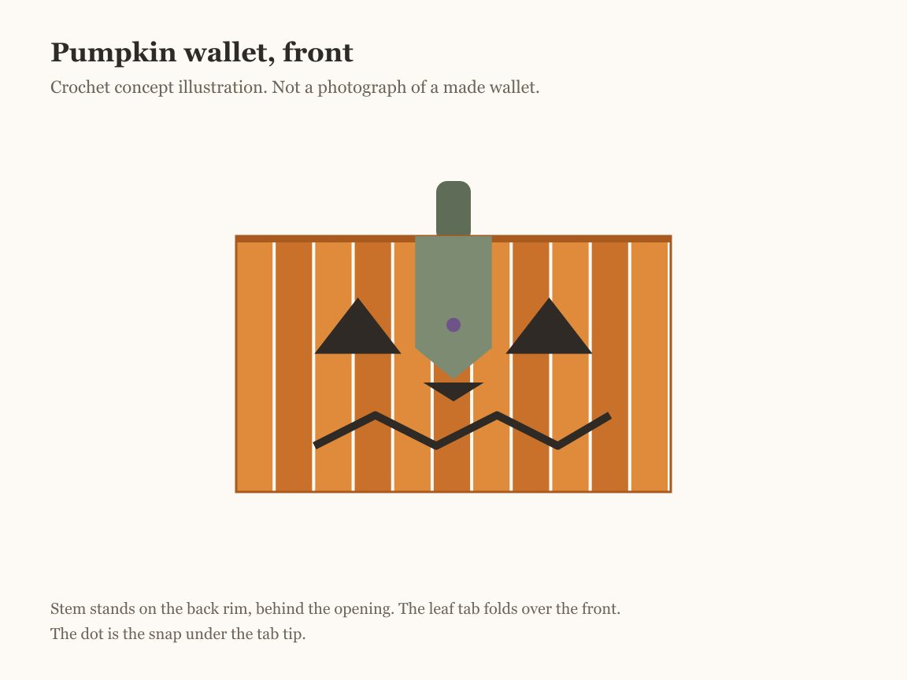

Most crochet pumpkins are round, which is a poor shape for cards. This one is a flat pouch that still reads as a jack-o'-lantern, because the ribs run up and down the way a real pumpkin's do. You get those ribs for free by working sideways in the back loop only. No color changes, no counting ribs, and one fold makes the pocket.

It is one of five patterns in the [Halloween crochet wallet collection](/halloween-crochet-wallets/), and the most forgiving one for a first project.

## What is checked, and what is not

| Part of this page | What it is |
| --- | --- |
| ID-1 card, 3.370 x 2.125 in | The ISO/IEC 7810 size of most US bank cards and licenses |
| Every stitch count and row count | Checked by hand on paper |
| 16 sc and 20 rows to 4 in | An example gauge, not measured from a finished wallet. Back-loop rows run shorter, so you swatch in back loops. |
| Finished size and card fit | Geometry from that gauge. Not physically test-crocheted. |
| The picture above | A computer illustration, not a made sample |

## Materials

- **Worsted weight (CYC 4) yarn** in orange. Cotton shows the ribs most crisply. [Yarn weight chart](/yarn-weight-chart/).
- **Scraps** of black for the face and green for the stem and tab.
- **US G/6 (4.0 mm) hook**, or the size that gives the gauge. [Hook size chart](/crochet-hook-size-conversion-chart/).
- **One sew-on snap**, 3/8 in (10 mm), and thread.
- Tapestry needle, scissors, a stitch marker, one card.

**How much yarn.** Not weighed from a made wallet. The pouch is about 24 square inches, roughly 1.5 times a 4 inch swatch. Weigh your back-loop swatch, multiply by 1.5, and add 20 percent.

## Abbreviations and stitches

US terms. See the [abbreviations chart](/crochet-abbreviations-chart/).

| Abbreviation | Meaning |
| --- | --- |
| ch | chain |
| sc | single crochet |
| BLO | back loop only: insert the hook under the loop farther from you |
| sc3tog | single crochet three together: pull up a loop in each of 3 stitches, yarn over, pull through all 4 loops |
| st(s) | stitch(es) |

**Turning chain rule.** Every row: ch 1, turn. The ch 1 does not count as a stitch.

## Size and gauge

**Gauge:** 16 sc and 20 rows = 4 in in single crochet, as an example. Work your swatch in BLO, because back-loop fabric is shorter per row than plain single crochet. The [gauge guide](/crochet-gauge/) shows how to measure.

The piece is worked sideways. The 20 stitches in each row set the height before folding: 5 inches, which folds to 2.5. The number of rows sets the width. You work rows until the piece measures 4.25 inches, which is about 22 rows at the example gauge, whatever your back-loop row gauge turns out to be. After seaming, the inside is about 3.9 inches wide and 2.4 deep against a 3.37 by 2.125 inch card.

## The pattern

### Stage 1: the ribbed piece

<figure class="diagram">

<figcaption>Diagram. Rows run up and down. The fold runs across the middle of every row.</figcaption>
</figure>

<figure class="diagram">

<figcaption>Diagram. One raised rib for every two rows, on one face of the fabric.</figcaption>
</figure>

With orange:

**Row 1:** Ch 21. Sc in the 2nd ch from the hook and in each ch across. (20)

**Row 2 and every row after:** Ch 1, turn. Sc BLO in each st across. (20)

Work until the piece measures 4.25 inches from the chain edge to the top of the current row, ending on an even-numbered row. At the example gauge that is about 22 rows. Fasten off.

The side with the raised ribs is the right side. Mark it. Then pick one long edge to be the front rim. From here on, stitches are counted from that edge: stitch 1 at the front rim, stitch 10 next to the fold, stitch 20 at the back rim.

Count 20 at the end of every few rows. Back-loop rows are easy to miscount at the turn, because the first stitch's back loop hides under the turning chain.

### Stage 2: the rims

With the right side facing, turn the piece so the back rim edge, the long edge of row ends at stitch 20, is at the top.

**Back rim:** Join orange at the right-hand corner. Ch 1. Work 22 sc along the edge, one in each row end. (22, or one per row if you worked a different number) Fasten off.

Join orange at the other long edge.

**Front rim:** Ch 1. Work 22 sc along the edge, one in each row end. Fasten off.

These two edges become the opening. One sc per row end keeps them from flaring. If the rim ripples, you added stitches; if it puckers, you skipped row ends.

### Stage 3: the face, before folding

<figure class="diagram">

<figcaption>Diagram. Row k mirrors row 23 minus k. Stitch 1 is at the front rim.</figcaption>
</figure>

On the right side of the front half, stitches 1 to 10:

1. **Eyes.** With black, a triangle on rows 5 to 7 over stitches 3 to 5, point toward the rim or toward the mouth, your choice. Outline in backstitch, then fill with close straight stitches. Repeat on rows 16 to 18.
2. **Nose.** A small triangle on rows 11 and 12 over stitches 6 and 7.
3. **Mouth.** A zigzag in backstitch from row 6 to row 17, moving between stitch 8 and stitch 9 every two rows. Following the ribs makes the points even.

Keep rows 10 to 13 on stitches 1 to 5 clear; the leaf tab covers that spot. Never pass the needle past stitch 10, or you will stitch the fold shut.

### Stage 4: fold and seam

<figure class="diagram">

<figcaption>Diagram. Fold right side out so the ribs and face stay outside.</figcaption>
</figure>

1. Fold between stitch 10 and stitch 11, right side out, so the two rims meet at the top.
2. Seam the foundation-chain edge: whipstitch with orange through both layers, stitch 10 to stitch 11, stitch 9 to stitch 12, and so on up to the rims. Catch the rim stitch at the top.
3. Seam the last-row edge the same way.
4. Slide a card in. It should go in flat. If it binds at the seams, the whipstitch was pulled tight; loosen it.

### Stage 5: stem, leaf tab, and snap

<figure class="diagram">

<figcaption>Diagram. The tab is the closure. The stem only decorates.</figcaption>
</figure>

**Stem**, green: Ch 7. Sc in the 2nd ch from the hook and across. (6) Rows 2–3: ch 1, turn, sc in each st. (6) Fasten off with a 10 inch tail. Roll from one short end into a cylinder about 0.6 inch tall and sew the edge down.

**Leaf tab**, green: Ch 4. Sc in the 2nd ch from the hook and across. (3) Rows 2–6: ch 1, turn, sc in each st. (3) Row 7: ch 1, turn, sc3tog. (1) Fasten off with a 10 inch tail. The tab is about 0.75 inch wide and 1.4 inches long.

**Assembly:**

1. Sew the tab's foundation edge to the inside of the back rim at the center, over the middle 3 rim stitches.
2. Fold the tab over both rims and down the front. Mark where the tip lands, usually stitches 3 to 4 of the front, between rows 11 and 12. Mark it with a card inside.
3. Sew the ball half of the snap under the tab at row 6, and the socket on the front at the mark. Doubled thread, four or five passes per hole, through the front layer only.
4. Sew the stem standing upright on the back rim, right over the tab's base, catching the tab too. That double layer is what takes the pull every time the tab opens.

Weave in ends inside the pocket along the seams. See [weaving in ends](/weaving-in-ends-and-blocking/).

## Make it yours

- **Two oranges.** Change color every 2 rows on the last yarn over, as in [changing yarn color](/changing-yarn-color-crochet/). Carry the unused color up the edge, under the rim.
- **No ribs.** Work both loops. Row gauge changes, so still work to 4.25 inches.
- **A friendly face.** Round eyes and a curved smile instead of triangles.
- **A white or green pumpkin.** Same counts, different yarn.
- **Lining.** Cut fabric 4.25 by 5 inches plus a 1/4 inch fold all around, sew it to the wrong side before folding, and fold the two together.

## Common mistakes and fixes

**The ribs show on both sides.** Some rows were worked in both loops. Back loop on every row, including row 2.

**The piece slants.** The first or last stitch of rows got skipped. Count 20.

**The rims ripple.** More than one sc went into some row ends. One per row end.

**The face is on the wrong half.** Stitches were counted from the wrong edge. Stitch 1 is at the front rim.

**The tab will not reach.** The tab tip should land 3 to 4 stitches below the front rim. Add a row to the tab before row 7 if your rims came out tall.

**Cards fall out.** Normal if the tab is open. The pouch is a card sleeve, not a coin purse.

## Care

Hand wash cool, dry flat, and shape the ribs with your fingers while damp. Test the black and green for color running on a white paper towel before the first wash.

## Frequently asked

**Will a bank card fit?** On paper, yes: about 3.9 by 2.4 inches inside against a 3.37 by 2.125 inch card. It has not been made and measured.

**Why sideways?** Sideways back-loop rows make ribs that run up and down, like a pumpkin. Worked bottom to top, the ribs would run sideways.

**Can a beginner make this?** Yes. It is single crochet, a fold, and two short seams. The embroidery is the slowest part.

**Do I need the snap?** Not strictly. Without it, the tab lies over the opening and cards stay in if the pouch stays upright.

**Can I sell the finished pouches?** Yes. Link here rather than reposting the pattern.

## More Halloween wallets

- [Black cat crochet wallet](/black-cat-crochet-wallet/): a seamless tube with ears
- [Ghost crochet wallet](/ghost-crochet-wallet/): shaped panels and a scalloped hem
- [Witch hat crochet wallet](/witch-hat-crochet-wallet/): two pockets and a buttonhole
- [Spiderweb crochet wallet](/spiderweb-crochet-wallet/): an embroidered web on a pointed flap

For round pumpkins, see [how to crochet a pumpkin](/how-to-crochet-a-pumpkin-step-by-step/). For a zipped pumpkin pouch, see the [pumpkin zipper pouch](/how-to-crochet-a-pumpkin-zipper-pouch/).

The pumpkin depends on two habits: back loops on every row, and one single crochet per row end on the rims. Work to 4.25 inches, embroider the face before you fold, and let the stem anchor the tab.
