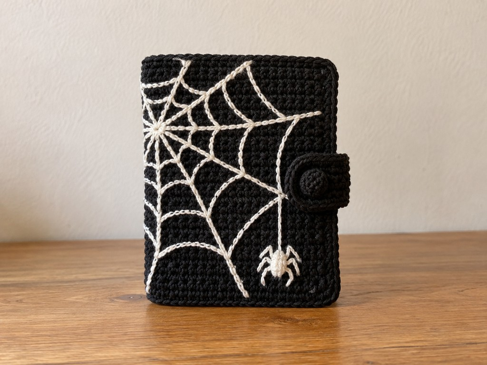
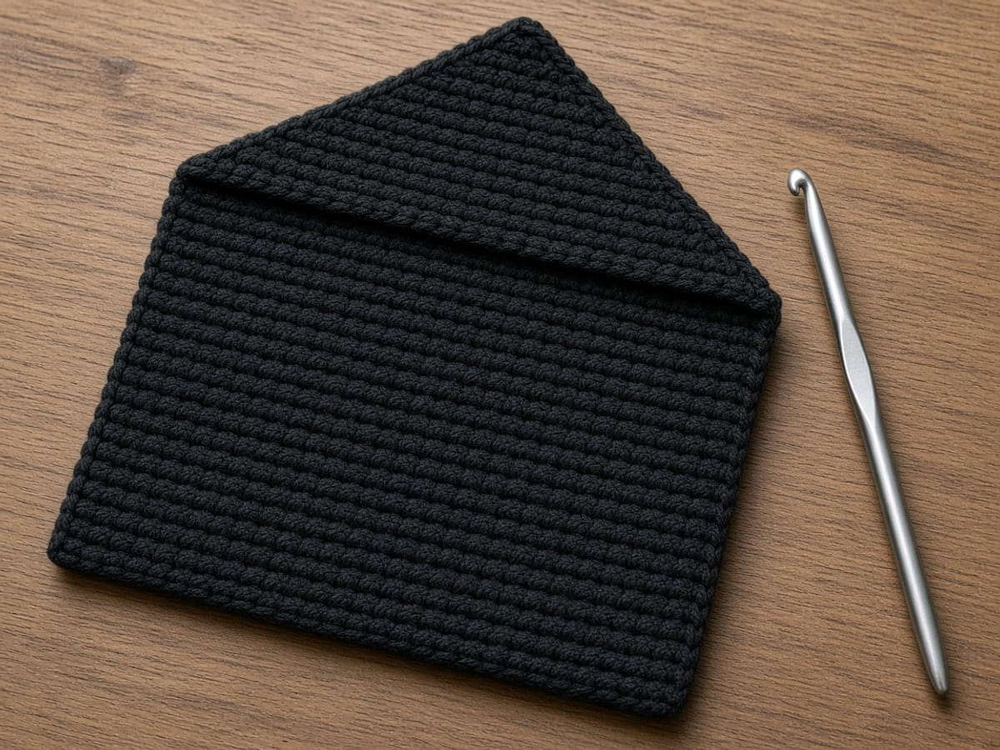
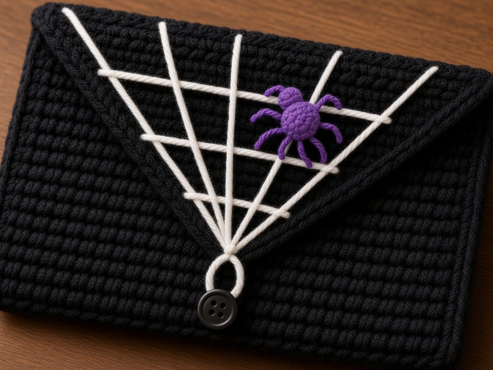

A spiderweb on a crochet wallet usually means a lot of fiddly white color changes. This one skips that. You crochet a plain black wallet with a pointed flap, then draw the web on top with backstitch, which you can pull out and redo until it looks right. A tiny crocheted spider sits on one strand.

It is one of five patterns in the [Halloween crochet wallet collection](/halloween-crochet-wallets/), and the one that teaches surface embroidery and a button loop.

The pocket size, flap drop, and loop length here are worked out from the example gauge rather than measured from a finished wallet, so swatch first and slip a real bank card in before you join. A standard US bank card is 3.370 by 2.125 inches, the ISO/IEC 7810 ID-1 size.

## Materials

- **Worsted weight (CYC 4) yarn** in black. Smooth cotton makes the white embroidery look crisp; fuzzy yarn blurs it. [Yarn weight chart](/yarn-weight-chart/).
- **White** worsted or a thinner white yarn, or six-strand embroidery floss, for the web.
- **Purple** scraps for the spider.
- **US G/6 (4.0 mm) hook** for the wallet, and a size smaller for the spider if you have one. [Hook size chart](/crochet-hook-size-conversion-chart/).
- **One button**, 5/8 in (15 mm), flat with holes.
- Tapestry needle, a sharp embroidery needle if using floss, chalk or a white pencil, stitch markers, one card.

**Yardage.** There is no weighed sample to quote. The wallet covers about 26 square inches, so weigh a 4 inch square swatch and allow 1.6 times that weight, then a fifth more for seams and the spider.

## Abbreviations and stitches

All terms are American; the [abbreviations chart](/crochet-abbreviations-chart/) lists the UK equivalents.

| Abbreviation | Meaning |
| --- | --- |
| ch | chain |
| sc | single crochet |
| sl st | slip stitch |
| sc2tog | decrease: draw up a loop in each of the next 2 stitches, then yarn over and pull through every loop on the hook |
| sc3tog | as sc2tog, over 3 stitches, removing 2 |
| inc | 2 sc in the same stitch |
| MR | magic ring; see [crochet in the round](/crochet-in-the-round/) |
| rnd | round |
| st(s) | stitch(es) |

**Turning.** Start each row with ch 1 and turn; that chain is never counted, and the first sc goes into the very first stitch.

**Backstitch.** Bring the needle up one stitch length ahead, go down at the end of the previous stitch, and repeat. It makes a solid line that can follow any direction.

## Size and gauge

**Gauge:** 16 sc and 20 rows to 4 inches. Measure the middle of a 5 inch swatch before starting; the [gauge guide](/crochet-gauge/) explains why the edges lie.

Seventeen stitches are 4.25 inches; after the side seams, the pocket is about 3.9 inches wide inside against a 3.37 inch card. The front and back are 13 rows, 2.6 inches, so the pocket is about 2.5 inches deep, enough for a 2.125 inch card with room to grip it. The flap is 8 rows, about 1.6 inches to the point, and the loop hangs about 0.4 inch past it.

## The pattern

### Stage 1: the rectangle and pointed flap

<figure class="diagram">

<figcaption>Diagram. The flap loses one stitch at each end of every row until it comes to a point.</figcaption>
</figure>

With black:

**Row 1:** Ch 18. Sc in the 2nd ch from the hook and in each ch across. (17)

**Rows 2–26:** Ch 1, turn. Sc in each st across. (17)

Mark the end of row 13 and row 26; those are the bottom and top folds.

**Row 27:** Ch 1, turn. Sc2tog, sc in the next 13 sts, sc2tog. (15)

**Row 28:** Ch 1, turn. Sc2tog, sc in the next 11 sts, sc2tog. (13)

**Row 29:** Ch 1, turn. Sc2tog, sc in the next 9 sts, sc2tog. (11)

**Row 30:** Ch 1, turn. Sc2tog, sc in the next 7 sts, sc2tog. (9)

**Row 31:** Ch 1, turn. Sc2tog, sc in the next 5 sts, sc2tog. (7)

**Row 32:** Ch 1, turn. Sc2tog, sc in the next 3 sts, sc2tog. (5)

**Row 33:** Ch 1, turn. Sc2tog, sc in the next st, sc2tog. (3)

**Row 34:** Ch 1, turn. Sc3tog. (1)

**Loop:** Ch 8, sl st in the same st. Hold the button against the loop. It should pass with a little resistance. Adjust between 7 and 10 chains. Fasten off and weave in.

The flap edges will be a little bumpy where each row decreases. A round of slip stitch along both slanted edges, worked loosely, smooths them. Do it before the embroidery.

### Stage 2: the web

<figure class="diagram">

<figcaption>Diagram. Spokes first, inner ring first, spider last.</figcaption>
</figure>

Fold the front up and the flap down, so you see the flap the way it will sit. Mark the spoke ends on row 27 with chalk or pins.

1. **Spokes.** With white, backstitch 5 straight lines, each starting at the point (row 34) and ending at row 27: one at stitch 2, then stitches 5, 8, 11, and 14. The middle spoke runs straight up stitch 8.
2. **Rings, inner first.** At row 33, take one stitch from each spoke to the next, so the ring has 4 segments. Pull each one only until it dips slightly toward the point. Then the ring at row 31, then row 29.
3. Secure the white on the back with running stitches under the existing strands, not with a knot. The back of the flap rubs the front of the wallet.

Work through the flap only. If a line comes out crooked, unpick it; backstitch comes out cleanly.

### Stage 3: the spider

<figure class="diagram">

<figcaption>Diagram. Two tiny balls and eight stitched legs.</figcaption>
</figure>

With purple, on the smaller hook if you have one:

**Abdomen. Rnd 1:** MR, 6 sc in the ring. (6)

**Rnd 2:** Inc in each st. (12)

**Rnd 3:** Sc in each st. (12)

**Rnd 4:** Sc2tog 6 times. (6) Stuff with purple yarn scraps. Fasten off, thread the tail through the 6 front loops, and pull closed. Keep the tail.

**Head. Rnd 1:** MR, 6 sc in the ring. (6)

**Rnd 2:** Sc in each st. (6) Fasten off and close the same way; it cups into a small bead.

**Assembly:** Sew the head to one end of the abdomen. Sew the pair to the flap on the fourth spoke from the left, the one ending at stitch 11, between the rings at rows 29 and 31. Then make 8 legs in purple, 4 per side, each two straight stitches: one out from the body, one shorter one bent toward the point. The spider is about 0.5 inch across before the legs.

### Stage 4: seam and button

<figure class="diagram">

<figcaption>Diagram. Close the flap with cards inside before marking the button.</figcaption>
</figure>

1. **Fold.** Fold rows 1 to 13 up against rows 14 to 26, right sides out. The chain edge is the front rim.
2. **Side seams.** Join black at the bottom fold. Ch 1. Work 13 sc up the side, one in each row end, through both layers. Fasten off. Repeat on the other side.
3. **Button.** Put two cards in and close the flap. Mark where the loop lands, near row 10 of the front, stitch 9, about 2 inches below the top. Sew the button through the front layer only.
4. **Ends.** Weave in along the seams. See [weaving in ends](/weaving-in-ends-and-blocking/).

## Make it yours

- **Purple wallet, black web.** Reverse the colors. Black backstitch on purple shows less, so use two strands.
- **More spokes.** Seven spokes at stitches 1, 3, 5, 8, 11, 13, 15 look closer to a real web but crowd near the point. Stop the outer ones at row 31.
- **No spider.** Embroider a small one instead: a French knot body and eight straight-stitch legs.
- **Snap closure.** Skip the loop. Sew a 3/8 inch snap under the flap point and on the front.
- **Lining.** Line the back only, so the pocket keeps its width. Cut fabric 4.25 by 2.6 inches plus a 1/4 inch fold.

## Common mistakes and fixes

**The flap is off center.** One decrease row missed a decrease at one end. Count each row: 15, 13, 11, 9, 7, 5, 3, 1.

**The spokes pull the flap into a cup.** The backstitch was too tight. Keep each stitch the length of one crochet stitch and do not tug.

**The rings look like straight lines.** They need a little slack. Leave each segment slightly long, then nudge it toward the point with the needle.

**The white strand shows gray.** Black fiber traveled with the needle. Use a sharp needle and go into the center of each stitch.

**The loop is too loose.** Crochet loops stretch. Redo with one chain fewer.

**The spider wobbles.** It is sewn only at one point. Tack it at both the head and the back of the abdomen.

## Care

Wash by hand in cool water and lay it flat to dry, spider up. Before the first wash, press a damp scrap of the black yarn on a white paper towel; if color transfers, the web will gray.

## Frequently asked

**Will cards fit?** On paper, the pocket is about 3.9 by 2.5 inches inside against a 3.37 by 2.125 inch card, so test the fit with a real card before you join.

**Can I crochet the web instead of embroidering it?** Possible, with surface slip stitch, but it is harder to control on a small triangle. Backstitch can be undone.

**Is the spider safe for a child?** It is sewn on, but small parts on any handmade item can come loose. For a young child, embroider the spider instead.

**Why a loop, not a buttonhole?** A buttonhole cannot go into the last few stitches of a point. The loop does the same job at the tip.

**May I sell wallets made from this?** Go ahead. Share a link to this page instead of copying the instructions.

## More Halloween wallets

- [Black cat crochet wallet](/black-cat-crochet-wallet/): a seamless tube with ears
- [Ghost crochet wallet](/ghost-crochet-wallet/): shaped panels and a scalloped hem
- [Pumpkin crochet wallet](/pumpkin-crochet-wallet/): back-loop ribs and a leaf tab
- [Witch hat crochet wallet](/witch-hat-crochet-wallet/): two pockets and a worked buttonhole

For a standalone spider and web, see [how to crochet a spider and web](/how-to-crochet-a-spider-and-web/). Decreases are explained in [increases and decreases](/crochet-increase-decrease/).

The spiderweb wallet is straight crochet followed by drawing. Count every flap row down to 1, put the spokes in first, and keep the backstitch loose enough that the flap stays flat.
