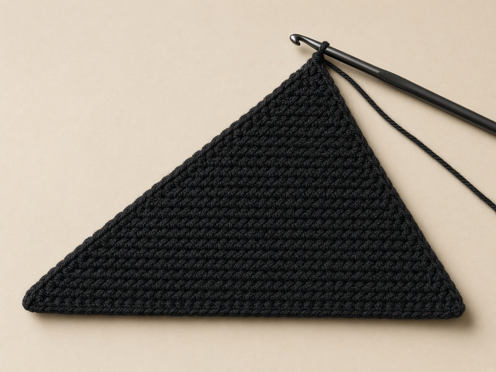
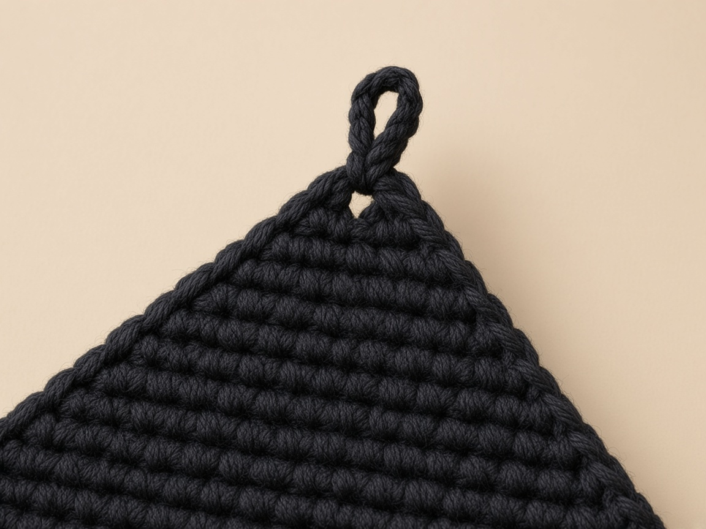
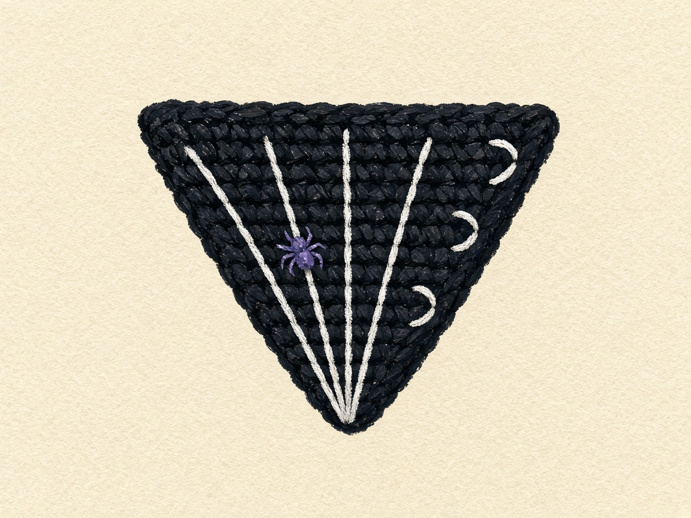
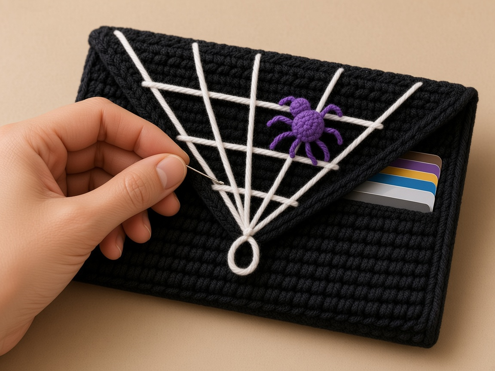

A spiderweb on a crochet wallet usually means a lot of fiddly white color changes. This one skips that. You crochet a plain black wallet with a pointed flap, then draw the web on top with backstitch, which you can pull out and redo until it looks right. A tiny crocheted spider sits on one strand.

It is one of five patterns in the [Halloween crochet wallet collection](/halloween-crochet-wallets/), and the one that teaches surface embroidery and a button loop.

The pocket size, flap drop, and loop length here are worked out from the example gauge rather than measured from a finished wallet, so swatch first and slip a real bank card in before you join. A standard US bank card is 3.370 by 2.125 inches, the ISO/IEC 7810 ID-1 size.

## Materials

- **Worsted weight (CYC 4) yarn** in black. Smooth cotton makes the white embroidery look crisp; fuzzy yarn blurs it. [Yarn weight chart](/yarn-weight-chart/).
- **White** worsted or a thinner white yarn, or six-strand embroidery floss, for the web.
- **Purple** scraps for the spider.
- **US G/6 (4.0 mm) hook** for the wallet, and a size smaller for the spider if you have one. [Hook size chart](/crochet-hook-size-conversion-chart/).
- **One button**, 5/8 in (15 mm), flat with holes.
- Tapestry needle, a sharp embroidery needle if using floss, chalk or a white pencil, stitch markers, one card.

#### Weigh the swatch, then scale it

1. There is no weighed sample to quote.
2. The wallet covers about 26 square inches.
3. Weigh a 4 inch square swatch and allow 1.6 times that weight.
4. Then allow a fifth more for seams and the spider.

White embroidery uses almost no yarn if it is floss, and a full strand of worsted if that is what you chose. Fuzzy black yarn does not change the counts. It blurs the white lines.

## Abbreviations and stitches

All terms are American; the [abbreviations chart](/crochet-abbreviations-chart/) lists the UK equivalents.

| Abbreviation | Meaning |
| --- | --- |
| ch | chain |
| sc | single crochet |
| sl st | slip stitch |
| sc2tog | decrease: draw up a loop in each of the next 2 stitches, then yarn over and pull through every loop on the hook |
| sc3tog | as sc2tog, over 3 stitches, removing 2 |
| inc | 2 sc in the same stitch |
| MR | magic ring; see [crochet in the round](/crochet-in-the-round/) |
| rnd | round |
| st(s) | stitch(es) |

#### Start each row the same way

1. Chain 1 and turn.
2. That chain is never counted.
3. The first single crochet goes into the very first stitch.

#### How a backstitch line is made

1. Bring the needle up one stitch length ahead.
2. Go down at the end of the previous stitch.
3. Repeat. It makes a solid line that can follow any direction.

The [abbreviations chart](/crochet-abbreviations-chart/) separates ch from sc so the turning chain is not mistaken for an edge stitch. It also writes sc2tog and sc3tog on separate lines.

## Size and gauge

**Gauge:** 16 sc and 20 rows to 4 inches. Measure the middle of a 5 inch swatch before starting; the [gauge guide](/crochet-gauge/) explains why the edges lie.

#### Apply the gauge to the counts

1. Seventeen stitches are 4.25 inches.
2. After the side seams, the pocket is about 3.9 inches wide inside against a 3.37 inch card.
3. The front and back are 13 rows, 2.6 inches, so the pocket is about 2.5 inches deep, enough for a 2.125 inch card with room to grip it.
4. The flap is 8 rows, about 1.6 inches to the point.
5. The loop hangs about 0.4 inch past it.

| Piece | Count at the example gauge | Figured size |
| --- | --- | --- |
| Outside width | 17 stitches at 16 sc to 4 inches | 4.25 in |
| Inside width, after the side seams | same 17 | about 3.9 in |
| Front and back height | 13 rows at 20 rows to 4 inches | 2.6 in |
| Inside depth | same 13 rows | about 2.5 in |
| Flap to the point | 8 rows | about 1.6 in |
| Loop past the point | chain 8 | about 0.4 in |

## How to read the three zones

This wallet is one black rectangle that changes job at two marked rows, then narrows into a point.

<figure class="diagram">

<figcaption>Diagram. Plain rows stay at 17. The flap counts stay odd, down to 1.</figcaption>
</figure>

#### Name the piece before you count it

1. It is not a web you crochet in white yarn.
2. It is not a round doily folded into a pocket.
3. The web is backstitch on the flap after the point exists.

If the white lines start before the decreases are counted, they land on the wrong rows and the spider has no fourth spoke to sit on.

#### Width from the example gauge

1. At the example gauge, 16 single crochet equal 4 inches, so one stitch is a quarter inch.
2. Seventeen stitches are 4.25 inches. That is the outside width of the rectangle before the side seams.
3. After those seams the inside is about 3.9 inches.
4. The difference, 0.35 inch, is the paper allowance for two seams.
5. A US bank card is 3.370 inches wide, so the paper clearance across the width is 3.9 minus 3.370, a little over half an inch.
6. That number is arithmetic from the example gauge. It is not a measurement from a finished wallet.
7. Put a real card in before you join the sides.

#### Depth from the row gauge

1. Twenty rows equal 4 inches in the example, so one row is 0.2 inch.
2. Thirteen rows are 2.6 inches. That is the outside height of the front and of the back.
3. The inside depth on paper is about 2.5 inches, a tenth of an inch for the fold and the seam at the bottom.
4. The card's short side is 2.125 inches, so the paper room above the card is about 0.375 inch, which is where your fingers grip it.
5. Measure the swatch the way the [gauge guide](/crochet-gauge/) describes, in the middle, before you decide the hook is close enough.
6. Do not change 13 and 13 into some other split to chase a different depth. The markers and the pairing list depend on those two blocks being equal.

If your row gauge is taller than 20 rows to 4 inches, 13 rows will be deeper than 2.6 inches and the flap, which is also row-based, will hang lower.

#### Count row 1 out loud

1. Chain 18.
2. Single crochet in the second chain from the hook and in every chain across.
3. Count 17.
4. The loop on the hook is not a chain. The chain nearest the hook is the one you skip.
5. The rest of the wallet is 17 until row 27, so a wrong first row never heals itself.
6. Count row 1 out loud before the first turn.

| Count on row 1 | What happened |
| --- | --- |
| 19 | The chain nearest the hook was used |
| 17 | Second chain through the last chain. This is the row. |
| 15 or 16 | A chain was skipped in the middle |

#### The turning chain is not stitch 1

1. Each plain row starts with a chain 1 that does not count, then a single crochet in the first stitch.
2. Stop at the end of the row and count before you turn again.
3. A slanted side by the first marker means the fault has been repeating since an early row.

| End-of-row count | What happened |
| --- | --- |
| 18 | A single crochet was worked into the turning chain |
| 17 | The first single crochet went into the first stitch |
| 16 | The first stitch was skipped because it hides under the chain |

#### Place the two fold markers

1. Put the first marker in the last stitch of row 13. That marker is the bottom fold, the line between the front and the back.
2. Put the second marker in the last stitch of row 26. That marker is the top fold, the line between the back and the flap.
3. Rows 1 through 13 and rows 14 through 26 are the same fabric: 17 single crochet, no decreases, no color change.
4. The markers are the only difference.

If you place the first marker at row 12 because the piece looks long enough, the front is shorter than the back, the side seam will have an extra row end on one layer, and the instruction to make 13 single crochet through both layers will not match the bumps you can see.

#### After the fold, row 1 is the rim

1. After the fold, row 1 is the top front rim, not the bottom. Read that twice before you seam.
2. The chain edge, which was the start of the work and sat at the bottom of the table while you crocheted, swings up to become the opening.
3. Pair the row ends in this order.

| Front row | Meets back row |
| --- | --- |
| 13 | 14 |
| 12 | 15 |
| 11 | 16 |
| 10 | 17 |
| 9 | 18 |
| 8 | 19 |
| 7 | 20 |
| 6 | 21 |
| 5 | 22 |
| 4 | 23 |
| 3 | 24 |
| 2 | 25 |
| 1 | 26 |

4. Count those pairs. There are 13.
5. The side seam is 13 single crochet through both layers, one in each pair, on each side.
6. Rows 27 through 34 stay free. They are the flap. They are not paired with anything.

| Seam stitches | What they catch |
| --- | --- |
| 13 | One stitch in each pair. The opening stays open. |
| 14 | The extra stitch has nowhere to go except into the flap, and a stitch in the flap sews the point shut. |

## What each flap row should count

#### One decrease at each end removes two

1. A decrease uses two stitches to make one.
2. Pull up a loop in the first stitch.
3. Pull up a loop in the next stitch.
4. Yarn over, and pull through all three loops.
5. One decrease at each end removes two stitches from the row.
6. Starting from 17, the row counts have to be 15, 13, 11, 9, 7, 5, 3, and then 1.

| What you count | What to do |
| --- | --- |
| An odd number in the list 15, 13, 11, 9, 7, 5, 3, 1 | Keep going |
| An even number | One end did not decrease. Pull that row out. |
| The next row decreased twice at one end to even things up | The point will lean, and stitch 8 of row 27 will no longer be the middle of the web. Pull back instead. |

#### Count the single crochet between the decreases

1. The single crochet between the decreases is the check you can feel.
2. Row 27 has 13 single crochet between the two decreases. The row count is 15.
3. Row 28 has 11 between the decreases. The row count is 13.
4. Row 29 has 9. The row count is 11.
5. Row 30 has 7. The row count is 9.
6. Row 31 has 5. The row count is 7.
7. Row 32 has 3. The row count is 5.
8. Row 33 has 1 single crochet in the middle stitch, with a decrease on each side, and the row count is 3.
9. Row 34 is not another pair of decreases. It is one single crochet three together: a loop from each of those 3 stitches, yarn over, pull through all four loops.
10. One stitch remains. That one stitch is the point the loop and every spoke share.

| Row | Between the decreases | Row count |
| --- | --- | --- |
| 27 | 13 single crochet | 15 |
| 28 | 11 single crochet | 13 |
| 29 | 9 single crochet | 11 |
| 30 | 7 single crochet | 9 |
| 31 | 5 single crochet | 7 |
| 32 | 3 single crochet | 5 |
| 33 | 1 single crochet, decrease on each side | 3 |
| 34 | sc3tog across the 3 stitches | 1 |

#### The two slanted edges have to mirror

1. Lay the point away from you and look along both slanted sides.
2. Each side should step in by one stitch per row.
3. The bumps along a correct edge are even.
4. If the left side is a smooth diagonal and the right side still has a straight run of two rows, the missed decrease is on the right.
5. A loose slip stitch around both slanted edges, worked before any embroidery, smooths those bumps. Do it before the web.

A slip stitch worked after the backstitch crosses the white lines and pins them to the edge.

#### Test the loop on the same button

1. The button loop is chain 8 from that one stitch, then a slip stitch back into the same stitch.
2. The chains form a ring whose far end hangs about 0.4 inch past the point at the example gauge, which is the figure in the size section.
3. Hold the 5/8 inch button against the loop. It should pass with a little push and not fall through.
4. If it falls through, pull the loop out and chain 7.
5. If it will not pass, chain 9 or 10.
6. Stay inside 7 to 10 chains.
7. Fasten off into the point so the tail does not become an extra spoke.

| Chains | What the button does |
| --- | --- |
| 8 | The start. It should pass with a little push. |
| 7 | Use this if the button falls through the chain-8 loop. |
| 9 or 10 | Use this if the button will not pass. |
| 12 or 15 | The wallet will close, but the loop will not sit where this pattern says it sits, a short hang past an 8-row point. |

#### Where the point hangs, and where the button is not

1. Eight flap rows at 0.2 inch each are 1.6 inches from row 27 to the point.
2. Row 27 is the base of the triangle, still almost as wide as the wallet, at 15 stitches.
3. The point is row 34.
4. When you fold the flap down over the front, row 27 lies near the top of the front wall and the point hangs partway down that wall.
5. The button is not sewn at a guessed row. You mark it with cards inside, where the loop actually lands.
6. The size section's 1.6 inch drop is the paper length of the flap, not a button coordinate.

## What the web should look like

<figure class="diagram">

<figcaption>Diagram. Five spokes, then the ring at row 33, then row 31, then row 29.</figcaption>
</figure>

#### Fold closed before you pin row 27

1. Fold rows 1 to 13 up and fold the flap down before you mark anything.
2. You want the flap the way it sits when the wallet is closed, so stitch 2 is on the same edge every time you count.
3. On row 27, which has 15 stitches, put a pin in stitch 2, stitch 5, stitch 8, stitch 11, and stitch 14.
4. The gaps are three stitches.
5. Stitch 8 is the middle of 15.
6. Stitch 1 and stitch 15 stay empty so the outer spokes do not fall off the slanted edge.

| Pins on row 27 | What the web will do |
| --- | --- |
| 2, 5, 8, 11, 14 | The written web. Gaps of three. Stitch 8 is the middle. |
| 1, 4, 8, 12, 15 | The web has shifted. The middle spoke will still look straight, and the outer ones will not match the rings. |

#### Five spokes share the point

1. Five spokes leave the point and end at those five pins.
2. All five start at row 34, the same stitch.
3. None of them starts at row 33 or along a ring.
4. Backstitch each line: needle up one stitch-length ahead, down where the last stitch ended.
5. Keep each stitch about the length of one crochet stitch.
6. Go through the flap only.

A spoke that starts on a ring is a chord, not a radius, and the later rings will not have a common center. A tight line cups the flap into a bowl, and the point will not lie on the front wall when you go to mark the button. A stitch that catches the front wall under the flap sews the wallet shut in a white bar you cannot see from the outside until a card stops.

#### Rings after the spokes, inner ring first

1. The inner ring is four segments at row 33, from spoke to spoke.
2. The middle ring is the same four segments at row 31.
3. The outer ring is the same four segments at row 29.
4. Leave each segment a little long and nudge it toward the point so it bows.
5. A tight segment is a straight bar.
6. Five spokes and three rings are the whole web in this pattern.
7. Seven spokes are listed later as a variation, at different stitches, and they are not a correction if five look sparse. Sparse is the written web.

#### The spider sits on the fourth spoke

1. The fourth spoke, counting from stitch 2, is the one that ends at stitch 11.
2. The spider sits on that spoke between the ring at row 29 and the ring at row 31.
3. It does not sit at the point, and it does not sit on the middle spoke unless you are deliberately ignoring the written placement.
4. One tack at the head and one at the back of the abdomen keep it from spinning.
5. Legs come after those tacks: four legs on each side, eight in all.
6. Each leg is two straight stitches, the second shorter and bent toward the point.

#### Count the spider before you sew it

1. The abdomen is a closed ball.
2. Magic ring of 6, then 2 single crochet in each stitch for 12, then one even round of 12, then six decreases back to 6.
3. A scrap of purple fills the hole before you close the 6 front loops.
4. The head is a magic ring of 6 and one even round of 6, closed the same way, so it cups into a bead rather than a disk.
5. Before the legs, the spider is about 0.5 inch across at the example gauge.
6. Count 6, then 12, then 12, then 6 on the abdomen.
7. Count 6, then 6 on the head.
8. Those are the only spider counts in the pattern.

| Piece | Rounds | If it will not cup |
| --- | --- | --- |
| Abdomen | 6, 12, 12, 6 | The 6 were not closed through the front loops, or the even round was increased by mistake |
| Head | 6, 6 | Same close. A disk means the front loops were missed or the second round increased |

#### Finish the white tails on the back of the flap

1. On the back of the flap, run the white tail under stitches you already made.
2. Do not knot it. The back of the flap rubs the front of the wallet, and a knot becomes a lump under the point.
3. If a spoke is crooked, unpick that spoke only.
4. The rings that touched it come out too, and they go back in after the spoke is straight.

## The pattern

### Step 1: the straight rectangle

<figure class="diagram">

<figcaption>Diagram. The flap loses one stitch at each end of every row until it comes to a point.</figcaption>
</figure>

Use black.

1. Chain 18. Do not count the loop on the hook.
2. Single crochet in the second chain from the hook, then in every chain across. Count 17.
3. For each new row: chain 1, turn, single crochet in the first stitch and in every stitch across, count 17.
4. Keep a tally. After row 13, put a marker in the last stitch. That marker is the bottom fold.
5. Keep going the same way through row 26. Put a second marker in the last stitch of row 26. That is the top fold.
6. Stop the plain rows there. You have one rectangle, 17 stitches wide and 26 rows tall.

#### Stop and name the rectangle

1. Rows 1 to 13 are the front. The marker in the last stitch of row 13 is the bottom fold.
2. Rows 14 to 26 are the back. The marker in the last stitch of row 26 is the top fold.
3. Both blocks are 17 single crochet, with no decreases and no color change.
4. Do not start the point until both markers are in the work.

### Step 2: the point, one decrease row at a time

<figure class="diagram">

<figcaption>Diagram. Both ends decrease on every flap row.</figcaption>
</figure>

A decrease uses two stitches to make one. Pull up a loop in the first stitch, pull up a loop in the next, yarn over, pull through all three loops.

1. **Row 27.** Chain 1, turn. Decrease over the first 2 stitches. Single crochet in the next 13, counting them. Decrease over the last 2. Count the row: 15.
2. **Row 28.** Chain 1, turn. Decrease, single crochet in the next 11, decrease. Count: 13.
3. **Row 29.** Decrease, 9 single crochet, decrease. Count: 11.
4. **Row 30.** Decrease, 7 single crochet, decrease. Count: 9.
5. **Row 31.** Decrease, 5 single crochet, decrease. Count: 7.
6. **Row 32.** Decrease, 3 single crochet, decrease. Count: 5.
7. **Row 33.** Decrease, 1 single crochet in the middle stitch, decrease. Count: 3.
8. **Row 34.** Chain 1, turn. Pull up a loop in each of the 3 stitches, yarn over, pull through all four loops. One stitch is left.

#### An even row is a missed end

1. If any row is an even number, a decrease was missed at one end.
2. Pull that row out.
3. The list is 15, 13, 11, 9, 7, 5, 3, 1.

| Row you just finished | Right count | Even count means |
| --- | --- | --- |
| 27 | 15 | One end stayed square |
| 28 | 13 | The lean starts here if you continue |
| 29 | 11 | Stitch 8 of row 27 will not stay the middle |
| 30 | 9 | Same miss, one row later |
| 31 | 7 | Same miss |
| 32 | 5 | Same miss |
| 33 | 3 | The middle single crochet is no longer centered |
| 34 | 1 | sc3tog was a two-together, so two stitches remain |

Do not fix an even row by decreasing twice at one end on the next row. The point will lean.

### Step 3: the button loop

<figure class="diagram">

<figcaption>Diagram. The loop returns to the same stitch at the point.</figcaption>
</figure>

1. Chain 8 from the one stitch at the point.
2. Slip stitch back into that same stitch, so the chains form a loop.
3. Hold your button against the loop. It should pass with a little push, not fall through.
4. If it falls through, pull the loop out and chain 7. If it will not pass, chain 9 or 10. Stay inside 7 to 10 chains.
5. Fasten off and weave the tail into the point.

The flap edges will be a little bumpy where each row decreases. A round of slip stitch along both slanted edges, worked loosely, smooths them. Do it before the embroidery.

#### The tail is not a spoke

1. Fasten off into the point.
2. Weave that tail before the white yarn goes in.
3. A black tail left under the point reads as an extra spoke once the five white lines meet there.

### Step 4: mark the five spoke ends

<figure class="diagram">

<figcaption>Diagram. Spokes first, inner ring first, spider last.</figcaption>
</figure>

1. Fold rows 1 to 13 up. Fold the flap down over them. You are looking at the flap the way it will sit when the wallet is closed.
2. On row 27, count stitches from the same edge every time. Put a pin in stitch 2, stitch 5, stitch 8, stitch 11, and stitch 14.
3. Stitch 8 is the middle. The middle spoke will run straight from the point to that pin.

#### Spokes

1. Thread white.
2. Start at the point, row 34.
3. Backstitch a straight line to the pin at stitch 2: come up one stitch-length ahead, go down where the last stitch ended, repeat.
4. Then a line from the point to stitch 5, then stitch 8, then stitch 11, then stitch 14.
5. Five lines, all starting at the same point.
6. Go through the flap only.

#### Inner ring

1. At row 33, stitch from the first spoke over to the second, then second to third, third to fourth, fourth to fifth.
2. That is 4 segments.
3. Leave each one a little long and nudge it toward the point with the needle so it bows.
4. A tight stitch makes a straight bar and cups the flap.

#### Middle ring

1. The same 4 segments at row 31.
2. Nudge each segment toward the point the same way.

#### Outer ring

1. The same 4 segments at row 29.
2. Five spokes and three rings are now on the flap.

#### The white tail

1. On the back of the flap, run the white tail under the strands you already stitched.
2. Do not knot it. The back of the flap rubs the front of the wallet.
3. If a line is crooked, unpick that line only. Backstitch pulls out cleanly.

### Step 5: the spider body, one round at a time

<figure class="diagram">

<figcaption>Diagram. Two tiny balls and eight stitched legs.</figcaption>
</figure>

Use purple. A hook one size smaller than the wallet hook makes a tighter ball. If you do not have one, use the same hook and keep the stitches snug.

**Abdomen**

1. Make a magic ring. If the ring is new, the [in the round](/crochet-in-the-round/) page shows the loop. Single crochet 6 into the ring. Count 6. Pull the tail so the hole closes.
2. Round 2: 2 single crochet in each of the 6 stitches. Count 12.
3. Round 3: 1 single crochet in each stitch. Count 12. Do not increase.
4. Round 4: decrease 6 times, once over every pair of stitches. Count 6.
5. Push a scrap of purple yarn into the hole.
6. Fasten off. Thread the tail through the front loop of each of the 6 stitches and pull until the hole closes. Keep the tail for sewing.

#### Check the abdomen before you close it

| Round | Count | If the count is off |
| --- | --- | --- |
| 1 | 6 in the magic ring | The center will not close cleanly |
| 2 | 12, two in each stitch | Five increases make 11, and round 4 cannot pair into 6 |
| 3 | 12, no increase | A second increase round makes 24, and the 0.5 inch figure no longer describes the ball |
| 4 | 6, six decreases | Stuff, then close the front loops |

**Head**

1. Magic ring, 6 single crochet. Count 6.
2. One more round of 1 single crochet in each stitch. Count 6.
3. Fasten off and close the 6 stitches the same way. It should cup into a bead, not a disk.

**Sew it on**

1. Sew the head to one end of the abdomen with the abdomen tail.
2. Find the spoke that ends at stitch 11. That is the fourth spoke if you count from stitch 2.
3. Sew the spider onto that spoke, between the ring at row 29 and the ring at row 31. Tack the head and the back of the abdomen. One tack lets it spin.
4. Legs: 4 on each side, 8 in all. Each leg is two straight stitches. The first goes out from the body. The second is shorter and bends toward the point.
5. Before the legs, the spider is about 0.5 inch across.

### Step 6: fold, seam the sides, then mark the button

<figure class="diagram">

<figcaption>Diagram. Mark the loop on the closed flap, then sew the button through the front wall only.</figcaption>
</figure>

1. Fold between row 13 and row 14, right side out. Pair front row 13 with back row 14, row 12 with row 15, and keep going until front row 1 meets back row 26. Row 1 is now the top front rim, not the bottom.
2. The flap, rows 27 to 34, stays free. Do not seam it.
3. Join black at the bottom fold on one side. Chain 1.
4. Make 1 single crochet through both layers in each of the 13 paired row ends. Count them. Fasten off.
5. Do the other side the same way: 13 single crochet, then fasten off.
6. Put in the cards you mean to carry. Lower the flap without stretching it.
7. Mark the front wall where the loop actually lands. Ignore any guessed row number if the fit is different.
8. Take the cards out. Sew the button at that mark, through the front wall only. If the needle comes out inside the pocket, you have stitched the pocket shut.
9. Weave the tails along the seams. See [weaving in ends](/weaving-in-ends-and-blocking/).

#### The button misses the pocket

1. Mark with the cards in, and sew with the cards out.
2. The needle stays in the front wall.
3. A needle that comes out inside the pocket has stitched the pocket shut.

## Order that keeps the web on the flap

The web, the spider, the side seams, and the button are easy to do in an order that belongs to a different object: a picture sewn onto a square, then folded however it looks best. This pattern has a fixed order because the flap has a right side up, the spokes have a row 27, and the button has to miss the pocket.

<figure class="diagram">

<figcaption>Diagram. The flap stays free. The button goes through one layer.</figcaption>
</figure>

#### Finish 17 stitches through row 26

1. Finish the 17-stitch rows through row 26 before you decrease.
2. The two markers should be in the work: last stitch of row 13, last stitch of row 26.
3. Then work the point one row at a time and write the count at the end of each row: 15, 13, 11, 9, 7, 5, 3, 1.

If you embroider a web on a flap that is still 17 stitches wide, you do not have a point for the spokes to share, and row 34 does not exist yet to start them from.

#### Loop, then the edge, then the closed fold

1. Make the chain loop next, and test it with the same button you will sew on.
2. A different button at the end, larger or thicker, will not match a loop you already fastened off.
3. Stay inside 7 to 10 chains.
4. Weave the loop's tail into the point before the white yarn goes in, so you are not fishing a black tail out from under five spokes.
5. Optional slip stitch along both slanted edges happens now, loosely, and not after the web.
6. Then fold the pocket and the flap into the closed position before any pin goes into row 27.
7. The fold you use for marking is the same fold you will seam: between row 13 and row 14, right side out.
8. You can mark and embroider before the side seams, while the front wall is still easy to keep away from the needle.
9. You should not mark on an unfolded rectangle, with row 1 at the bottom of the table, and hope the left edge stays the left edge after the fold. Turning the flap down reverses which side is stitch 2.

#### Spokes, rings, spider, then legs

1. Spokes first, all five from row 34 to the pins at stitches 2, 5, 8, 11, and 14.
2. Inner ring at row 33, four segments, each nudged toward the point.
3. Middle ring at row 31.
4. Outer ring at row 29.
5. Then the spider on the spoke that ends at stitch 11, between row 29 and row 31.
6. Legs last.

If you sew the spider before the outer ring, the ring has to detour around a body that is already in its path, and the four segments stop being equal.

#### Seam 13, then stop

1. Seam the sides only after the needle is out of the flap.
2. Join black at the bottom fold.
3. One single crochet through both layers in each of the 13 paired row ends.
4. Fasten off. Repeat on the other side.
5. Count 13 twice.
6. The flap's row ends are above the top fold and they stay unworked.

A seam that continues until the yarn runs out will climb row 27 and row 28 and pinch the base of the triangle.

#### Mark the button on the stack you will carry

1. Put in the cards you mean to carry.
2. Two cards stack thicker than one and push the flap higher, so the loop lands in a different place.
3. Lower the flap without stretching it.
4. Mark the front wall where the loop actually sits.
5. Take the cards out.
6. Sew the button at that mark through the front wall only.
7. If the needle comes out inside the pocket, you have stitched the pocket shut.
8. The same test catches a spoke that dipped through both layers: the card will stop against a white bar.
9. Unpick that bar from the pocket side. Do not cut it from the front or the spoke disappears with it.

#### Read this list before the last tail

1. The front and the back are the same height, 13 rows, meeting at 13 pairs.
2. The flap count ended at 1, not at 3 with a loop stuck through the middle stitch of row 33.
3. Five spokes meet at the point and at stitches 2, 5, 8, 11, and 14.
4. Three rings bow toward the point at rows 33, 31, and 29.
5. The spider is on the fourth spoke between the outer and middle rings.
6. The button passes the loop with a push and does not pin the back wall.
7. A failure on that list is fixed at that step.

Adding a sixth spoke to hide a crooked fifth one makes a different web than the one written.

#### Yardage stays an estimate

1. About 26 square inches is 1.6 times a 4 inch swatch, plus a fifth for seams and the spider.
2. Weigh the swatch.
3. There is no weighed wallet to copy a gram count from.
4. White embroidery uses almost no yarn if it is floss, and a full strand of worsted if that is what you chose.
5. Fuzzy black yarn does not change the counts. It blurs the white lines, which is why the materials list asks for a smooth cotton when you want the web to read as lines rather than as a pale smudge.

#### Wash without crushing the legs

1. Hand wash in cool water and dry flat, spider up, so the legs are not crushed while the fabric is soft.
2. Press a damp scrap of the black on a white paper towel first.
3. Color that transfers will gray the web, and gray backstitch on a black flap disappears.
4. The spokes can be tightened by accident while the piece is wet.
5. Ease them back to the length of a crochet stitch with the needle still in the tail if you have not woven it in yet.
6. Once the tail is buried, a tight ring has to be unpicked.

## Make it yours

- **Purple wallet, black web.** Reverse the colors. Black backstitch on purple shows less, so use two strands.
- **More spokes.** Seven spokes at stitches 1, 3, 5, 8, 11, 13, 15 look closer to a real web but crowd near the point. Stop the outer ones at row 31.
- **No spider.** Embroider a small one instead: a French knot body and eight straight-stitch legs.
- **Snap closure.** Skip the loop. Sew a 3/8 inch snap under the flap point and on the front.
- **Lining.** Line the back only, so the pocket keeps its width. Cut fabric 4.25 by 2.6 inches plus a 1/4 inch fold.

## Pair the folded pocket rows before marking the button

#### Pair 13 row ends, then leave the flap free

1. Fold between rows 13 and 14.
2. Pair front row 13 with back row 14, row 12 with 15, continuing to front row 1 with back row 26.
3. Row 1 is now the top front rim, not the bottom.
4. Sew only those thirteen row-end pairs on each side.
5. The flap starts at row 27 and ends at row 34, so it remains free.
6. With cards inside, lower the flap and mark the loop's actual landing place.
7. Ignore any estimated front-row number if your fit differs.
8. Embroider only after fixing the flap's closed orientation, and keep the needle out of the pocket.

## A last count before the button

#### Touch the flap from the base to the point

1. Read the flap from the base to the point with the wallet closed, and touch each row as you say the number.
2. Row 27 is the wide base, 15 stitches, with the five pins already replaced by spoke ends at stitches 2, 5, 8, 11, and 14.
3. Row 28 is 13.
4. Row 29 is 11, and the outer ring crosses it.
5. Row 30 is 9.
6. Row 31 is 7, and the middle ring crosses it.
7. Row 32 is 5.
8. Row 33 is 3, and the inner ring crosses it.
9. Row 34 is the single stitch under your finger at the point, with the chain loop returning to that same stitch.

| Ring sitting on | What to do |
| --- | --- |
| Row 33, 31, or 29 | Leave it. Those are the written rings. |
| Row 30 or row 32 | It has landed on an even row that this web does not use. Move that ring to the odd row next to it: 29, 31, or 33. The spokes can stay. |

#### Touch 13 seam stitches on each side

1. Start at the bottom fold, where row 13 meets row 14, and walk to the opening, where row 1 meets row 26.
2. You should feel 13 stitches on the left and 13 on the right.
3. The opening itself is not seamed. You should be able to slide a finger along row 1, the front rim, without crossing a join.
4. The flap's slanted edges start above that rim.

If a side seam stitch sits on the slant, the triangle is narrower than 15 stitches at its base and the outer spokes are pulled toward each other.

#### Recount the spider by rounds

1. The spider is small enough to miscount by one stitch and change its shape.
2. On the abdomen, round 1 is 6 single crochet in a magic ring, and the tail pulls the center shut.
3. Round 2 puts 2 single crochet in each of those 6, which is 12.
4. If you increase in only five of them, you have 11, and round 4 cannot decrease into a clean 6 because the stitches do not pair.
5. Round 3 is one single crochet in each of the 12, with no increase.
6. A second increase round makes 24, and the 0.5 inch before the legs figure at the example gauge no longer describes the ball.
7. Round 4 decreases once over every pair, six decreases, back to 6.
8. Stuff with a scrap of the same purple before you close, then run the tail through the front loop of each of those 6 and pull.
9. The head is only two rounds, 6 and then 6 again, closed the same way.
10. Sew the head to one end of the abdomen before you choose the spoke, so you are attaching a finished spider, not building it on the web.

#### Eight legs, bent toward the point

1. Four legs on the left and four on the right, each made of two straight stitches, are the whole set.
2. The longer stitch leaves the body.
3. The shorter stitch bends toward the point, which is toward row 34, not toward row 27.
4. Legs that bend toward the base of the flap look like they are walking off the web.
5. Count the white stitches leaving the body: eight.
6. A ninth usually means one side was given five in an effort to make the spider look busier. Pull the extra one.
7. The body stays between row 29 and row 31 on the stitch-11 spoke while you add the legs, so a leg that crosses the middle spoke can be shortened until it only reaches toward the point.

#### sc2tog and sc3tog are not the same row

1. Single crochet two together is the decrease used on rows 27 through 33: two loops pulled up, yarn over, pull through all three.
2. Single crochet three together is row 34 only: three loops pulled up, yarn over, pull through all four.
3. Using sc2tog on row 34 leaves two stitches at the point, and the chain loop has to pick one of them. The spokes will not share a center.
4. Using sc3tog on an earlier row, where you meant to decrease only the first two stitches, drops the count by two at that end and the list goes even.
5. The [abbreviations chart](/crochet-abbreviations-chart/) writes both decreases on separate lines.
6. Keep this page's row list next to the work: two-together while the row still has a middle of single crochet, three-together only when three stitches are left.

| Decrease | Loops on the hook before the yarn over | Rows |
| --- | --- | --- |
| sc2tog | 3 | 27 through 33, one at each end |
| sc3tog | 4 | Row 34 only |

#### Ease a cupped flap without wetting the spider

1. If the flap cups after the web is in, the backstitch is shorter than the crochet stitch under it.
2. Dampen the flap only, pat it flat, and ease the tight segment with the needle until the white line bows toward the point instead of pulling the black fabric up.
3. Do not steam the spider.
4. A wet ball of purple can bleed onto the black, which is the same reason the care section tells you to test the black on a paper towel before a full wash.
5. The pocket underneath should stay dry during that easing so the front wall does not take the shape of the cup.

#### Close it full, then close it empty

1. When the button is on, close the loop with the cards you marked against still inside, then take them out and close it empty.
2. Both closes should use the same hole in the button and the same chain loop.
3. If the empty wallet needs a tug that bends row 34, the mark was made without the cards and the button is too high, toward the opening.
4. Move the button to the mark the loop made when the cards were in.
5. Do not lengthen the chain past 10 to reach a high button. The pattern's loop range stops at 10.

#### The finger test inside the pocket

1. The pocket, once seamed, should open along row 1 only.
2. Run a finger inside from the left seam to the right.
3. You should feel 13 seam stitches at each end and an unseamed rim between them.
4. The flap folds down from row 27 and does not join that finger's path.
5. If the finger stops in the center, a spoke or the button thread has caught the back wall.
6. Unpick the stitch that stopped you, from the inside, and leave the surface line in place if it is still continuous on the flap.

## Common mistakes and fixes

#### The flap is off center

1. One decrease row missed a decrease at one end.
2. Count each row: 15, 13, 11, 9, 7, 5, 3, 1.
3. Pull the even row out before the next decrease.

#### The spokes pull the flap into a cup

1. The backstitch was too tight.
2. Keep each stitch the length of one crochet stitch and do not tug.
3. Ease the tight segment toward the point.

#### The rings look like straight lines

1. They need a little slack.
2. Leave each segment slightly long, then nudge it toward the point with the needle.

#### The white strand shows gray

1. Black fiber traveled with the needle.
2. Use a sharp needle and go into the center of each stitch.

#### The loop is too loose

1. Crochet loops stretch.
2. Redo with one chain fewer.
3. Stay inside 7 to 10 chains.

#### The spider wobbles

1. It is sewn only at one point.
2. Tack it at both the head and the back of the abdomen.

## Care

1. Wash by hand in cool water.
2. Lay it flat to dry, spider up, so the legs are not crushed while the fabric is soft.
3. Before the first wash, press a damp scrap of the black yarn on a white paper towel.
4. If color transfers, the web will gray, and gray backstitch on a black flap disappears.

## Frequently asked

### Will cards fit?

1. On paper, the pocket is about 3.9 by 2.5 inches inside against a 3.37 by 2.125 inch card, so test the fit with a real card before you join.
2. The 3.9 inch width is 17 stitches at the example gauge of 16 single crochet to 4 inches, after the side seams.
3. The 2.5 inch depth is 13 rows at 20 rows to 4 inches, after the bottom fold.
4. Both figures are paper sizes.
5. A swatch that does not match the [gauge](/crochet-gauge/) changes the pocket even if you still work 17 stitches and 26 plain rows.
6. Measure before you start the decreases.
7. Do not add stitches to row 14 because a card feels tight in the hand.
8. The seam is the usual reason a card binds, and the fix is a looser single crochet through the pairs, still 13 of them.

### Can I crochet the web instead of embroidering it?

1. Possible, with surface slip stitch, but it is harder to control on a small triangle.
2. Backstitch can be undone.
3. If you do use slip stitch, keep the same map: five lines from row 34 to stitches 2, 5, 8, 11, and 14 on row 27, then four segments at row 33, four at row 31, and four at row 29.

A slip-stitched web that starts at the corners of row 26 is sitting on the fold, not on the flap.

### Is the spider safe for a child?

1. It is sewn on, but small parts on any handmade item can come loose.
2. For a young child, embroider the spider instead.
3. An embroidered body still belongs between the ring at row 29 and the ring at row 31 on the spoke that ends at stitch 11, so the web keeps the written center.

### Why a loop, not a buttonhole?

1. A buttonhole cannot go into the last few stitches of a point.
2. Row 34 is one stitch.
3. A chain-3 skip, the kind the witch hat wallet uses in a straight row, would consume the entire point and leave no stitch to return to.
4. The chain loop does the same job at the tip, and it is tested against the button before it is fastened off.
5. The range in the pattern is 7 to 10 chains, with 8 as the start.

### May I sell wallets made from this?

Go ahead. Share a link to this page instead of copying the instructions.

### What does an even flap row mean?

1. It means one end was not decreased.
2. The written list is 15, 13, 11, 9, 7, 5, 3, 1.
3. Those are all odd because you start at 17 and remove two stitches each row, then remove the last three together.
4. An even count cannot be centered on stitch 8 of row 27.
5. Pull the even row out and work the decrease at both ends before you continue.
6. The single crochet between the decreases, 13 then 11 then 9 then 7 then 5 then 3 then 1, is the second count that should match.

### Which spoke gets the spider?

1. The spoke that ends at stitch 11 on row 27.
2. Counting from stitch 2, that is the fourth spoke.
3. The body sits between the outer ring at row 29 and the middle ring at row 31.
4. The middle spoke, stitch 8, is the straight line from the point.
5. It stays empty so the web still has a center after the spider is on.

### When do I fold for the embroidery?

1. After the loop is finished and before the pins go in.
2. Fold between row 13 and row 14, bring the flap down, and only then count stitches 2, 5, 8, 11, and 14 on row 27.
3. Embroider through the flap alone.
4. Seam the 13 pairs after the white yarn is finished, so a side stitch cannot climb into the triangle.

### How do I know the sides stopped at the opening?

1. Count 13 single crochet from the bottom fold up to the opening, on each side.
2. The next row end above that opening is row 27, the base of the flap, and it should still be a single layer.
3. If it is caught in the seam, the triangle starts at fewer than 15 stitches and the pins at stitches 2 and 14 sit on fabric that can no longer lie flat.
4. Take those extra stitches out and leave the 13.

### Where do the abbreviations for the spider live?

1. Magic ring, increase, and the two decreases are in the abbreviations list on this page, and the longer names are on the [abbreviations chart](/crochet-abbreviations-chart/).
2. The abdomen's rounds are 6, 12, 12, and 6.
3. The head's rounds are 6 and 6.
4. An increase means two single crochet in the same stitch, which is how round 2 of the abdomen goes from 6 to 12.

## More Halloween wallets

- [Black cat crochet wallet](/black-cat-crochet-wallet/): a seamless tube with ears
- [Ghost crochet wallet](/ghost-crochet-wallet/): shaped panels and a scalloped hem
- [Pumpkin crochet wallet](/pumpkin-crochet-wallet/): back-loop ribs and a leaf tab
- [Witch hat crochet wallet](/witch-hat-crochet-wallet/): two pockets and a worked buttonhole

For a standalone spider and web, see [how to crochet a spider and web](/how-to-crochet-a-spider-and-web/). Decreases are explained in [increases and decreases](/crochet-increase-decrease/).

The spiderweb wallet is straight crochet followed by drawing. Count every flap row down to 1, put the spokes in first, and keep the backstitch loose enough that the flap stays flat.
