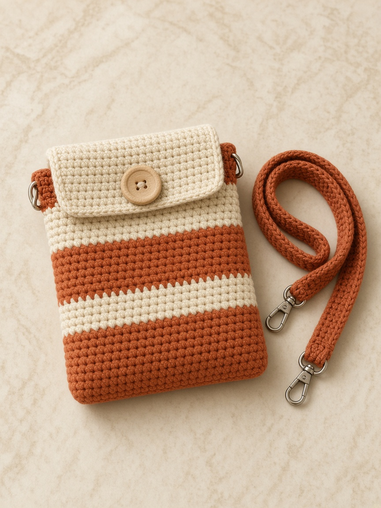
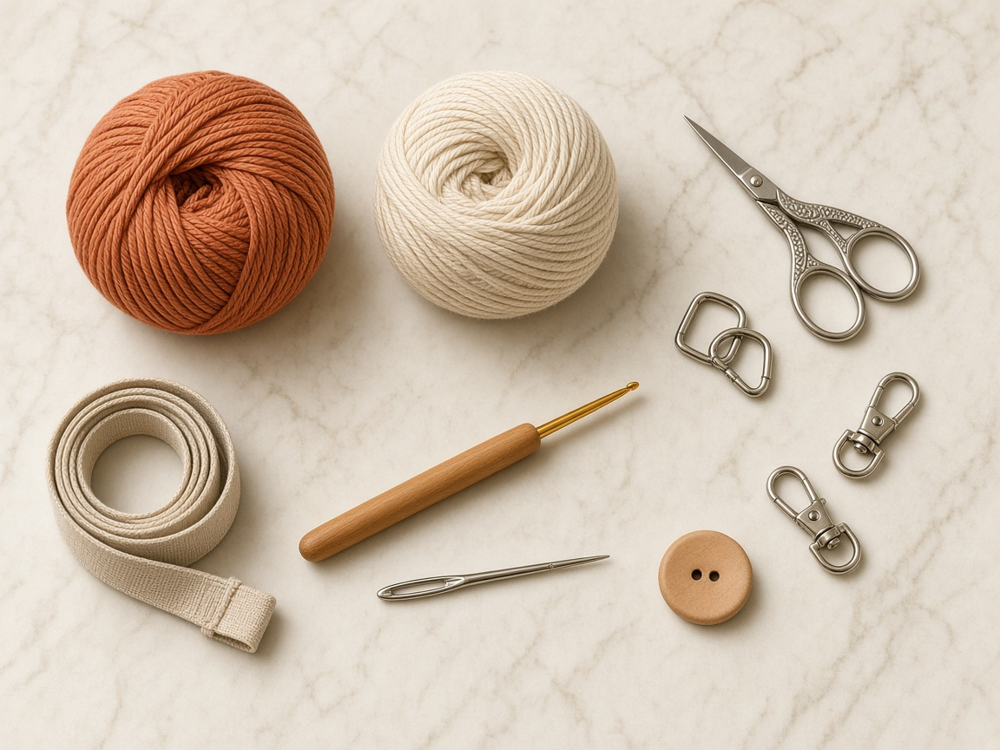
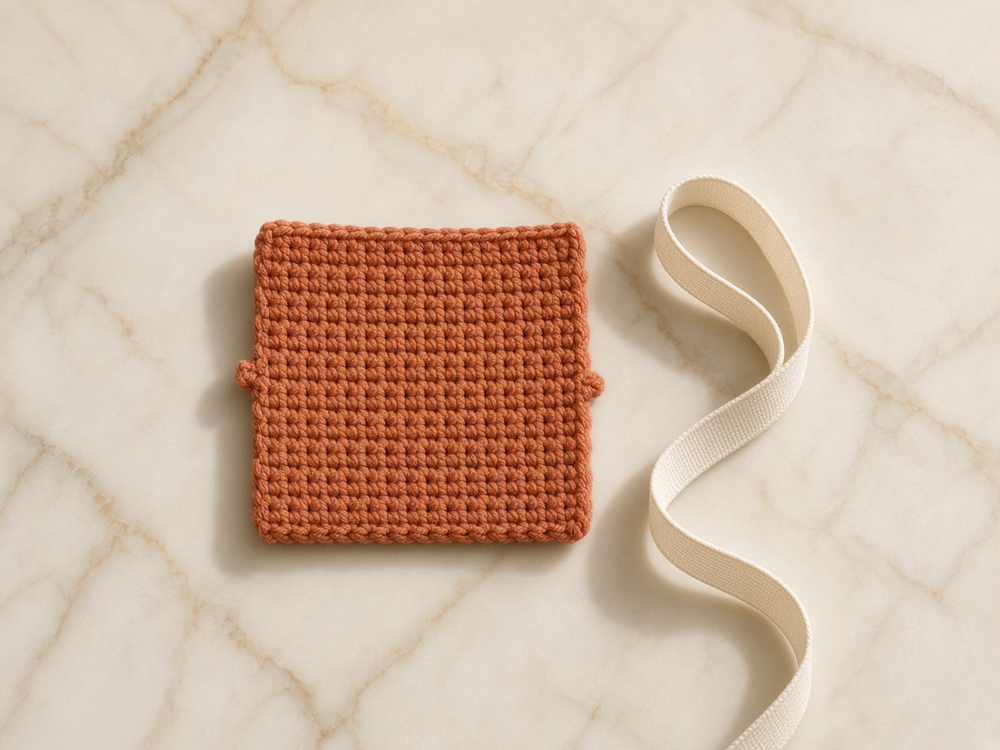
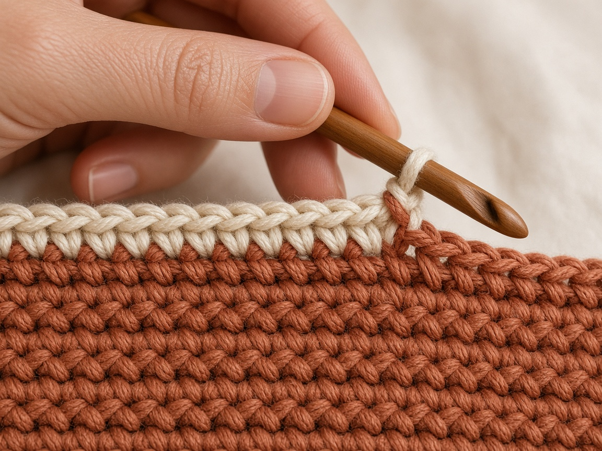
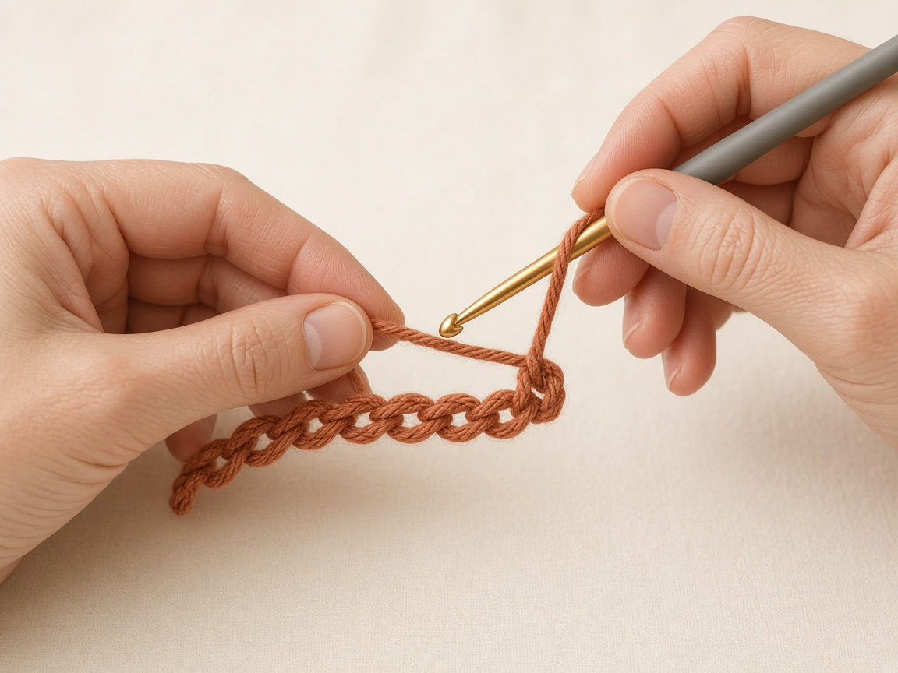
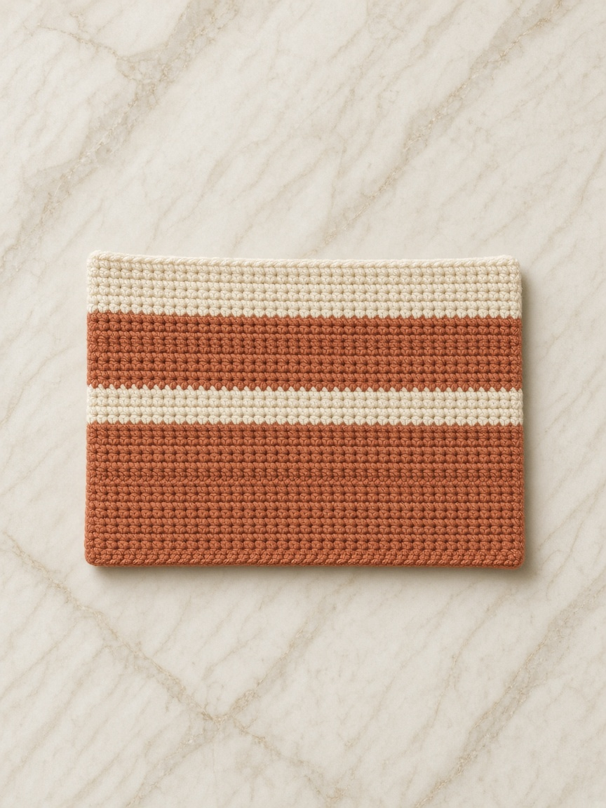
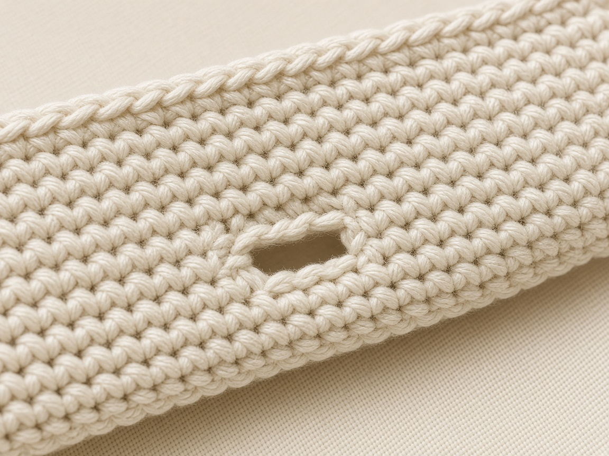
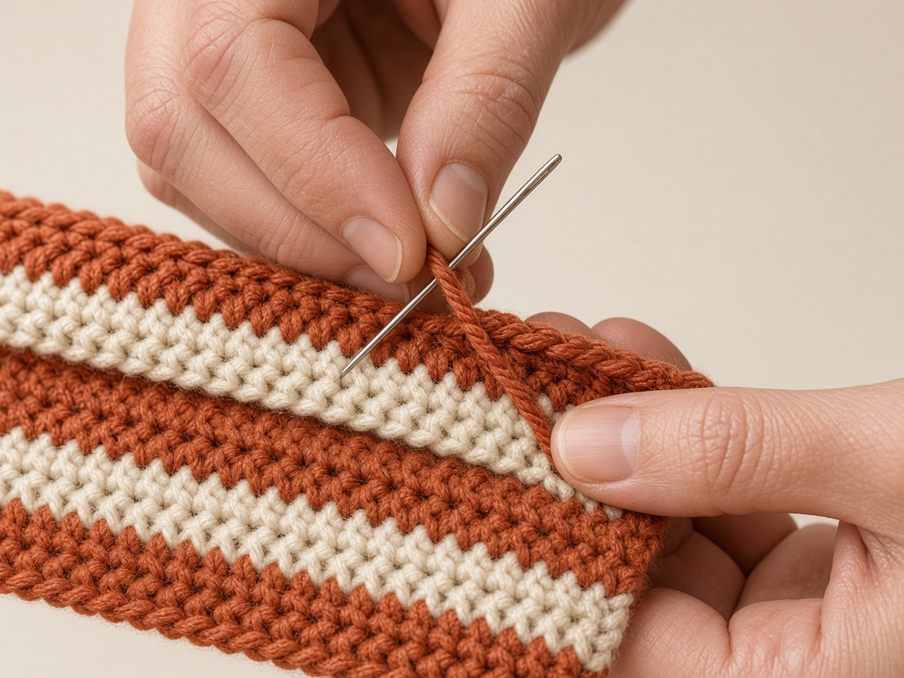
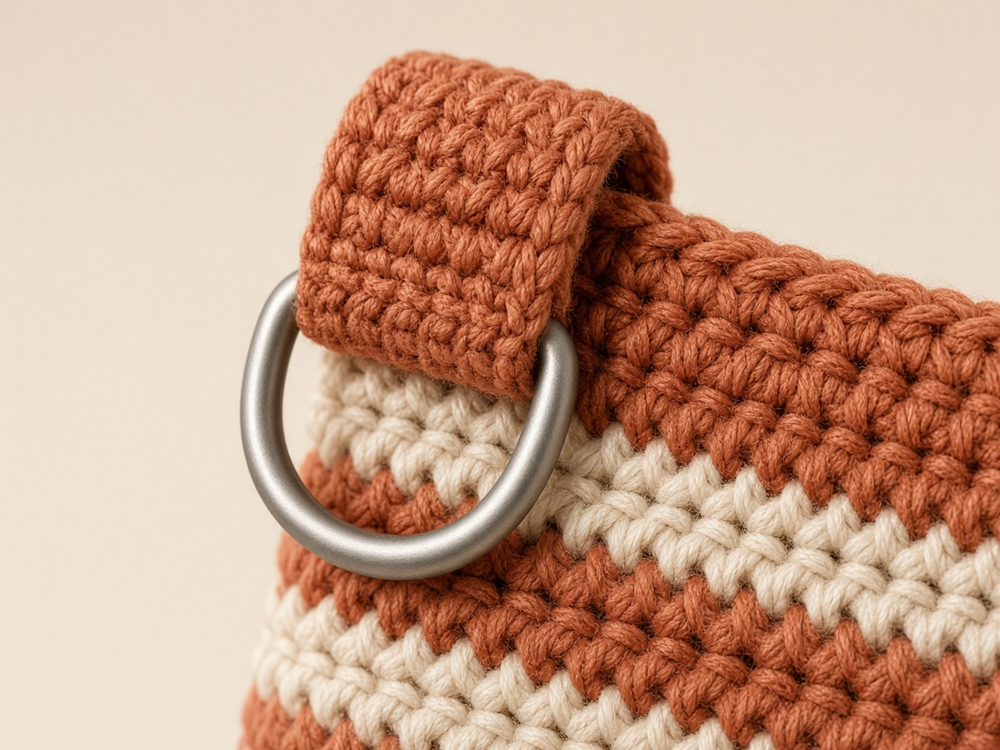
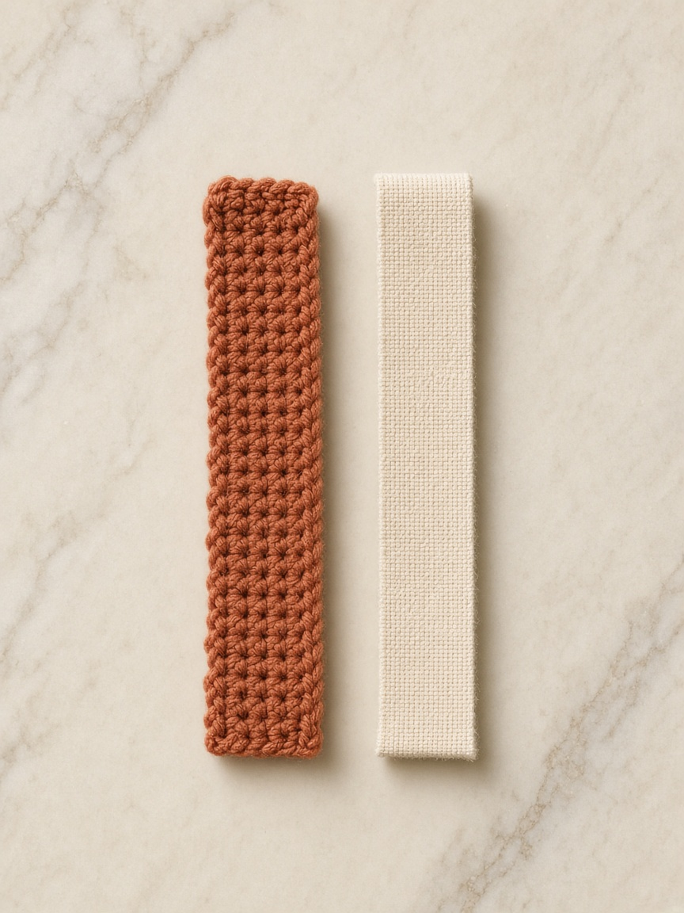

The little bag in our inspiration photo has a wonderfully simple idea: broad earthy stripes, a clean cream top edge, a central wooden button, and a narrow crochet strap clipped to either side. It keeps a phone within easy reach while looking like an intentional handmade accessory. This tutorial develops that look into a **two-panel crochet crossbody phone bag**, constructed using basic US single crochet stitches. It is an original instructional interpretation of the photograph, not a claim to reproduce an unseen maker's exact pattern or stitch counts.

The project starts with a gauge swatch, then two matching striped panels. The back panel extends into a short cream flap; the front panel stops at the opening. The panels are joined at the sides and bottom. A real button passes through a reinforced buttonhole in the flap, while crocheted attachment tabs hold two rings for a detachable strap. We'll explain what to do if your phone is bigger, narrower, in a bulky protective case, or slightly different from the example. **The numbers below are a worked sample, not physically tested measurements.** Check the fit as you work, particularly before attaching hardware.

This is a soft yarn accessory, not a shockproof phone case. It does not provide waterproofing, guaranteed drop protection, or theft protection. Test seams, strap, clips, and button securely with a light nonvaluable object before trusting it with a phone. Remove your phone while charging to avoid trapping heat.

## Project at a glance

| Feature | This tutorial |
|---|---|
| Finished style | Cream-and-terracotta striped crossbody phone bag |
| Skill level | Confident beginner, with some careful finishing |
| US terms | Chain (ch), single crochet (sc), slip stitch (sl st), single crochet two together (sc2tog, optional) |
| Main construction | Two flat rectangular panels, back flap extension, seamed sides and bottom |
| Sample outer panel width | About 10.6 cm / 4.2 in before seaming |
| Sample body height | About 18.9 cm / 7.4 in before finishing |
| Approximate inner width | Roughly 9.6 cm / 3.8 in after two 0.5 cm seams; measure yours |
| Sample flap extension | About 3.3 cm / 1.3 in |
| Strap | Narrow, reinforced crocheted strap with detachable clips |
| Example stitch gauge | 16 sc and 18 rows = 10 cm / 4 in |
| Intended use | Light, everyday phone carrying; not protective equipment |

## What makes this phone bag different?

A phone cozy can be nothing more than a little rectangle. Here, a few details make it practical: the strap attachment is placed near the opening instead of low on the bag; the back panel continues into a flap instead of adding a bulky separate piece; a button keeps the phone from tipping out; and the classic wide stripes make the finished object visually easy to recognize. The same simple construction also makes changes in height or width more approachable.

Our color inspiration is **warm terracotta or cinnamon rust** paired with **natural cream**. Choose matte cotton for a crisp summery appearance, or a smooth cotton-blend for a slightly softer hand. A phone bag will be handled often and rub against clothing, so prioritize low-pilling yarn and securely woven ends over fluffy novelty fibers. Keep your stitch tension reasonably firm so the contents do not show through large gaps.

## Materials and tools

- **Main yarn A:** Terracotta/rust, smooth worsted-weight cotton or sturdy cotton-blend, approximately 55–85 m (60–93 yd) for the sample; buy more if enlarging or lengthening the strap.
- **Contrast yarn B:** Warm ivory/cream in the **same weight and fiber family**, approximately 35–60 m (38–66 yd), plus extra for an optional strap accent.
- **Crochet hook:** Start with 3.5–4.0 mm, adjusting until the fabric is firm and the desired gauge is achieved. Yarn label hook size is only a starting point.
- **One button:** Approximately 18–22 mm, preferably smooth with rounded edges; test against your actual buttonhole.
- **Two sturdy D-rings or O-rings:** Approximately 15–20 mm internal width, with no sharp gaps.
- **Two secure swivel clips:** Sized to the rings and suitable for a lightweight accessory. Avoid flimsy decorative clips.
- **Yarn needle:** For joining and weaving ends.
- **Stitch markers or safety-style markers:** To mark the flap center, seam points, and strap positions.
- **Flexible tape measure and ruler:** Measure both the phone and your swatch.
- **Scissors.**
- **Optional:** Narrow woven webbing or nonstretch tape to strengthen the strap, matching sewing thread and needle, a fabric lining, and a blunt awl for neat reinforcement if appropriate to your materials.

**Yarn-estimate note:** Yardage depends on your gauge, exact device, panel dimensions, strap length, and yarn. The quantities above are shopping estimates, not verified consumption. Purchase an extra matching skein if you need an exact color lot.

## Terms you will see

| Abbreviation | Meaning | Practical reminder |
|---|---|---|
| ch | Chain | Makes the foundation and buttonhole |
| sc | Single crochet | Insert hook, yarn over, pull up loop, yarn over, pull through two loops |
| sl st | Slip stitch | Insert hook, yarn over, pull through stitch and active loop |
| st(s) | Stitch(es) | Count the V-shaped tops of the stitches |
| RS / WS | Right side / wrong side | Choose your preferred public-facing side consistently |
| BLO | Back loop only | Not required in main pattern; optional texture variation only |
| FO | Fasten off | Cut a tail and secure after the final stitch |

**US/UK translation:** US *single crochet* is UK *double crochet*. Follow US terminology throughout; mixing the systems changes the finished dimensions.

## Step 1 — Measure the phone, including its everyday case

Never choose a stitch count based only on a phone model's marketing name. Lay the actual phone (inside its everyday hard case, if used) on a table. Measure its **width, height, and thickness**. A protective case, wallet attachment, or unusually high camera bump may change the fit noticeably. If you are making the bag as a gift, ask the recipient for those three measurements and whether they use a case.

For the sample calculation in this tutorial, assume a **phone-and-case envelope** of **8.2 cm wide × 16.5 cm tall × 1.2 cm thick**. These are *illustrative hypothetical measurements*, **not specifications for any named device**. Record your real measurements instead.

Allow the bag to contain the phone without squeezing it. One practical starting point is an **internal bag width = phone width + phone thickness + 0.2–0.6 cm ease**. Thus an 8.2 cm wide, 1.2 cm thick phone could begin with an inside width target of about **9.6–10.0 cm**. This is a heuristic for a flat fabric pouch, not a mechanical guarantee: yarn stretch, seam bulk and phone corners matter. For the inside height, allow the phone's 16.5 cm height plus approximately 1–2 cm clearance above and below, giving **17.5–18.5 cm**. A test insertion matters more than any formula.

### Measurement worksheet

| Write down | Your measurement | Sample only |
|---|---|---|
| Phone + case width | ______ cm | 8.2 cm |
| Phone + case height | ______ cm | 16.5 cm |
| Phone + case thickest point | ______ cm | 1.2 cm |
| Desired internal width | ______ cm | about 9.6–10.0 cm |
| Desired usable internal height | ______ cm | about 18.0 cm |
| Seam allowance on each side | ______ cm | about 0.5 cm |
| Target panel width | ______ cm | about 10.6 cm |
| Target body panel height | ______ cm | about 18.9 cm |

Cut two rectangles of scrap paper to your proposed panel dimensions. Tape or clip their sides and bottom with the proposed seam width, then test-fit the phone. Paper is not elastic like crochet, but this immediately exposes obviously insufficient width or height.

## Step 2 — Make a swatch, not a guess

Start with the hook and yarn you want to use, and crochet a practice rectangle larger than 10 cm across. Chain about 25, make 24 sc across starting in the second chain from hook, ch 1 and turn, and continue until the swatch is at least 13 cm high. Keep your turning chain **out** of the stitch count. Work sc under both loops unless your pattern says otherwise. Let the sample rest; if your yarn label allows, wash and dry it the way the finished bag will be handled.

Lay your ruler inside the middle of the swatch, away from the curled edges. Count how many stitches span 10 cm, then turn the ruler vertically and count rows over 10 cm. Record your actual figures. In the examples below, we use **16 stitches × 18 rows per 10 cm**. Your numbers may be different, even with the same yarn and hook.

### Translate gauge into a custom starting count

For stitches across the panel:

**Panel width in cm × (stitches per 10 cm ÷ 10) = target stitches.**

At 10.6 cm target panel width and 16 sc per 10 cm, 10.6 × 1.6 = 16.96. Round to **17 actual single crochet stitches**. For a flat single-crochet foundation, chain **18**, work 17 sc from the second chain onward.

For rows in the body:

**Body height in cm × (rows per 10 cm ÷ 10) = target rows.**

At 18.9 cm body height and 18 rows per 10 cm, 18.9 × 1.8 = 34.02: use **34 rows**. The sample flap is six additional rows, or around **3.3 cm** at this gauge.

Do not force the sample numbers if your actual gauge differs. For example, if you count 20 sc over 10 cm and want a 10.6 cm-wide panel, your target is about 21 stitches, so start with **22 chains**. Similarly, if you make 22 rows per 10 cm, a 19 cm body needs roughly 42 rows, not 34.

### When the swatch is too loose or too tight

If the fabric has visible gaps and feels floppy with a phone inside, try a smaller hook and swatch again. If the fabric is so stiff that the stitches are difficult to work and the bag has no give, try a slightly larger hook. Change hook size rather than randomly removing stitches, because stitch density affects strength and visual texture. A tighter swatch may use more yarn, so keep enough of each color.

## Step 3 — Plan the stripes before crocheting

The visual reference uses repeated horizontal terracotta and cream bands. Our sample uses a **four-row terracotta / three-row cream repeat**. At the sample row gauge, each terracotta band is about 2.2 cm high and each cream band about 1.7 cm. The bottom begins in terracotta and the upper opening finishes in cream, so the button and flap sit visually within a light band.

| Body rows | Color | Instruction |
|---|---|---|
| 1–4 | A: terracotta | First wide band |
| 5–7 | B: cream | Narrow contrast band |
| 8–11 | A | Wide band |
| 12–14 | B | Contrast band |
| 15–18 | A | Wide band |
| 19–21 | B | Contrast band |
| 22–25 | A | Wide band |
| 26–28 | B | Contrast band |
| 29–32 | A | Last wide band |
| 33–34 | B | Short cream band at opening |
| 35–40, back only | B | Continuous cream flap extension |

This table is **the sample's exact color map**. On a resized bag, keep the same ratio and end the front opening with a cream band; the number of repeats will change. Do not interrupt a necessary body-height adjustment just to force identical stripes.

### A neat color change at the edge

On the **last stitch of the final row of a color**, insert the hook and pull up a loop with the old color. Yarn over with the **new color** and pull it through both loops. Chain 1 in the new color and turn. Keep the stitch count unchanged. Leave 12–15 cm tails to weave in, and avoid carrying a contrasting yarn up long side edges where it might peek through the seam. For a clean striped bag, cut and rejoin colors at each transition.

## Step 4 — Crochet the front panel

**Foundation (A):** Chain 18.

**Row 1 (A):** Work 1 sc into the second chain from your hook and 1 sc into each remaining chain. **17 sc.** Chain 1, turn. The turning chain does not count as a stitch.

**Rows 2–4 (A):** Work 1 sc into every stitch. **17 sc each row.** Ch 1, turn after Rows 2 and 3 and before Row 5.

**Rows 5–7 (B):** Change to cream on the final pull-through of Row 4; work 17 sc in each row. Ch 1 and turn between rows.

**Rows 8–11 (A):** Work four rows of 17 sc, changing yarn at the previous row's last pull-through.

**Rows 12–14 (B):** Three rows, 17 sc each.

**Rows 15–18 (A):** Four rows, 17 sc each.

**Rows 19–21 (B):** Three rows, 17 sc each.

**Rows 22–25 (A):** Four rows, 17 sc each.

**Rows 26–28 (B):** Three rows, 17 sc each.

**Rows 29–32 (A):** Four rows, 17 sc each.

**Rows 33–34 (B):** Two final cream rows, 17 sc each. **Fasten off after Row 34**, leaving an adequate tail for finishing. The front panel is approximately 10.6 × 18.9 cm using the *example* gauge.

At the end of each row count the 17 V-shaped stitch tops; accidentally working into the turning chain adds a stitch, while missing the first or last sc removes one. If the rectangle is widening or narrowing, correct it before moving to the next stripe. The cream top edge should be straight. Place a removable marker in each top corner to make seam alignment simpler.

### Check the front panel before moving on

Lay the panel flat without stretching it. Confirm that its width is close to your calculated target and that the height is sufficient for your phone. If the piece is much narrower than anticipated, your crocheting gauge is tighter than the swatch; the best fix may be to remake the panel with the appropriate foundation count. A few extra rows can increase height, but extra rows cannot correct insufficient width.

## Step 5 — Crochet the back panel and integrated flap

Work **the back panel exactly like the front for Rows 1–34**, using the same yarn, hook, color sequence and 17 stitches per row. Make sure both panels are identical in width. Do **not** fasten off after Row 34. Remain with the cream yarn.

**Rows 35–37 (B):** Sc 17 across each row, ch 1 and turn. These rows start the back's cream flap, which will fold toward the front of the bag.

**Row 38 (buttonhole row, B):** Work 7 sc, **ch 3, skip 3 stitches**, then work 7 sc into the final seven stitches. You now have **14 sc plus one ch-3 bridge** spanning the three skipped stitch positions. Chain 1 and turn. Place a marker at the buttonhole center.

**Row 39 (B):** Work 7 sc over the first seven sc, work **3 sc into the ch-3 space**, then work 7 sc over the last seven sc: **17 sc**. Chain 1, turn. Check that the opening accommodates the chosen button without pulling too tightly or gaping.

**Row 40 (B):** Sc 17. Fasten off and weave in the tail. You have six cream rows beyond the back body, forming a centered buttonhole flap about 3.3 cm deep at sample gauge.

This is a short, straight flap rather than a rounded envelope tip. To soften the flap visually, work a simple optional edging after seaming, following the shape without adding so many stitches that it ruffles. Do not sew this flap to the front top edge; it must fold freely.

### Buttonhole reality check

A chain-3 opening is only a starting point. Button size, yarn thickness, and the amount of stretch differ. Insert the actual button through the opening before continuing. If a chain-2 hole is better, remake Rows 38–40 with **7 sc, ch 2, skip 2, 8 sc**, then on the next row work **7 sc, 2 sc into the gap, 8 sc** (17 sc total). For a larger hole, design an equivalent chain/skip count centered around the middle of the 17 stitches, keeping the total on the next row at 17. Secure all loose buttonhole yarn strands so the opening does not widen with use.

## Step 6 — Align and join the body

Lay the panels together with **wrong sides facing inward and right sides facing outward**, stripes precisely aligned, bottom foundation edges meeting and 34-row body sections overlapping. The back's six-row flap should extend above the front. Insert markers through both layers at the lower corners and at the top ends of the side seams. Check that the phone, or a paper template of the phone, can fit between the panels.

For the sample, use yarn A or a neutral yarn and a tapestry needle to whipstitch or mattress-sew **the left side seam, across the bottom, and up the right side seam** using approximately 0.5 cm of edge fabric for each seam. Keep the seam even, slightly flexible and strong; do not cinch the fabric into a narrow tube. **Do not seam across the top opening or across the cream flap.** A single continuous seam is convenient, but three separately secured seams also work.

Because crochet edges vary, do not impose an arbitrary number of needle passes; instead place stitches consistently through both panels every few millimeters, catching strong loops without splitting yarn. Add a second reinforcing pass at the two upper corners, where pulling forces are concentrated. Weave ends deeply through several stitch directions. Check for gaps at the bottom corners where a phone could poke through.

### Optional single-crochet seam

If you prefer visible raised edging, place right sides outward, insert the hook through corresponding outer loops of both panels, and work sc down the side, across the bottom, and up the other side. Add extra stitches **only as needed** at the bottom corners so they lie flat; too many create bulges, too few cause tight corners. This increases bulk and may reduce interior width more than a sewn seam. Recheck fit before choosing it.

## Step 7 — Test the phone fit safely

With the bag still unbuttoned and before installing hardware, insert the **actual phone in its usual case** slowly. Check that the phone reaches the bottom without stretching the seams visibly. The front should cover most of the screen, the flap should reach the button area, and there should be modest space for insertion and removal. A little structure is desirable; extreme tension is not. Do not force the device into an undersized bag.

If the phone will not go in, first identify whether the issue is width, height, or thickness. Width is determined mostly by starting stitches and seam bulk. Height is determined by the 34 body rows; a too-short bag may need longer panels rather than a longer flap. If the pouch collapses and the phone shifts sideways, consider decreasing panel width by one or two stitches **on a new version**, or insert a removable soft liner. Resizing is easiest before final seaming.

## Step 8 — Add the wooden button

Fold the cream flap toward the front, with the phone inside temporarily **only to locate the closure**. Mark where the buttonhole falls naturally on the front panel. Remove the phone before sewing. Position the button centrally on or close to the front's upper cream stripe, where it will lie flat and not press hard against the phone screen. Add a small square of fabric or felt behind the button if necessary to distribute pressure, but do not introduce sharp parts inside the bag.

With strong matching thread or tightly plied yarn, sew the button through multiple secure passes. Tie and bury the ends inside the crochet fabric. The button must pass through the buttonhole without excessive stretching, but should not be loose enough to slip out as you walk. Close, open, and close the flap repeatedly to confirm alignment. Check the button for rough edges that could snag yarn.

## Step 9 — Make reinforced strap-attachment tabs

Do not attach metal clips through a single loose crochet stitch or only through the cream top edging. The strap can pull downward every time you move, so **reinforced tabs and sturdy ring placement are essential**.

Make two small terracotta tabs, each starting with **ch 5** and working **4 sc** into the chain. Continue for approximately **8 rows** (or until the tab is about 4–5 cm long and comfortably folds over your chosen D-ring), with 4 sc in each row; ch 1 and turn between rows. Fasten off with a long sewing tail. Repeat to create the second tab. These are approximate tab dimensions: different yarn and rings may need more rows.

Thread a sturdy D-ring through one tab and fold the tab over its straight bar so both short ends meet. Sew both tab ends **through several rows of the bag's upper side-seam area** near the opening, not merely through the topmost loops. Repeat on the opposite side at the same height. Do not sew through the flap. Reinforce each attachment with multiple passes that spread force over at least 2–3 cm of strong fabric. If you have sturdy woven tape, it can sit invisibly inside the tab as reinforcement.

**Load warning:** Crocheted tabs, yarn, rings, and hardware have not been tested for a stated safe load. Do not rely on this pattern to prevent a device from falling. Pull-test gently over a soft surface with a lightweight dummy load, inspect frequently, and use an additional inner protective case.

## Step 10 — Crochet the detachable shoulder strap

The photo shows a slim rust-colored strap connected to metal clips on each side. A narrow **crochet strip can stretch** with a phone's weight, particularly if made from soft yarn. For practical use, a **narrow nonstretch woven strap covered with crochet** is the most reliable approach. You can make the visual crochet strap as follows, but the resulting strength is untested.

**Crocheted outer strap:** Using A, chain **5**, sc into the second chain from the hook and across (**4 sc**). Chain 1, turn. Continue rows of **4 sc** until the crocheted strip is the length you want. Keep row count consistent and tension firm. The finished width is approximately 2.5 cm at the example stitch gauge, though it may vary. Weave in ends securely.

**Sizing the length:** To estimate drop, use a fabric measuring tape as a pretend crossbody strap from one upper bag corner over your opposite shoulder and back to the other corner. For many adults, the resulting *total strap length between clips* may be roughly 100–130 cm, but body size and preference vary widely. **Measure on yourself** rather than treating this range as universal; remember to include clip length and folded ends. For younger users, size specifically for them and consider whether a strap is appropriate at all.

**Recommended reinforcement:** Stitch an equally long, slim woven cotton or polyester tape to the back of the crochet strip with strong thread along both edges, then anchor tape (not just yarn) around the clip attachment points. If the strap must be genuinely adjustable, use compatible strap hardware and webbing, following the hardware manufacturer's guidance. Do not simply knot a slippery yarn strap around a clip.

**Attach swivel clips:** Feed each reinforced end through the swivel clip's strap bar, fold it back at least 2–3 cm and stitch through the reinforced layers securely. Clip each end to its corresponding D-ring. Verify that the metal closes completely and has no rough burrs that could cut the yarn. If using decorative swivel clips of unknown strength, make the accessory an aesthetic or light-duty pouch only.

### Why not crochet one very long chain as the strap?

A single chain looks delicate, but it is thin, twist-prone, and can stretch substantially. Even a four-stitch-wide single-crochet strap will lengthen under load unless stabilized. A woven inner core preserves the reference photo's narrow profile while improving practicality. Treat the crochet as the visible cover, not as certified load-bearing equipment.

## Step 11 — Finishing the opening and edges

Look closely at the bag's top edge. If the front opening is uneven, join cream yarn into one corner and work one row of sc across the free top edge, placing roughly one sc in each visible stitch without accidentally joining the front to the flap. Fasten off. For the flap, add a single subtle sc edging around its three free edges if you want a slightly firmer finish. When edging the flap's side edges, space stitches evenly rather than forcing one stitch into each row end, which can cause buckling.

Weave every yarn tail through several centimeters of interior stitches, then reverse direction before cutting. Check that no tails protrude where the phone might snag them. Lightly smooth or block panels according to the yarn label, **without exposing the phone, button, rings, or clips to steam or heat**. If a cotton bag shrinks in washing, its fit can change, so test washing on a swatch first.

## Step 12 — Final quality and safety checks

The completed design should have broad terracotta stripes, thinner cream accents, a cream foldover flap, a central wooden button, and narrow tabs supporting matching metal hardware. Place the bag flat, inspect the seam alignment, then hang it with a nonvaluable lightweight object inside to spot uneven pull. Confirm that the flap remains closed and neither ring tab distorts dramatically. Inspect the clip gates. After all checks, test insertion and removal of the phone over a soft surface.

Do not carry keys or hard, sharp objects in the same compartment as the phone. Do not hang the bag from hooks or bike handles, swing it by the strap, or use it for sports. A lined version may reduce rubbing, but it is not a substitute for a protective phone case. Always remove the phone for washing and charging.

## How to resize the pattern for another phone

Because the two-panel method is made from rectangles, it adapts well to different screen sizes. The order is important: measure the real phone-and-case envelope, swatch the yarn, choose interior ease, calculate the target **outer** panel width accounting for seam use, then calculate stitch and row counts. Do not simply add a few random chains to a published count.

### Width formula

1. Measure phone width **W**, thickness **T**, and choose a small ease **E** (for example 0.2–0.6 cm as a starting point).
2. Start with an estimated interior width: **I ≈ W + T + E**. Confirm with actual fabric and a test insertion.
3. Add the portion the seams consume: **P = I + 2S**, where **S** is seam use per side (about 0.5 cm for the sample).
4. Calculate stitches: **N = round(P × stitch gauge per cm)**.
5. Chain **N + 1** for a US single-crochet flat foundation.

For **W = 8.2**, **T = 1.2**, **E = 0.2**, **S = 0.5**, **gauge = 1.6 sc/cm**: I ≈ 9.6; P ≈ 10.6; N ≈ 17 sc; chain 18. This is exactly how the sample was derived. If you use thicker yarn, greater seam bulk, or a hard frame case, **recheck with an actual mock-up and do not assume this simple formula captures every shape**.

### Height formula

Choose a body height sufficient to cover the phone and clear the opening. The example uses 18.9 cm external panel height for a 16.5 cm tall device, including some room for bottom seam use and clearance. Calculate the needed rows: **R = round(target panel height × row gauge per cm)**. Crochet the front and the body portion of the back to the same R. Add the flap length as separate back-panel rows, typically 3–4 cm depending on button position and desired overlap. A deep flap can block access; a very shallow flap may open too easily.

### Stripe adjustments

Keep a rough ratio of four terracotta rows to three cream rows if you like the photograph. For taller panels, repeat the stripe blocks until near target height; finish the top in cream. For shorter panels, remove one full stripe block and adjust the final color section to achieve accurate body length. Mirror the sequence on the front and back so the stripes meet at the seams. Count the total body rows **after** changing the stripe plan.

### Cases with unusual camera bumps or grips

The sample is an **open-top fabric pouch**, not a fitted rear-shell cover. A pronounced camera bump or finger grip can add thickness; measure the device at its largest thickness and check that the pouch does not scrape lens edges. Avoid a button placed directly against a bare screen. A device with a pop socket or bulky wallet case may need more ease and sturdier construction.

## Alternatives to try once you understand the base pattern

**Without a strap:** Omit both tabs and rings and carry the pouch as a handheld sleeve; it is also an easier first project.

**With a fixed strap:** Rather than clips, use a continuous reinforced woven strap sewn securely to both sides. This removes detachable hardware but still needs strength checks.

**All-cotton summer version:** Choose a firm cotton in natural cream and muted clay; cotton can hold stitch definition beautifully but may stretch or shrink.

**More dramatic stripes:** Replace four-row terracotta blocks with six rows and cream sections with two rows. You will need to recompute the total rows to preserve body height.

**Lining:** Sew a soft woven cotton lining sized to the finished *inside* of the pouch, leaving the top open and keeping the flap functional. Turn the raw edges under and hand-sew to the bag's inside near the opening; do not stitch through the phone-facing surface where hard knots might scratch. Lining can limit stretch but also reduce available room, so fit it after testing.

**Color blocking:** The same geometry works in navy/cream, sage/ivory, charcoal/oatmeal, or a single saturated color. For the photo-inspired version, stay with terracotta and cream.

## Troubleshooting: what went wrong and how to fix it

| Problem | Likely cause | Suggested fix |
|---|---|---|
| Phone doesn't fit across | Gauge tighter than swatch; seams too thick; missing thickness allowance | Measure interior; redo panels with more stitches or lower-bulk seams |
| Phone sticks out of opening | Body panels too short | Recalculate rows; lengthen both panels equally and retain separate flap extension |
| Bag flares outward | Extra stitches at ends of rows or loose tension | Count every row; don't work into ch-1 turns |
| Stripes don't match at seams | Row counts differ between panels | Compare row charts before seaming; correct mismatched panel |
| Gaps appear between stripes | Tails not tensioned consistently | Rejoin yarn at edge and weave securely; avoid long floats |
| Buttonhole is too tight | Hole doesn't match button or yarn thickness | Rework centered buttonhole using appropriate chain/skip size |
| Buttonhole stretches open | Loose yarn, too large opening, repeated tugging | Reinforce around opening or make a smaller buttonhole |
| Flap twists | Unequal width, misaligned seam top, uneven edge | Check panel width and flap alignment before final attachment |
| Strap becomes longer when worn | Crochet stretches under load | Add nonstretch woven reinforcement; shorten only after testing |
| Bag hangs crooked | D-rings or tabs attached at different heights | Reposition both tabs symmetrically and reinforce |
| Phone rubs against button | Button is too low or backing is abrasive | Move button, use a soft internal backing, or add lining |
| Corners bunch up | Too many seam or border stitches | Remove excess corner stitches and redo evenly |

## Care and durability

Cotton yarn may tolerate handwashing, but the bag is an assembled accessory containing metal hardware and a button. Follow the yarn's care label, unclip the strap if possible, and gently handwash the **empty bag only** when every component permits it. Blot moisture in a towel and reshape flat to dry. Never tumble-dry a phone bag with hardware unless all material and hardware instructions explicitly allow it. Air-dry thoroughly before placing electronics inside.

Check attachment points and button stitches frequently. If you notice a separating seam, a weakening tab, a broken metal clip, or fraying around the buttonhole, stop carrying a phone in the bag until repaired. Consider any stretching over time normal for a handmade fabric accessory and adjust the strap only after reinforcement is secure.

## Frequently asked

### Can beginners crochet this phone holder?

Yes, if they already know how to make consistent chains and single crochet stitches. The flat panels are straightforward; the more demanding steps are centered buttonhole placement, neat side seams, and safe strap reinforcement. First-time crocheters might make the pouch without a strap, then add hardware after practicing small tabs.

### How much yarn will I need?

It depends on the yarn and strap length. For the example, use the material estimates above only as planning ranges, then weigh your swatch or track your yarn consumption. A long crossbody strap can use considerably more yarn than expected, especially if stitched over reinforcing webbing.

### Can I make it for an iPhone, Samsung, or another phone?

Yes, because the pattern isn't tied to a single model. Measure the specific device **with its existing protective case** and use the width and height formulas. Its shape, corner radius, and thickest point still need a real insertion test.

### Can I remove the strap?

Yes, when you use detachable swivel clips and firmly attached rings. Detach both clips before washing. Ensure the clips close securely and do not catch the fabric.

### Do I need a lining?

No. Firm single crochet and good seams can make a useful fabric pouch, but lining can hide interior ends and reduce snagging. It also makes the interior slightly smaller, so account for it during sizing.

### Can I use acrylic instead of cotton?

You can, but different fibers stretch, pill, and wash differently. Swatch the actual acrylic yarn and reinforce the strap and tabs. Do not assume identical stitch counts from a cotton pattern.

### Is a crochet phone bag safe for carrying an expensive phone?

It is a handmade fashion accessory, not certified phone protection. Use a conventional protective case, verify all attachment points and metal components, and avoid situations where a drop would be dangerous. No load rating or drop-test result is claimed here.

### Why is my flap not the same shape as the reference image?

The image is design inspiration. This pattern intentionally uses a simple straight flap with an integrated buttonhole to make construction consistent and achievable. Small changes in yarn, tension and flap edging can alter its shape.

### Can I sell finished bags made from this tutorial?

Check any applicable pattern and brand-use terms before selling products. For physical goods, make accurate claims about materials and construction and do not claim official phone manufacturer approval or certified protection.

### How do I make the bag sit higher on my body?

Try the full bag over your shoulder using a temporary tape-measure strap, then reduce the measured finished strap length. A crossbody bag should be easy to reach and should not swing wildly. Be mindful of snagging and the risk of a long strap around small children.

## Finishing checklist

- [ ] Both body panels have the same number of stitches and rows.
- [ ] Terracotta and cream bands line up at the side seams.
- [ ] The phone slides in and out without excessive pressure.
- [ ] Both side seams and the bottom seam are secure, with no gaps.
- [ ] The flap folds over freely, and the buttonhole fits the button.
- [ ] The button is securely sewn and doesn't scratch the phone.
- [ ] Strap tabs are symmetrically placed and reinforced through sound fabric.
- [ ] Clips close properly and show no rough edges.
- [ ] The narrow crocheted strap has adequate reinforcement for intended light use.
- [ ] All tails are woven in, and the empty bag has been gently tested over a soft surface.

## A little handmade accessory with big personality

The charm of this cream-and-terracotta phone bag comes from its restraint. You need just a basic stitch, two colors, a well-planned opening, and a secure strap solution. Make the swatch, measure your own phone, and keep the stripes aligned. The result is a personalized handmade piece that brings the cozy look of the inspiration photo into a repeatable, clearly documented crochet project.

The same single crochet is on [basic stitches](/basic-crochet-stitches/). Gauge is covered on [crochet gauge](/crochet-gauge/), and the abbreviations match the [abbreviations chart](/crochet-abbreviations-chart/). A simpler open sleeve is the [phone case](/how-to-crochet-a-phone-case/). Strap length and a sewn-on strap are on the [strap bag](/how-to-crochet-a-strap-bag/). Ends are finished the way [weaving in ends](/weaving-in-ends-and-blocking/) describes.

---
