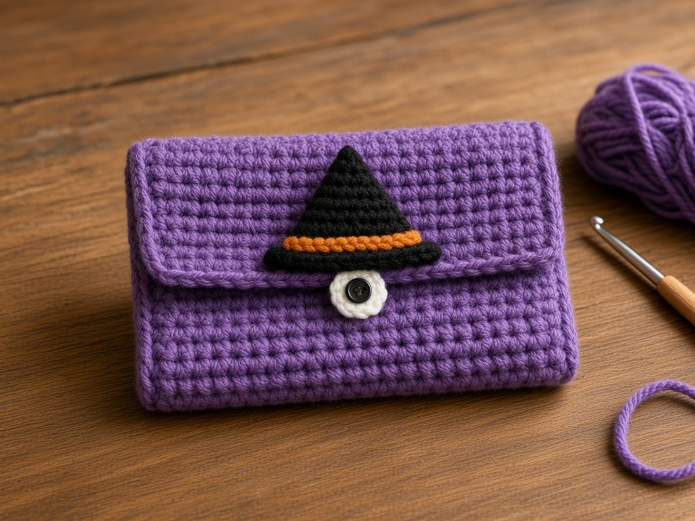
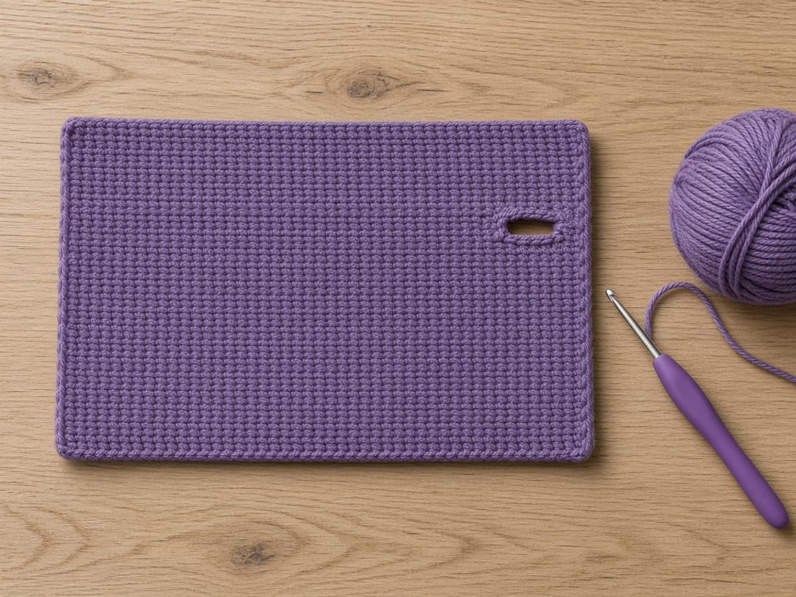
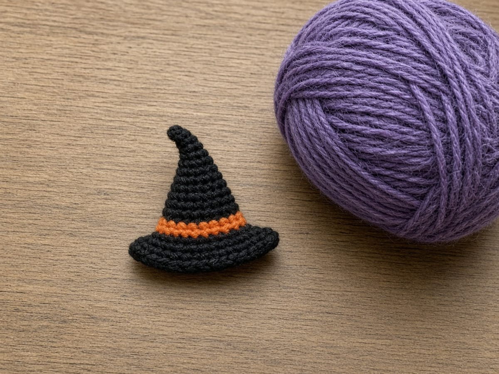

A wallet with one pocket fills up fast, and the card you want is always at the back. This witch hat wallet has an inner divider, so there are two pockets the same size: cards in one, folded cash or a transit pass in the other. The flap closes with a buttonhole you crochet into a row, and the hat sits right above it.

It is one of five patterns in the [Halloween crochet wallet collection](/halloween-crochet-wallets/). The new skills here are a worked buttonhole and seaming through three layers.

## What is checked, and what is not

| Claim | How solid it is |
| --- | --- |
| A standard card is 3.370 x 2.125 in | Fixed by ISO/IEC 7810 (ID-1) |
| Rectangle, divider, hat, and buttonhole counts | Each row added up on paper |
| 16 sc and 20 rows per 4 in | Example gauge only; swatch to confirm yours |
| Pocket sizes and the 5/8 in button fit | Calculated, then flagged for you to test. Not yet crocheted. |
| The image at the top | Generated artwork of the idea, not a sample |

## Materials

- **Worsted weight (CYC 4) yarn** in purple. A cotton or cotton blend keeps the buttonhole from stretching. [Yarn weight chart](/yarn-weight-chart/).
- **Scraps** of black and orange for the hat.
- **US G/6 (4.0 mm) hook**, or the size that gives the gauge. [Hook size chart](/crochet-hook-size-conversion-chart/).
- **One button**, 5/8 in (15 mm), flat, with holes rather than a tall shank. A shank button pushes into the cards.
- Purple thread or yarn for the button, a tapestry needle, stitch markers, one card.

**Estimating yarn.** No sample has been weighed. The rectangle and divider together are about 39 square inches, which is 2.4 four-inch squares. Weigh your swatch, scale it up, and keep a fifth extra for seams.

## Abbreviations and stitches

US terms. See the [abbreviations chart](/crochet-abbreviations-chart/).

| Abbreviation | Meaning |
| --- | --- |
| ch | chain |
| sc | single crochet |
| sk | skip |
| sp | space |
| sc2tog | single crochet two together: pull up a loop in each of 2 stitches, yarn over, pull through all 3 loops |
| sc3tog | single crochet three together: the same with 3 stitches |
| st(s) | stitch(es) |

**Turning.** Each row opens with ch 1 and a turn. Do not count that chain.

**Color change.** Work the last stitch of the old color until two loops remain on the hook, then pull the new color through. [Changing yarn color](/changing-yarn-color-crochet/) shows it step by step.

## Size and gauge

**Gauge:** 16 sc and 20 rows = 4 in. Measure a swatch first, as in the [gauge guide](/crochet-gauge/).

Seventeen stitches make 4.25 inches; after the side seams, each pocket is about 3.9 inches wide against a 3.37 inch card. The front and back are 12 rows each, 2.4 inches, so each pocket is about 2.3 inches deep inside, enough for a 2.125 inch card. The flap is 9 rows, about 1.8 inches. The buttonhole is 3 stitches, about 0.75 inch, which is the usual starting point for a 5/8 inch button, since crochet holes stretch.

## The pattern

### Stage 1: the main rectangle

<figure class="diagram">

<figcaption>Diagram. Three zones in one piece. The chain edge becomes the front rim.</figcaption>
</figure>

With purple:

**Row 1:** Ch 18. Sc in the 2nd ch from the hook and in each ch across. (17)

**Rows 2–30:** Ch 1, turn. Sc in each st across. (17)

Place a marker at the end of row 12 and row 24; those are the two folds.

**Row 31 (buttonhole):** Ch 1, turn. Sc in the next 7 sts, ch 3, sk 3 sts, sc in the last 7 sts. (14 sc and a ch-3 space)

**Row 32:** Ch 1, turn. Sc in the next 7 sts, 3 sc in the ch-3 sp, sc in the last 7 sts. (17)

**Test the button now.** Push it through the hole. It should pass with a little resistance. If it falls through, redo row 31 as sc 7, ch 2, sk 2, sc 8, and row 32 as sc 7, 2 sc in the space, sc 8. If it will not pass, redo row 31 as sc 6, ch 4, sk 4, sc 7, and row 32 as sc 7, 4 sc in the space, sc 6.

**Row 33:** Ch 1, turn. Sc2tog, sc in the next 13 sts, sc2tog. (15)

Fasten off and weave in.

<figure class="diagram">

<figcaption>Diagram. Count 17 after row 32. The hole sits over stitches 8 to 10.</figcaption>
</figure>

### Stage 2: the divider

**Row 1:** With purple, ch 18. Sc in the 2nd ch from the hook and across. (17)

**Rows 2–11:** Ch 1, turn. Sc in each st across. (17)

Fasten off. The divider is 11 rows, about 2.2 inches, one row shorter than the front, so its top edge stays below the rim and does not show.

### Stage 3: the hat appliqué

<figure class="diagram">

<figcaption>Diagram. Hat band in orange, the rest in black. Keep row 31 clear.</figcaption>
</figure>

**Cone:**

**Row 1:** With orange, ch 6. Sc in the 2nd ch from the hook and across, changing to black on the last yarn over. (5) Cut orange, leaving a tail.

**Row 2:** Ch 1, turn. Sc in each st. (5)

**Row 3:** Ch 1, turn. Sc2tog, sc in the next st, sc2tog. (3)

**Row 4:** Ch 1, turn. Sc in each st. (3)

**Row 5:** Ch 1, turn. Sc3tog. (1) Fasten off with a 12 inch tail.

**Brim:** With black, ch 9. Sc in the 2nd ch from the hook and across. (8) Fasten off with a 10 inch tail.

The hat is about 1.25 inches wide at the band and about 1.2 inches tall with the brim.

**Sew it on before seaming,** while the flap is a single layer. Fold the flap down over the front so you can see where it lands. Place the brim on row 30, centered on stitch 9, and the cone's orange row on top of the brim, with the tip reaching row 25 at the fold. Whipstitch around the edges through the flap only. Do not cover or sew into row 31; the button has to come through.

### Stage 4: assembly

<figure class="diagram">

<figcaption>Diagram. Two pockets of the same width, sealed by the same side seams.</figcaption>
</figure>

1. **Fold.** Fold rows 1 to 12 up against rows 13 to 24, right sides out. The chain edge is now the front rim.
2. **Divider.** Slide it between the front and back, its lower edge in the fold. Clip all three layers at both sides.
3. **Side seams.** Join purple at the bottom fold on one side. Ch 1. Work 12 sc up the side, one in each row end, through front, divider, and back. The 12th stitch catches only front and back, because the divider is one row shorter. Fasten off. Repeat on the other side.
4. **Button.** Put two cards in, close the flap, and mark the front through the buttonhole. It should land near row 7, stitch 9, about 1.3 inches below the fold. Sew the button there through the front layer only, so it does not stitch the pocket shut.
5. **Ends.** Weave them along the seams, as in [weaving in ends](/weaving-in-ends-and-blocking/).

To stop the divider from riding up when you pull a card out, tack its lower edge to the fold with a few whipstitches at the center and each quarter.

## Make it yours

- **One pocket.** Skip the divider. The seams stay the same.
- **Snap instead of button.** Skip the buttonhole: work rows 31 and 32 as plain sc. Sew a 3/8 inch snap under row 31 at the center and on the front at the mark.
- **Edged flap.** Work one round of slip stitch around the flap edges for a firmer outline.
- **Other hat colors.** A green or purple band, or a black hat with a silver band. Keep the band a color that shows against the flap.
- **Lining.** Line the back only, so the divider still fits. Cut fabric 4.25 by 2.4 inches plus a 1/4 inch fold.

## Common mistakes and fixes

**Row 32 has 16 or 18 stitches.** The ch-3 space got 2 or 4 sc. It takes 3, one for each skipped stitch.

**The buttonhole is off center.** Count 7 before the chain. The hole should be over stitches 8 to 10.

**The flap lifts at the corners.** The decrease row is what lets it lie flat. Make sure row 33 has 15.

**The hat covers the buttonhole.** The brim drifted below row 30. Unpick and move it up a row.

**The divider shows above the rim.** It has 12 rows instead of 11. Pull out the last row.

**The button pulls the front out of shape.** It was sewn without cards inside. Mark with cards in place, and add a small flat button on the inside as a backer if the fabric is soft.

## Care

Wash by hand, cool, and dry it flat. Orange and black scraps sometimes bleed onto purple, so blot a wet scrap of each on paper towel first. Wash it on its own; the button can scratch.

## Frequently asked

**Will cards fit both pockets?** On paper, each pocket is about 3.9 by 2.3 inches inside, against a 3.37 by 2.125 inch card. It has not been made and measured.

**Why 3 stitches for a 5/8 inch button?** Three stitches measure about 0.75 inch at the gauge, and crochet stretches around a button. The test after row 32 is the real check.

**Can I add more pockets?** A second divider makes three, but each pocket then holds only one or two cards, and the side seams become very thick.

**Is the hat sewn or crocheted on?** Sewn. It is crocheted separately so you can position it exactly.

**Can I sell wallets I make from it?** Yes. If you share the design, link to this page; do not republish the rows.

## More Halloween wallets

- [Black cat crochet wallet](/black-cat-crochet-wallet/): a seamless tube with ears
- [Ghost crochet wallet](/ghost-crochet-wallet/): shaped panels and a scalloped hem
- [Pumpkin crochet wallet](/pumpkin-crochet-wallet/): back-loop ribs and a leaf tab
- [Spiderweb crochet wallet](/spiderweb-crochet-wallet/): an embroidered web and a button loop

The decreases in row 33 and the hat cone are explained in [increases and decreases](/crochet-increase-decrease/).

The witch hat wallet depends on two tests: the button through the hole after row 32, and the cards inside before you mark the button. Do both, and the rest is straight single crochet.
