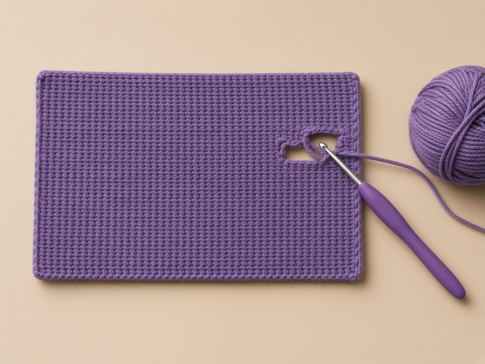
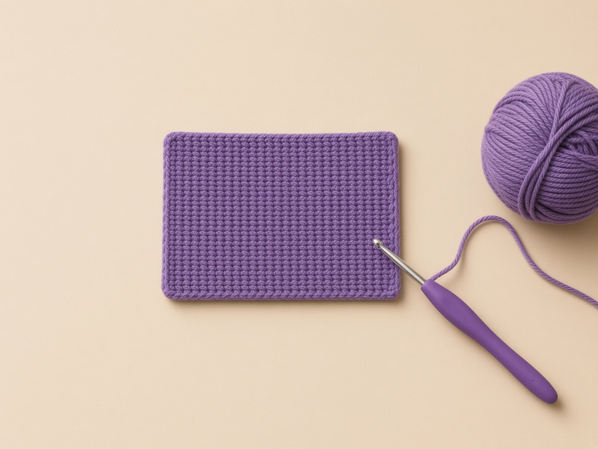
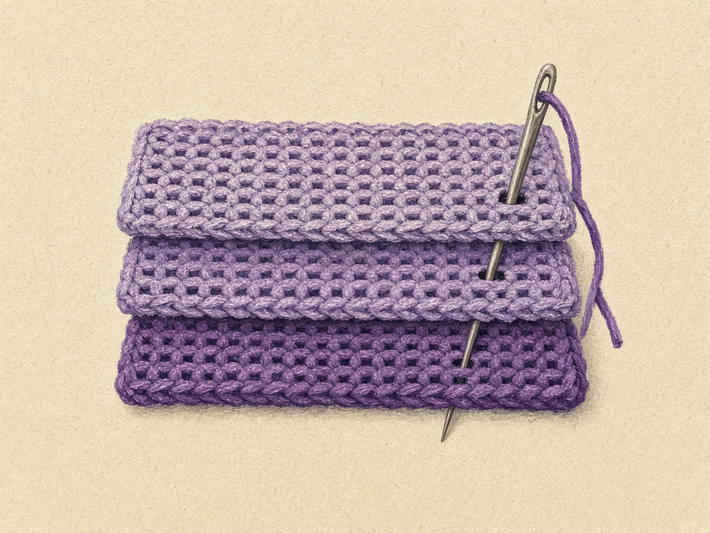

A wallet with one pocket fills up fast, and the card you want is always at the back. This witch hat wallet has an inner divider, so there are two pockets the same size: cards in one, folded cash or a transit pass in the other. The flap closes with a buttonhole you crochet into a row, and the hat sits right above it.

It is one of five patterns in the [Halloween crochet wallet collection](/halloween-crochet-wallets/). The new skills here are a worked buttonhole and seaming through three layers.

The pocket sizes and the 5/8 inch button fit here are worked out from the example gauge rather than measured from a finished wallet, so swatch first and test with a real bank card and your button before you sew up. A standard US bank card is 3.370 by 2.125 inches, the ISO/IEC 7810 ID-1 size.

## Materials

- **Worsted weight (CYC 4) yarn** in purple. A cotton or cotton blend keeps the buttonhole from stretching. [Yarn weight chart](/yarn-weight-chart/).
- **Scraps** of black and orange for the hat.
- **US G/6 (4.0 mm) hook**, or the size that gives the gauge. [Hook size chart](/crochet-hook-size-conversion-chart/).
- **One button**, 5/8 in (15 mm), flat, with holes rather than a tall shank. A shank button pushes into the cards.
- Purple thread or yarn for the button, a tapestry needle, stitch markers, one card.

#### Weigh the swatch, then scale it

1. No sample has been weighed.
2. The rectangle and divider together are about 39 square inches, which is 2.4 four-inch squares.
3. Weigh your swatch, scale it up, and keep a fifth extra for seams.

Black and orange are scraps: a 5-stitch cone over 5 rows, and an 8-stitch brim one row tall. Cotton or a cotton blend is named here because the buttonhole stretches less than a soft acrylic.

## Abbreviations and stitches

US terms. See the [abbreviations chart](/crochet-abbreviations-chart/).

| Abbreviation | Meaning |
| --- | --- |
| ch | chain |
| sc | single crochet |
| sk | skip |
| sp | space |
| sc2tog | single crochet two together: pull up a loop in each of 2 stitches, yarn over, pull through all 3 loops |
| sc3tog | single crochet three together: the same with 3 stitches |
| st(s) | stitch(es) |

#### Turning

1. Each row opens with ch 1 and a turn.
2. Do not count that chain.
3. The first single crochet goes into the first stitch.

#### Color change

1. Work the last stitch of the old color until two loops remain on the hook.
2. Pull the new color through those two loops.
3. [Changing yarn color](/changing-yarn-color-crochet/) shows it step by step.

The [abbreviations chart](/crochet-abbreviations-chart/) is the list to check when ch, sk, and sc start to look like the same instruction. Skipping is a buttonhole action. It does not belong on rows 1 through 30.

## Size and gauge

**Gauge:** 16 sc and 20 rows = 4 in. Measure a swatch first, as in the [gauge guide](/crochet-gauge/).

#### Apply the gauge to the counts

1. Seventeen stitches make 4.25 inches.
2. After the side seams, each pocket is about 3.9 inches wide against a 3.37 inch card.
3. The front and back are 12 rows each, 2.4 inches, so each pocket is about 2.3 inches deep inside, enough for a 2.125 inch card.
4. The flap is 9 rows, about 1.8 inches.
5. The buttonhole is 3 stitches, about 0.75 inch, which is the usual starting point for a 5/8 inch button, since crochet holes stretch.

| Piece | Count at the example gauge | Figured size |
| --- | --- | --- |
| Outside width | 17 stitches at 16 sc to 4 inches | 4.25 in |
| Inside width, after the side seams | same 17 | about 3.9 in |
| Front and back height | 12 rows at 20 rows to 4 inches | 2.4 in |
| Inside depth | same 12 rows | about 2.3 in |
| Flap | 9 rows | about 1.8 in |
| Buttonhole | 3 stitches | about 0.75 in |
| Divider | 11 rows | about 2.2 in |

## How to read the rectangle and the divider

The witch hat wallet is one purple rectangle, a shorter purple rectangle inside it, and a small hat sewn to the flap.

<figure class="diagram">

<figcaption>Diagram. Front and back are 12 rows each. The divider stops at 11.</figcaption>
</figure>

#### Two pockets come from one divider, fully attached

1. The two pockets are the same size on paper because the divider is caught in the bottom fold and in the side seams, not because you crochet two separate pouches.
2. If the divider is tacked in three places instead of along all 17 chains, a card will pass under it and the two pockets become one.

#### Width from the example gauge

1. At the example gauge, 16 single crochet equal 4 inches, so 17 stitches are 4.25 inches across.
2. That is the outside width of the rectangle and of the divider.
3. After the side seams, each pocket is about 3.9 inches wide inside.
4. The 0.35 inch difference is the paper allowance for the two side seams.
5. On this wallet the seams pass through three layers for most of their height, so they can take up at least as much as a two-layer seam.
6. A US bank card is 3.370 inches wide. Against 3.9 inches, the paper clearance is a little over half an inch.
7. That clearance is arithmetic from the example gauge, not a measurement from a finished wallet.
8. Test with a real card in each pocket before you call the seams done.

#### Depth, and why the divider stops at 11

1. Depth is rows. Twenty rows equal 4 inches in the example, so one row is 0.2 inch.
2. Twelve rows are 2.4 inches, the outside height of the front and of the back.
3. Each pocket is about 2.3 inches deep inside, a tenth of an inch for the fold.
4. The card's short side is 2.125 inches, so the paper room for a fingertip is under a fifth of an inch.
5. That is tighter than the spiderweb wallet's 13-row pocket, and it is why this pattern does not add a twelfth row to the divider.
6. Eleven rows are 2.2 inches at the same gauge, one row shorter than the front, so the divider hides under the rim instead of standing up past it.

If you work 12 rows on the divider because the front is 12, the extra row shows as a second rim inside the opening. Pull that row out. The pattern says to stop at row 11.

#### The flap is nine rows, and the button mark is not a fixed row

1. The flap is rows 25 through 33, nine rows, about 1.8 inches.
2. Row 31, the buttonhole, sits inside that flap, not on the pocket.
3. Nine times 0.2 is 1.8, which matches the size section.
4. The button, once marked, lands on the front, near row 7 at stitch 9 in the example, about 1.3 inches below the fold.
5. Use the mark the buttonhole actually makes when cards are inside.
6. The 1.3 inch figure is where the example gauge puts a 5/8 inch button under a 1.8 inch flap.
7. A taller row gauge moves that mark.
8. Do not sew the button on row 7 just because the sentence names row 7.

#### Count 17 on row 1 of each piece

1. Chain 18 and single crochet across for 17.
2. The same start builds the divider later.
3. Count 17 on row 1 of each piece before you turn.
4. Every plain row after that is chain 1, which does not count, then 17 single crochet.

| Count on row 1 | What happened |
| --- | --- |
| 18 | The chain next to the hook was used |
| 17 | Second chain through the last chain. This is the row. |
| 16 | A chain was skipped |

#### The two markers split front, back, and flap

1. Marker one goes in the last stitch of row 12. That is the bottom fold.
2. Marker two goes in the last stitch of row 24. That is the top fold, where the flap begins.
3. Rows 25 through 30 are still plain 17s. They are flap, not pocket.
4. The side seam instruction, 11 three-layer stitches plus one two-layer stitch, assumes front and back are both 12 rows.

If the second marker goes in at row 26 because you were counting the flap from 1 again, the back becomes 14 rows and the front stays 12. Unequal panels make position 12 land in the middle of a layer instead of at the opening.

#### After the fold, the chain edge is the front rim

1. After the fold, the chain edge of the main rectangle is the front rim.
2. Row 1 is at the opening.
3. Row 12 is at the bottom fold, meeting row 13.
4. The divider's chain edge also goes into that bottom fold, on the inside.
5. All 17 of its chain stitches are whipstitched there in a continuous line.

A few tacks leave a gap. A card slips through the gap into the other pocket, which feels like the divider failed when the seam was simply unfinished.

## What the buttonhole row should count

<figure class="diagram">

<figcaption>Diagram. Test the button after row 32, before the decrease row.</figcaption>
</figure>

#### Say 7 before you chain

1. Row 31 is the first row that is not 17 single crochet.
2. Chain 1, turn, single crochet in the first 7 stitches, chain 3, skip the next 3 stitches, single crochet in the last 7.
3. Say the 7 out loud before you chain.
4. The skipped stitches are numbers 8, 9, and 10 of the row you are looking at.
5. The hole sits over those three.
6. You should have 14 single crochet and one chain-3 space.

| Single crochet on row 31 | What the skip did |
| --- | --- |
| 14, plus one chain-3 space | Skipped 3. The hole covers stitches 8, 9, and 10. |
| 15 | You skipped only 2 and the chain-3 is extra yarn across a smaller gap. Pull the row out. |
| 13 | You skipped 4. Pull the row out. |

Do not even it up on row 32. Pull row 31 out.

#### Row 32 puts the 3 stitches back

1. Single crochet in the first 7.
2. Then 3 single crochet into the chain-3 space, all three in that same hole.
3. Then single crochet in the last 7.
4. Count 17.
5. The 3 in the space replace the 3 you skipped, one for one, so the fabric on either side of the hole does not shift.
6. The hole remains in the middle, over what were stitches 8, 9, and 10.

| Count after row 32 | What the space received |
| --- | --- |
| 16 | The space got 2 stitches |
| 17 | The space got 3. This is the return row. |
| 18 | The space got 4 |

#### Test the 5/8 inch button before row 33

1. Push the 5/8 inch button through the hole after row 32 and before row 33.
2. It should pass with a small push.
3. Three stitches at a quarter inch each are about 0.75 inch, which is the usual starting hole for a 5/8 inch button because the chain stretches.

| What the button does | Row 31 | Row 32 |
| --- | --- | --- |
| Passes with a small push | 7 sc, chain 3, skip 3, 7 sc | 7 sc, 3 sc in the space, 7 sc |
| Falls through | 7 sc, chain 2, skip 2, 8 sc | 7 sc, 2 sc in the space, 8 sc |
| Will not pass | 6 sc, chain 4, skip 4, 7 sc | 7 sc, 4 sc in the space, 6 sc |

4. On the larger hole, row 31 has 6 on the leading side and 7 on the far side, and row 32 has 7 and then 6.
5. That reversal puts the extra stitches back on the side that had fewer, so the hole does not walk toward one edge.

Inventing your own pair, such as 6 and 7 on both rows, shifts the hole and the hat, which is centered on stitch 9, will no longer sit above it.

#### Row 33 narrows the corners

1. Decrease over the first 2 stitches.
2. Single crochet in the next 13.
3. Decrease over the last 2.
4. Count 15.
5. Fasten off.
6. A row 33 that is still 17 leaves the corners square, and the flap lifts at the sides when the button is closed.
7. Do not decrease on row 30. The buttonhole needs a full 17-stitch row under it and a full return to 17 above it before the corners come in.

#### Keep the hat off row 31

1. The hat stays off row 31.
2. The brim is an 8-stitch black strip: chain 9, single crochet across, count 8.
3. Pin it on row 30 with stitch 9 of the flap in the middle of those 8 stitches.
4. The strip stays on row 30, above the hole, not across it.
5. The cone's orange row sits on top of the brim.
6. The black tip should reach row 25, at the top fold.
7. Row 25 is the first flap row.

| Where the hat sits | What it does |
| --- | --- |
| Brim on row 30, tip at row 25 | The hole on row 31 stays clear, and the tip meets the top fold |
| Brim on row 31 | It covers the chain space and the button cannot pass. Unpick and move it up. |
| Tip stops at row 28 | Sitting too low, crowded against the brim, and it will be pushed onto the hole when you sew |
| Tip passes row 25 onto row 24 | On the back of the wallet, past the fold, and it will be caught in the pocket when you close the flap |

#### The cone is five rows and one color change

1. With orange, chain 6.
2. Single crochet in the second chain from the hook and in the next 3 chains: that is 4 orange stitches.
3. The last chain starts in orange and finishes in black when 2 loops remain on the hook. Count 5.
4. Cut the orange.
5. Row 2 is black, 5 single crochet.
6. Row 3 is a decrease, 1 single crochet in the middle, a decrease, count 3.
7. Row 4 is 3 single crochet.
8. Row 5 pulls up a loop in each of those 3, yarn over, and pulls through all four loops. One stitch remains.
9. That one stitch is the tip that should reach row 25.
10. At the example gauge the hat is about 1.25 inches wide at the band and about 1.2 inches tall with the brim.
11. Those are paper sizes from 5 stitches and the row gauge, not measurements from a sewn sample.

#### Sew the hat while the flap is one layer

1. Sew the hat while the flap is still one layer, before any side seam.
2. Whipstitch around the brim and the cone through the flap only.
3. Then look at row 31 again.
4. The hole is completely clear, or you move the brim.

## The pattern

### Step 1: plain rows up to the buttonhole

<figure class="diagram">

<figcaption>Diagram. Three zones in one piece. The chain edge becomes the front rim.</figcaption>
</figure>

Use purple.

1. Chain 18. Single crochet in the second chain from the hook and in each chain across. Count 17.
2. For every following row until you reach row 30: chain 1, turn, single crochet in each stitch, count 17.
3. After row 12, put a marker in the last stitch. That is the bottom fold.
4. After row 24, put a marker in the last stitch. That is the top fold.
5. Finish rows 25 through 30 the same plain way. Count 17 at the end of row 30.

#### Name the three zones before the hole

1. Rows 1 to 12 are the front. The marker is the bottom fold.
2. Rows 13 to 24 are the back. The marker is the top fold.
3. Rows 25 to 30 are already flap, and they are still 17 single crochet.
4. Do not skip a stitch until row 31.

### Step 2: the buttonhole, then count back to 17

**Row 31**

1. Chain 1 and turn.
2. Single crochet in the first stitch. Then the next, until you have made 7. Say the numbers out loud.
3. Chain 3. Skip the next 3 stitches. Do not put the hook in them.
4. Single crochet in each of the last 7 stitches.
5. You should have 14 single crochet and one chain-3 space. The hole sits over stitches 8, 9, and 10.

**Row 32**

1. Chain 1 and turn.
2. Single crochet in the first 7 stitches.
3. Make 3 single crochet into the chain-3 space, all three in that same hole. One for each stitch you skipped.
4. Single crochet in the last 7 stitches.
5. Count across. You need 17 again. Sixteen means the space got 2 stitches. Eighteen means it got 4.

#### Redo only if the button test fails

1. Push the button through the hole now, before row 33. It should pass with a small push.
2. If it falls through, pull out rows 31 and 32 and redo them as: row 31 is 7 single crochet, chain 2, skip 2, 8 single crochet; row 32 is 7 single crochet, 2 single crochet in the space, 8 single crochet.
3. If the button will not pass, redo row 31 as 6 single crochet, chain 4, skip 4, 7 single crochet, and row 32 as 7 single crochet, 4 single crochet in the space, 6 single crochet.
4. On that larger hole, the return row reverses the side counts so the hole stays near the middle.

**Row 33.** Chain 1, turn. Decrease over the first 2 stitches, single crochet in the next 13, decrease over the last 2. Count 15. Fasten off and weave the tail in. The decrease lets the flap corners lie down.

<figure class="diagram">

<figcaption>Diagram. Count 17 after row 32. The hole sits over stitches 8 to 10.</figcaption>
</figure>

### Step 3: the divider, one row shorter than the front

<figure class="diagram">

<figcaption>Diagram. Eleven rows, so the divider stays under the rim.</figcaption>
</figure>

1. With purple, chain 18. Single crochet in the second chain from the hook and across. Count 17.
2. Rows 2 through 11: chain 1, turn, single crochet in each stitch, count 17.
3. Stop at row 11. Do not add a twelfth row. Fasten off.

#### Hold it against the front before you sew

1. Eleven rows is about 2.2 inches at the example gauge, one row shorter than the 12-row front.
2. The shortfall is what keeps the divider hidden under the rim.
3. If the edges match the rim, you have 12 rows. Pull the last one out before it is inside the wallet, where it is harder to see.

### Step 4: the hat cone, then the brim strip

<figure class="diagram">

<figcaption>Diagram. Hat band in orange, the rest in black. Keep row 31 clear.</figcaption>
</figure>

**Cone**

1. With orange, chain 6. Single crochet in the second chain from the hook and in the next 3 chains. That is 4 stitches so far.
2. On the last chain, start the single crochet with orange. When 2 loops are left on the hook, drop orange and pull black through those 2 loops. Count 5.
3. Cut the orange and leave a short tail.
4. Row 2, black: chain 1, turn, single crochet in each of the 5 stitches. Count 5.
5. Row 3: chain 1, turn, decrease, 1 single crochet in the middle stitch, decrease. Count 3.
6. Row 4: chain 1, turn, single crochet in each of the 3 stitches. Count 3.
7. Row 5: chain 1, turn, pull up a loop in each of the 3 stitches, yarn over, pull through all four loops. One stitch remains.
8. Fasten off with a tail about 12 inches long.

#### Check the color change before row 2

1. The first four stitches of row 1 are fully orange.
2. The fifth stitch is the color change: orange until two loops remain, then black.
3. If the orange runs out on the first stitch of the cone, finish that stitch with the black you were about to change to anyway, and the band disappears.
4. Keep enough orange for four full stitches and the start of the fifth.

**Brim**

1. With black, chain 9.
2. Single crochet in the second chain from the hook and in each chain across. Count 8.
3. Fasten off with a tail about 10 inches long.

At the example gauge the hat is about 1.25 inches wide at the band and about 1.2 inches tall with the brim.

**Sew the hat on before any side seam**, while the flap is one layer.

1. Fold the flap down over the front so you can see where it will land.
2. Pin the brim on row 30, with stitch 9 in the middle of the 8-stitch strip.
3. Pin the cone's orange row on top of the brim. The black tip should reach row 25, at the fold.
4. Whipstitch around the brim and the cone, through the flap only.
5. Look at row 31. The hole must be completely clear. If a stitch covers it, unpick and move the brim up.

### Step 5: fold, sew the divider to the bottom, then seam the sides

<figure class="diagram">

<figcaption>Diagram. Stitch 1 is at the fold. Stitch 12 is at the opening.</figcaption>
</figure>

1. Fold rows 1 to 12 up against rows 13 to 24, right side out. The chain edge is the front rim.
2. Slide the divider between the front and the back. Its chain edge goes into the bottom fold.
3. Whipstitch all 17 chain stitches of the divider to the inside of that fold. Use shallow stitches so they do not show on the outside. The line has to be continuous. A few tacks leave a gap, and a card will slip under the divider into the other pocket.
4. Clip the three layers at both sides. Divider row ends 1 through 11 line up with the first 11 row ends of the front and back. The front and back have one extra row end at the top. That extra one is position 12.
5. Join purple at the bottom fold on one side. Chain 1.
6. Make single crochet 1 through 11 through all three layers, one in each row end.
7. Make stitch 12 through the front and the back only. The divider has already ended.
8. Count 12. Fasten off. Repeat on the other side.
9. Put one card in each pocket. Neither card should pass under the divider. If one does, the bottom seam has a gap. Open that side and close the gap before you continue.
10. Close the flap. Mark the front through the buttonhole. At the example gauge that mark is near row 7, stitch 9, about 1.3 inches below the fold. Use the mark the buttonhole actually makes.
11. Sew the button there, through the front layer only.
12. Weave the tails along the seams, as in [weaving in ends](/weaving-in-ends-and-blocking/).

#### Position 12 is the opening

1. Positions 1 through 11 go through front, divider, and back.
2. Position 12 goes through front and back only.
3. Count 12 on each side before you fasten off.

## Order that keeps the hole clear and the pockets separate

The hat, the divider, and the side seams overlap in space. The hat wants row 30. The buttonhole is row 31. The divider wants the bottom fold and the first 11 side stitches. Doing those in the wrong order covers the hole or opens a tunnel between the pockets.

<figure class="diagram">

<figcaption>Diagram. The hat is on before the sides. Position 12 does not catch the divider.</figcaption>
</figure>

#### Hole first, decrease last

1. Work the purple rectangle through row 30 as plain rows of 17, with the marker in row 12 and the marker in row 24, before you make the hole.
2. Then work row 31 as 7 single crochet, chain 3, skip 3, 7 single crochet.
3. Work row 32 as 7 single crochet, 3 single crochet in the chain space, 7 single crochet.
4. Count 17. Test the 5/8 inch button.
5. Only if that test fails do you rip back and use the chain-2 or chain-4 pair written in the pattern.
6. Then work row 33: decrease, 13 single crochet, decrease, count 15, and fasten off.
7. The decrease is last so you are not trying to center a hole inside a row that is already 15 stitches wide.

#### Divider before the fold is sewn

1. Make the divider next, or whenever you like, as long as it is finished before the fold is sewn.
2. Seventeen stitches, 11 rows, then stop.
3. Hold it against the front. It should end one row below the front rim.
4. If the edges match the rim, you have 12 rows.
5. Pull the last one out before it is inside the wallet, where it is harder to see.

#### Hat while the flap is still one layer

1. Make the cone and the brim before any side stitch.
2. Fold the flap down over the front so you can see the closed position.
3. Pin the brim on row 30 centered on stitch 9.
4. Pin the orange band of the cone on that brim.
5. Check that the black tip reaches row 25 and that row 31 is still a clean hole.
6. Whipstitch through the flap only.
7. This is the last moment the flap is a single layer you can lift and look under.
8. Once the sides are seamed you can still unpick the hat, but you will be sewing above a pocket and it is easier to catch the front by mistake.

#### Seventeen chains, then twelve side stitches

1. Fold rows 1 to 12 up against rows 13 to 24, right side out. The chain edge is the front rim.
2. Slide the divider between them with its chain edge in the bottom fold.
3. Whipstitch all 17 chain stitches to the inside of that fold.
4. Shallow stitches, so they do not show on the outside, and a continuous line.
5. Count the whipstitches if you cannot see them: 17, one per chain.
6. Then clip the three layers at the sides.
7. Divider row ends 1 through 11 line up with the first 11 row ends of the front and of the back.
8. The front and the back have one more row end at the top. That extra one is position 12.
9. Join at the bottom fold.
10. Single crochet 1 through 11 through all three layers.
11. Single crochet 12 through the front and the back only.
12. Count 12. Fasten off. Repeat on the other side.
13. Position 12 is the opening.
14. Twelve is the whole seam. Eleven of them include the divider. One does not.

| Position | Layers | If you change it |
| --- | --- | --- |
| 1 through 11 | Front, divider, and back | Skipping the divider here leaves a side gap |
| 12 | Front and back only | Sending it through the divider sews the divider to the rim, and the one-row-shorter planning is undone |
| Stop at 11 | The corner is open | A card catches at the top of the pocket |

#### One card in each pocket

1. Put one card in each pocket.
2. The front pocket is the space between the front and the divider.
3. The back pocket is the space between the divider and the back.
4. Neither card should pass under the divider into the other space.
5. If one does, the bottom seam has a gap between two of the 17 chains.
6. Open that side enough to reach the gap, close it, and test again.
7. Do not add a second divider to catch the card. The pattern's two pockets come from one 11-row piece, fully attached.

#### Mark with cards in, sew through the front only

1. Close the flap with the cards still in.
2. Mark the front through the buttonhole.
3. At the example gauge that mark is near row 7, stitch 9, about 1.3 inches below the fold.
4. Sew the button there, through the front layer only.
5. A stitch that also catches the divider pins one pocket shut.
6. You will notice when the front card will not go in past the button.
7. Take the cards out before you sew, so you are not stitching through plastic, but mark while they are in, so the flap is sitting where it will sit in use.

#### The last look

1. Row 32 was 17 before row 33 became 15.
2. The hole is over the middle, clear of the brim.
3. The brim is on row 30, the tip on row 25.
4. The divider is 11 rows and 17 chains, all 17 chains sewn into the fold.
5. Each side seam is 12 stitches, the twelfth through two layers.
6. The button is on the front only, at the mark the hole made.
7. The stem of a pumpkin, or a loop at a point, does not belong on this flap.
8. This closure is the worked hole and the 5/8 inch button.

#### Yardage, and the orange for the band

1. Yardage stays the estimate in the materials list.
2. The rectangle and the divider together are about 39 square inches, 2.4 four-inch squares, plus a fifth for seams.
3. Weigh the swatch. No finished wallet has been weighed for this page.
4. Black and orange are scraps: a 5-stitch cone over 5 rows, and an 8-stitch brim one row tall.
5. If the orange runs out on the first stitch of the cone, finish that stitch with the black you were about to change to anyway, and the band disappears.
6. The color change is the last stitch of row 1, the fifth stitch, so keep enough orange for four full stitches and the start of the fifth.

#### A loose hole is the chain-2 redo, not a sewn bar

1. Cotton or a cotton blend is named in the materials because the buttonhole stretches less than a soft acrylic.
2. The same counts in a drapey yarn still make a hole of 3 chains, and that hole will grow past the 0.75 inch paper size the first time the button is forced through.
3. If your test after row 32 already feels loose, use the chain-2 redo written above before you continue to row 33.
4. Do not tighten the hole by sewing across it. A sewn-across hole is no longer the buttonhole in row 31.

#### Wash without stretching the hole

1. Wash by hand, cool, and dry flat.
2. Blot wet scraps of orange and black on a paper towel before they touch the purple.
3. Orange that runs will stripe the flap under the hat, which is the part everyone looks at.
4. Wash the wallet on its own. The button can scratch other fabric, and a wet three-layer seam takes longer to dry than the flap.
5. Shape the opening while it is damp so position 12 stays at the rim and the divider stays a row below it.
6. Do not stretch the buttonhole around a larger button while the yarn is wet. Wet cotton holds whatever size you force it to.

## A count of the layers at the side

#### Read the stack from the outside

1. Stand the wallet on the bottom fold and look at one side edge as a stack.
2. From the outside you see the front, then the divider, then the back.
3. Positions 1 through 11 of the seam go through that whole stack.
4. You can check by opening the pocket and finding the seam stitch from the inside: it should pass through the divider's row end, not skip over it.
5. Position 12, the one nearest the rim, is absent from the divider.
6. From the inside of the front pocket, that top stitch holds the front and the back together at the corner while the divider has already ended.
7. You should be able to see the top of the divider as a raw row sitting just below that stitch, not pierced by it.

#### The bottom seam is not the side seam

1. The bottom is a different seam. It is whipstitch, not the single crochet side seam.
2. It only has to catch the divider's chain edge and the inside of the fold.
3. It should not stitch the front to the back along the bottom in a way that replaces the side seams.
4. The sides are what close the pockets at the left and right.
5. The bottom whipstitch is what stops a card from changing pockets.
6. Both have to exist.

A wallet with beautiful side seams and three tacks along the bottom still fails the two-card test.

#### Count bumps, not the flap

1. Row ends are what you sew through on the sides, one bump per row.
2. Twelve bumps on the front, twelve on the back, eleven on the divider.
3. If you count fourteen bumps on the front, the marker was not at row 12, and the flap has been partly included.
4. Stop and find row 24's marker. Everything above it is flap and stays out of the seam.
5. The flap's own edges can take a round of slip stitch later, as a firmer outline, and that round is not the side seam.
6. It does not pass through the divider.

#### The hat thread is a fourth path

1. The hat's sewing thread is a fourth yarn path, and it should never join this stack.
2. Lift the flap while you check.
3. The underside of the flap shows the whipstitch around the brim and the cone, and the pocket underneath is unmarked.
4. A purple stitch on the front wall in the shape of the brim means you sewed through two layers.
5. Unpick it from the pocket side so the hat stitches on the flap can stay.

#### Button thread is the fifth path

1. Button thread goes through the front wall at the mark.
2. Optionally add a small flat button on the inside as a backer if the fabric is soft.
3. The backer sits in the front pocket, against the front, not through the divider.
4. If the backer is large, it competes with the card. Keep it smaller than the 5/8 inch button on the outside.
5. The pattern's button is flat, with holes, not a tall shank.
6. A shank pushes into the cards because the pocket is only about 2.3 inches deep on paper and the card already fills most of that.

#### Change the hook, not the stitch count

1. Use the [gauge guide](/crochet-gauge/) if the 17 stitches are not close to 4.25 inches.
2. A wider gauge makes the 0.75 inch hole larger too, since the hole is three stitches of that same gauge, and the button test after row 32 becomes more important than the paper 0.75 inch.
3. A tighter gauge makes 17 stitches narrower than the card's 3.370 inches plus seam allowance, and the card will not fit no matter how loosely you seam.
4. Change the hook and re-swatch.
5. Do not drop the rectangle to 15 stitches. The buttonhole math, 7 plus a skip of 3 plus 7, is written for 17.

Check the continuous divider-bottom seam before closing the sides. Sparse tacks can leave openings between the compartments.

## Make it yours

- **One pocket.** Skip the divider. The seams stay the same.
- **Snap instead of button.** Skip the buttonhole: work rows 31 and 32 as plain sc. Sew a 3/8 inch snap under row 31 at the center and on the front at the mark.
- **Edged flap.** Work one round of slip stitch around the flap edges for a firmer outline.
- **Other hat colors.** A green or purple band, or a black hat with a silver band. Keep the band a color that shows against the flap.
- **Lining.** Line the back only, so the divider still fits. Cut fabric 4.25 by 2.4 inches plus a 1/4 inch fold.

## Keep the hat above the buttonhole and the divider below the rim

#### Fold, pin, then seam

1. The rectangle divides into front rows 1–12, back rows 13–24 and flap rows 25–33.
2. Fold first to see the closed flap orientation, then pin the hat on the flap only, leaving row 31's hole clear.
3. For a resized buttonhole, use the specified reversed left and right counts on its return row so the extra stitches do not shift the hole.
4. Anchor the divider's entire lower edge inside the fold before seaming the eleven three-layer positions and final two-layer position.
5. Test one card in each compartment separately. Neither should pass underneath the divider.

## What the hat and the two pockets should look like

#### The hat is a flat appliqué

1. The hat is a flat appliqué, not a stuffed cone and not a hat you could wear.
2. Laid on the open flap, before it is sewn, it has a wide black brim of 8 stitches and a cone that starts at 5 stitches, holds 3, and ends at 1.
3. The orange is one row, the starting row, and only the first four stitches of that row are fully orange.
4. The fifth stitch is the color change, orange until two loops remain, then black.
5. If the whole first row is orange, you changed color on row 2 instead of inside the last stitch, and the band is a row taller than the pattern.
6. If no orange shows, the change happened on stitch 1 and the band is gone.
7. Both are visible before you sew. Fix the cone while it is still a separate piece.

| What you see on row 1 | What the band became |
| --- | --- |
| Four orange stitches, fifth stitch changes to black | The written band |
| The whole first row orange | You changed color on row 2. The band is a row taller. |
| No orange | The change happened on stitch 1. The band is gone. |

#### The silhouette steps outward

1. The silhouette from the tip down should step outward: one stitch, then a row of 3, then a row of 3, then a row of 5, then the brim sticking out past that row of 5 on both ends.
2. The brim is 8 and the cone's base is 5, so the brim extends past the cone.
3. That overhang is the brim.
4. If the brim is the same width as the orange row, it was chained to 6 stitches instead of 8, and it will not read as a hat brim when it sits on row 30.
5. Count 8 before you pin.

#### On the closed flap

1. The brim lies on row 30, stitch 9 in the middle of the strip.
2. The tip reaches row 25, which is the first row of the flap and the row just after the top fold at row 24.
3. The hole is not a gap you cut. It is the chain-3 space, with 3 single crochet worked into it on the following row, so the top of the hole is a solid row of stitches and the bottom is the chain.
4. The button passes between them.

#### Look down into the two pockets

1. The two pockets are easier to see before the button is on.
2. Open the wallet and look down.
3. The divider's top edge sits one row below the front rim.
4. You should see purple, then a step down to the divider, then the back wall behind it.
5. If the divider comes up flush with the rim, it has 12 rows.
6. If you cannot see it at all, it was sewn too far down, or the 17-chain whipstitch pulled it into a roll at the bottom.
7. Smooth it upward until the top edge is just under the rim and the chain edge is still in the fold.
8. Those two conditions can be true at once only when the piece is 11 rows.

#### Count the side from the fold

1. Count the side from the fold, not from the rim, so position 1 stays at the bottom.
2. Position 1 joins front row 12 to back row 13, through the divider.
3. Position 2 joins front row 11 to back row 14.
4. Continue that way: each step moves one row up the front and one row up the back.
5. Position 11 joins front row 2 to back row 23, still through the divider.
6. Position 12 joins front row 1 to back row 24, and the divider is not in that stitch.
7. Row 1 is the chain edge, the front rim.

If your position 12 is joining row 3 to row 22, you started the count in the middle of the side and the divider is either missed at the fold or caught at the rim. Pull the side out and start again at the marker in row 12.

#### The two-card test

1. A card in the front pocket should slide in until it stops at the bottom whipstitch, and the same for a card in the back pocket.
2. Pull gently on each card toward the side seams.
3. Neither card should pop into the other pocket.
4. That pop is a missed chain among the 17.
5. The fix is more whipstitch at the gap, not a tighter side seam.
6. The side seam cannot close a hole that is in the middle of the bottom edge.

#### Closed flap, 15 stitches across the top

1. When the flap is closed, the button sits on the front, under the hole, and the flap corners, which are the decreases of row 33, lie down instead of standing off the front wall.
2. If the corners stick up, row 33 was skipped or it still has 17 stitches.
3. Count the top edge of the flap: 15 stitches, one decrease's worth of narrowing at each end.
4. The hole is below that edge, in from the decreases, still in the middle of the flap.

#### Skip is not a slip stitch

1. Keep the [gauge guide](/crochet-gauge/) next to the swatch until 17 stitches and the row gauge are settled.
2. Keep the [abbreviations chart](/crochet-abbreviations-chart/) next to row 31 so skip is not read as slip stitch.
3. A slip stitch into those three stitches would close the hole you meant to leave.
4. The hook leaves stitches 8, 9, and 10 unworked, the chain 3 bridges them, and row 32 puts three single crochet into the bridge.
5. That is the whole buttonhole.

## Common mistakes and fixes

#### Row 32 has 16 or 18 stitches

1. The ch-3 space got 2 or 4 sc.
2. It takes 3, one for each skipped stitch.
3. Pull row 32 back and put 3 single crochet in the space.

#### The buttonhole is off center

1. Count 7 before the chain.
2. The hole should be over stitches 8 to 10.
3. If the sides are not 7 and 7, pull row 31 out.

#### The flap lifts at the corners

1. The decrease row is what lets it lie flat.
2. Make sure row 33 has 15.
3. A row that is still 17 leaves the corners square.

#### The hat covers the buttonhole

1. The brim drifted below row 30.
2. Unpick and move it up a row.
3. Look at row 31 again. The hole has to be completely clear.

#### The divider shows above the rim

1. It has 12 rows instead of 11.
2. Pull out the last row.
3. Eleven rows are about 2.2 inches, one row shorter than the 12-row front.

#### The button pulls the front out of shape

1. It was sewn without cards inside.
2. Mark with cards in place.
3. Add a small flat button on the inside as a backer if the fabric is soft.
4. Keep that backer smaller than the 5/8 inch button, and keep it out of the divider.

## Care

1. Wash by hand, cool, and dry it flat.
2. Orange and black scraps sometimes bleed onto purple, so blot a wet scrap of each on paper towel first.
3. Wash it on its own. The button can scratch.
4. Shape the opening while it is damp so position 12 stays at the rim and the divider stays a row below it.
5. Do not stretch the buttonhole around a larger button while the yarn is wet.

## Frequently asked

### Will cards fit both pockets?

1. On paper, each pocket is about 3.9 by 2.3 inches inside, against a 3.37 by 2.125 inch card, so test both pockets with a real card before you sew up.
2. The width is 17 stitches at 16 single crochet to 4 inches, after the seams.
3. The depth is 12 rows at 20 rows to 4 inches, after the fold, which the size section calls about 2.3 inches inside.
4. The divider does not change that paper size. It splits one pocket into two of the same plan.
5. A card that fits the front and not the back usually means the back was caught in the button stitches or the divider was sewn to the rim at position 12.
6. Fix that stitch. Do not add a row to the back only.
7. Front and back are both 12 so the pairs stay even.

### Why 3 stitches for a 5/8 inch button?

1. Three stitches measure about 0.75 inch at the gauge, and crochet stretches around a button.
2. The test after row 32 is the real check.
3. If the button falls through, use the written chain-2 version: 7 single crochet, chain 2, skip 2, 8 single crochet, then 7 single crochet, 2 in the space, 8 single crochet.
4. If it will not pass, use the chain-4 version: 6, chain 4, skip 4, 7, then 7, 4 in the space, 6.
5. Keep those reversed side counts on the return row so the hole stays near the middle, under the hat centered on stitch 9.

### Can I add more pockets?

1. A second divider makes three, but each pocket then holds only one or two cards, and the side seams become very thick.
2. This pattern's seam is already three layers for positions 1 through 11.
3. A second divider would need its own row count and its own decision about which positions it reaches, and those decisions are not in the written instructions.
4. Stay with one divider of 11 rows and 17 chains.

### Is the hat sewn or crocheted on?

1. Sewn. It is crocheted separately so you can position it exactly.
2. The cone is orange for the first 4 stitches and changes to black on the 5th, then decreases from 5 to 3 to 1.
3. The brim is 8 single crochet.
4. Both are whipstitched to the flap only, brim on row 30, tip reaching row 25, hole on row 31 left clear.

### Can I sell wallets I make from it?

Yes. If you share the design, link to this page; do not republish the rows.

### Why is the divider 11 rows, not 12?

1. The front is 12 rows, about 2.4 inches at the example gauge.
2. Eleven rows are about 2.2 inches, one row shorter, so the divider hides under the rim.
3. A 12-row divider shows as a second edge at the opening.
4. The side seam uses that extra front-and-back row as position 12, worked through two layers only.
5. Matching the divider to the front removes the stitch that was supposed to stop at the divider's top.

### When do I test the button?

1. After row 32, when the count is back to 17, and before row 33's decrease to 15.
2. A hole that is tested only after the hat is sewn and the sides are closed is much harder to redo, because rows 31 and 32 have to come out together.
3. The hat goes on after the hole has passed the button, and the button is sewn on the front only after the cards have shown you where the hole lands.

### Which stitch is the center of the hat?

1. Stitch 9 of the flap, in the middle of the 8-stitch brim, on row 30.
2. The buttonhole under it, in the standard version, covers stitches 8, 9, and 10 of row 31.
3. Those two centers agree.
4. If you move the brim to stitch 6 so it looks more to the left, the hole stays in the middle and the hat no longer sits above the closure.
5. The tip still has to reach row 25, at the top fold, not row 24 on the back.

### Where are the decrease names written?

1. Single crochet two together and single crochet three together are in the abbreviations on this page and on the [abbreviations chart](/crochet-abbreviations-chart/).
2. Row 33 of the flap uses the two-together decrease at each end, with 13 single crochet between them, and the row ends at 15.
3. Row 5 of the cone uses the three-together decrease across the last 3 stitches, and one stitch remains.
4. They are not interchangeable.
5. The [gauge guide](/crochet-gauge/) is the other page to keep open while you measure the 17-stitch swatch, because every paper inch on this wallet comes from that swatch.

## More Halloween wallets

- [Black cat crochet wallet](/black-cat-crochet-wallet/): a seamless tube with ears
- [Ghost crochet wallet](/ghost-crochet-wallet/): shaped panels and a scalloped hem
- [Pumpkin crochet wallet](/pumpkin-crochet-wallet/): back-loop ribs and a leaf tab
- [Spiderweb crochet wallet](/spiderweb-crochet-wallet/): an embroidered web and a button loop

The decreases in row 33 and the hat cone are explained in [increases and decreases](/crochet-increase-decrease/).

The witch hat wallet depends on two tests: the button through the hole after row 32, and the cards inside before you mark the button. Do both, and the rest is straight single crochet.
